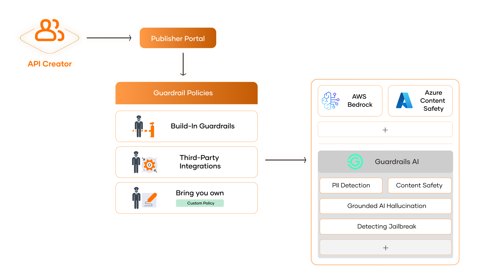

# AI Guardrails

Generative AI brings immense potential—but without the right controls, it also introduces significant risks.

LLMs (Large Language Models) are fundamentally **non-deterministic**. A request may succeed technically (returning a `200 OK`), but semantically **fail** your application’s logic, output expectations, safety guidelines, or compliance mandates. This disconnect creates a growing need for **real-time enforcement** of AI behavior.

### What Can Go Wrong: Risks of AI API Integration

| Problem | Description |
|--------|-------------|
| **Unpredictable Outputs** | LLMs may generate factually incorrect, incoherent, or harmful content even when inputs seem safe. |
| **Bias and Fairness** | AI systems can amplify biases from training data, leading to discriminatory or offensive results. |
| **Security Vulnerabilities** | Attacks like **prompt injection** can subvert your prompts and redirect model behavior maliciously. |
| **Privacy Leaks** | Generated outputs can expose sensitive or personally identifiable information (PII) unintentionally. |
| **Regulatory Risk** | Lack of content moderation or auditability can breach compliance frameworks such as GDPR, HIPAA, or internal ethical standards. |

As adoption of LLMs and AI services accelerates across sectors, it’s critical for organizations to move beyond experimentation and toward **safe, reliable production usage**. This requires governing AI systems a through a **structured behavioral control framework** that ensure:

- **AI outputs remain aligned** with organizational values, policies, and formatting standards.  
- **Requests are inspected and validated** before reaching the model to prevent abuse or misuse.  
- **Responses are evaluated and refined** to uphold quality, safety, and compliance.  
- **Systems can respond intelligently** through retries, fallbacks, or logging when model behavior deviates from expected norms.

These practices help establish **trustworthy AI integrations**, minimize unexpected failures, and enable organizations to confidently scale their AI workloads in production.

## Safeguard AI API Integrations with **WSO2 AI Guardrails**

AI Guardrails in WSO2 AI Gateway are **real-time validation and enforcement layers** that sit between your application and the underlying AI provider.

They act as intelligent filters that:

- Inspect both **inputs** and **outputs** to AI models.
- Apply **policy-driven checks** to assess safety, quality, and compliance.
- Enable client applications to implement **adaptive response strategies** based on given guardrail error responses.

---

## Supported Guardrails

  <a href="../content-length-guardrail">
    
Content Length Guardrail

    
Restricts the maximum length of LLM requests or responses.

  </a>

  <a href="../regex-guardrail">
    
Regex Guardrail

    
Validates LLM requests or responses using custom regular expressions.

  </a>

  <a href="../json-schema-guardrail">
    
JSON Schema Guardrail

    
Ensures LLM requests or responses match a specified JSON schema.

  </a>

  <a href="../sentence-count-guardrail">
    
Sentence Count Guardrail

    
Limits the number of sentences in LLM requests or responses.

  </a>

  <a href="../url-guardrail">
    
URL Guardrail

    
Validates URLs in LLM responses, useful to detect hallucinated URLs.

  </a>

  <a href="../word-count-guardrail">
    
Word Count Guardrail

    
Restricts the number of words in LLM requests or responses.

  </a>

  <a href="../regex-pii-masking">
    
PII Masking with Regex

    
Safeguard Personally Identifiable Information (PII) in LLM requests or responses by leveraging user-defined regular expressions.

  </a>

  <a href="../semantic-prompt-guardrail">
    
Semantic Prompt Guardrail

    
Evaluate the semantic similarity of incoming prompts against a predefined list to allow or deny LLM requests.

  </a>

  <a href="../semantic-tool-filtering-guardrail">
    
Semantic Tool Filtering

    
Selects and ranks available API tools by semantic relevance to the user's query; includes evaluation metrics comparing embedding providers.

  </a>

  <a href="../azure-content-safety">
    
Azure Content Safety Content Moderation

    
Perform content moderation on LLM requests or responses using Azure Content Safety's Content Moderation API.

  </a>

  <a href="../aws-bedrock-guardrail">
    
AWS Bedrock Guardrail

    
Enforce AI API Safeguards with AWS Bedrock Guardrails

  </a>

