# Secure APIs with API Keys

From WSO2 API Manager 4.7.0 onwards, you can secure APIs using **API-bound API keys** - opaque tokens that are scoped to a single API. Unlike traditional application-bound keys that can be reused across multiple APIs, an API key bounded to an API is valid only for the specific API it was generated for.

API keys are generated directly from the Developer Portal without communicating with the Key Manager, making them lightweight and straightforward to issue and manage.

## Key Characteristics of API Keys

- API-specific – The key is linked to one API.
- Limited scope – It cannot be used to call other APIs.
- Security control – Reduces misuse because the key works only with the assigned API.
- Simpler authorization – The gateway validates that the key is mapped to the requested API along with the IP and referred restrictions. Additionally, it does subscription validation for the subscription enabled APIs.
- Subscriptionless API support – For APIs that do not require a subscription, an API key can be used to invoke the API without a subscription or any application association. Optionally, the key can be associated with an application to gain usage insights and analytics.
- Environment scoping – When generating an API key, you can specify whether it is for the **Production** or **Sandbox** environment, allowing you to use separate keys for testing and production traffic.

When an API is invoked specifying an API key as the authentication method, the APIM Gateway performs the following basic validations.

- Subscription validation
- IP and referrer validation

## Using API keys to secure an API

Follow the instructions below to use API key Authentication in WSO2 API Manager.

<Steps>

### Create and publish an API {/* #step-1---create-and-publish-an-api */}

Create, publish and deploy an API that is secured with the API key security scheme as the application-level security. Let's work with the sample app for this purpose.


1. Sign in to the Publisher.  
    
     `https://<hostname>:9443/publisher`

2. Click **DEPLOY SAMPLE API** to deploy the sample PizzaShack API.

3. Click **Develop -> API Configurations -> Runtime** and select **Application Level Security**.

4. Select **API Key**. Note that `APIKey` is used as the default header. This value can be changed using the `APIKey Header` field.

     [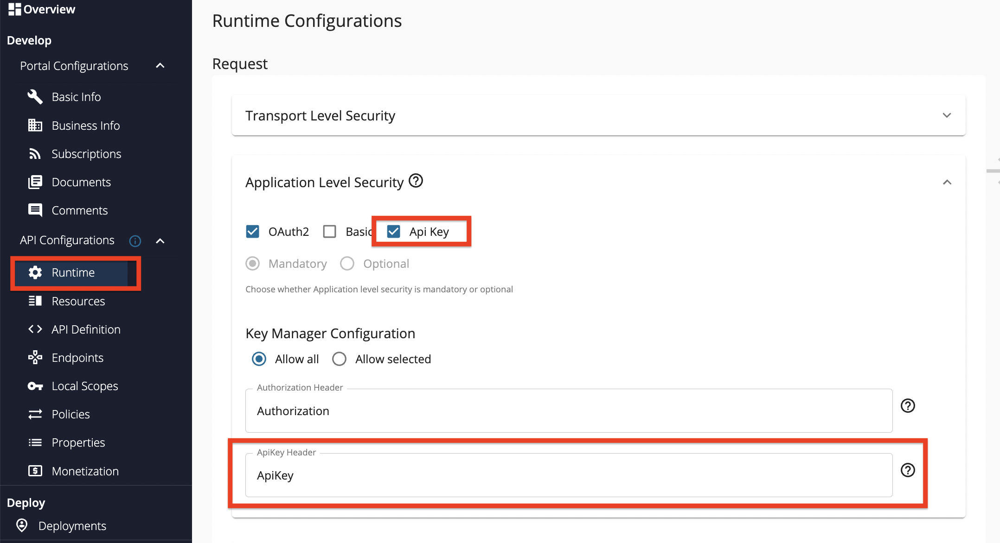](../../../../assets/img/learn/api-key-option.png)
     
5. Click **Save and Deploy** to save the changes made within the **Runtime Configurations** page. Upon redirection to the **Deployments** page, select the relevant Gateway and click on **Deploy**.


### Generate the API Key {/* #step-2---generate-the-api-key */}


1. Sign in to the Developer Portal.

     `https://<hostname>:9443/devportal`

2. Click **APIs** and click on the respective API (e.g., `PizzaShackAPI`).

3. Click **API Keys** from the left menu of the API.

     [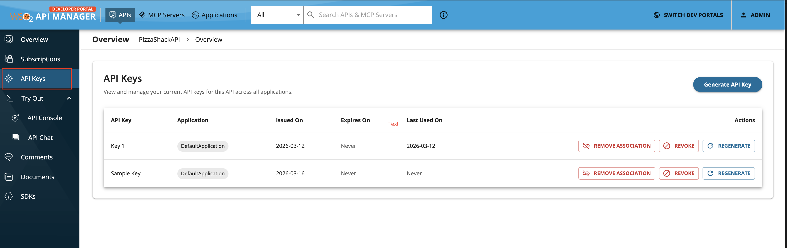](../../../../assets/img/learn/api-keys/api-api-key-left-menu.png)

4. Click **Generate API Key** and provide a Key Name.

     [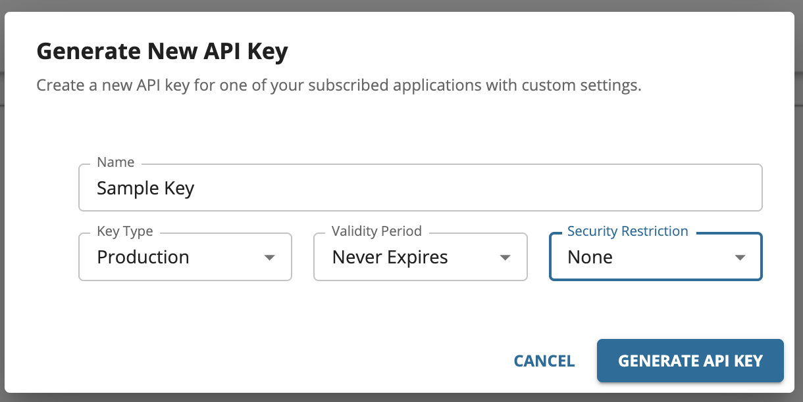](../../../../assets/img/learn/api-keys/generate-api-api-key.png)

5. Optionally, configure the validity period before generating the key.

     By default, the API Key does not expire. To set an expiry, select the required validity period option from the drop-down. For a custom validity period, enter the expiry time in **days**.

6. Click **GENERATE API KEY**.

7. Copy the generated API key.

     [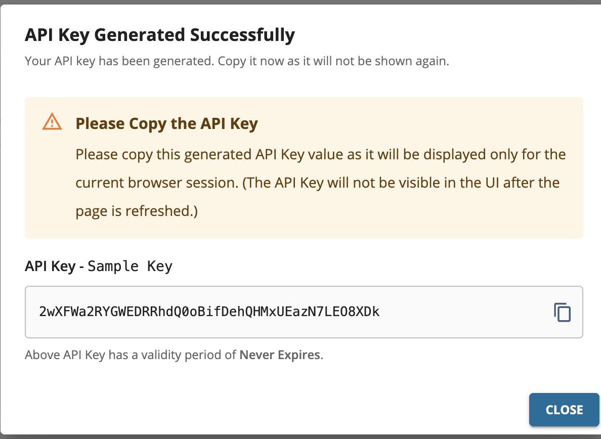](../../../../assets/img/learn/api-keys/generate-api-api-key-response.png)

Once the API key is generated, the steps to use it depend on whether the API requires a subscription. Follow the relevant section below.

#### For subscription-enabled APIs

A valid subscription must exist and the generated API key must be associated with a subscribed application before it can be used to invoke the API.

1. Click **Subscriptions** from the left menu of the API.

2. Select an application and a throttling policy.

     &lt;html>
     <div className="admonition note">
     <p className="admonition-title">Note</p>
     <p>API Keys can be associated with any application type — JWT or OAuth.</p>
     </div>
     &lt;/html>

3. Click **Subscribe**.

     [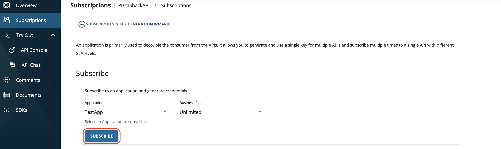](../../../../assets/img/learn/subscribe-to-api.png)

4. Click **Associate** on the API key to link it to the subscribed application.

     [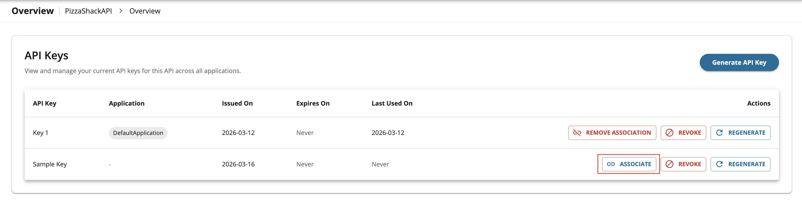](../../../../assets/img/learn/api-keys/associate-api-key-button.png)

5. Select the application from the drop-down and click **ASSOCIATE**.

     [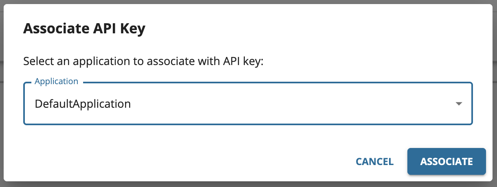](../../../../assets/img/learn/api-keys/associate-api-key.png)

     Alternatively, you can associate the API key from the subscribed application's **API Keys** page.

     [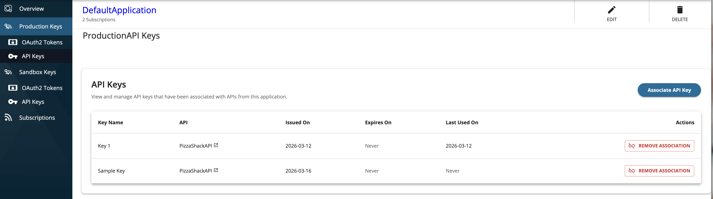](../../../../assets/img/learn/api-keys/app-associate-buttopn.png)

     Select the API and the generated API key from the drop-down and associate.

     [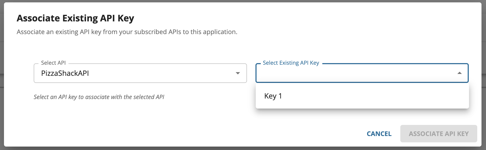](../../../../assets/img/learn/api-keys/associate-api-key-from-app.png)

#### For subscriptionless APIs

The generated API key can be used directly to invoke a subscriptionless API without any subscription or application association.

Optionally, you can associate the API key with an application to gain usage insights and analytics. To do so, follow steps 4–5 above.


### Invoke the API {/* #step-3---invoke-the-api */}

Invoke the API using the API key. You can use either of the following methods to invoke the API.

- Specify the API Key in the `apikey` header.

    <Tabs>
    <TabItem value="tab-0" label="Format">

      ```bash
      curl -k -X GET "https://localhost:8243/pizzashack/1.0.0/menu" -H "accept: application/json" -H "apikey: <API_key_value>"
      ```

    </TabItem>
    <TabItem value="tab-1" label="Example">

      ```bash
      curl -k -X GET "https://localhost:8243/pizzashack/1.0.0/menu" -H "accept: application/json" -H "apikey: lTiFQrRvNBOkVShNrKG13VhuXoZ2EfgJ_qU529RyXB8"
      ```

    </TabItem>
    <TabItem value="tab-2" label="Response">

      ```bash
      [{"name":"BBQ Chicken Bacon","description":"Grilled white chicken, hickory-smoked bacon and fresh sliced onions in barbeque sauce","price":"24.99","icon":"/images/6.png"},{"name":"Chicken Parmesan","description":"Grilled chicken, fresh tomatoes, feta and mozzarella cheese","price":"11.99","icon":"/images/1.png"},{"name":"Chilly Chicken Cordon Bleu","description":"Spinash Alfredo sauce topped with grilled chicken, ham, onions and mozzarella","price":"23.99","icon":"/images/10.png"},{"name":"Double Bacon 6Cheese","description":"Hickory-smoked bacon, Julienne cut Canadian bacon, Parmesan, mozzarella, Romano, Asiago and and Fontina cheese","price":"20.99","icon":"/images/9.png"},{"name":"Garden Fresh","description":"Slices onions and green peppers, gourmet mushrooms, black olives and ripe Roma tomatoes","price":"11.99","icon":"/images/3.png"},{"name":"Grilled Chicken Club","description":"Grilled white chicken, hickory-smoked bacon and fresh sliced onions topped with Roma tomatoes","price":"14.99","icon":"/images/8.png"},{"name":"Hawaiian BBQ Chicken","description":"Grilled white chicken, hickory-smoked bacon, barbeque sauce topped with sweet pine-apple","price":"12.99","icon":"/images/7.png"},{"name":"Spicy Italian","description":"Pepperoni and a double portion of spicy Italian sausage","price":"23.99","icon":"/images/2.png"},{"name":"Spinach Alfredo","description":"Rich and creamy blend of spinach and garlic Parmesan with Alfredo sauce","price":"25.99","icon":"/images/5.png"},{"name":"Tuscan Six Cheese","description":"Six cheese blend of mozzarella, Parmesan, Romano, Asiago and Fontina","price":"24.99","icon":"/images/4.png"}]
      ```

    </TabItem>
    </Tabs>

- Specify as a query parameter in the API request.

    - `<url_encoded_API_key_value>` - Encode the API key using a URL encoder (e.g., [https://www.urlencoder.org](https://www.urlencoder.org)).

    <Tabs>
    <TabItem value="tab-0" label="Format">

      ```bash
      curl -k -X GET "https://localhost:8243/pizzashack/1.0.0/menu?apikey=<url_encoded_API_key_value>"
      ```

    </TabItem>
    <TabItem value="tab-1" label="Example">

      ```bash
      curl -k -X GET "https://localhost:8243/pizzashack/1.0.0/menu?apikey=lTiFQrRvNBOkVShNrKG13VhuXoZ2EfgJ_qU529RyXB8"
      ```

    </TabItem>
    <TabItem value="tab-2" label="Response">

      ```bash
      [{"name":"BBQ Chicken Bacon","description":"Grilled white chicken, hickory-smoked bacon and fresh sliced onions in barbeque sauce","price":"24.99","icon":"/images/6.png"},{"name":"Chicken Parmesan","description":"Grilled chicken, fresh tomatoes, feta and mozzarella cheese","price":"11.99","icon":"/images/1.png"},{"name":"Chilly Chicken Cordon Bleu","description":"Spinash Alfredo sauce topped with grilled chicken, ham, onions and mozzarella","price":"23.99","icon":"/images/10.png"},{"name":"Double Bacon 6Cheese","description":"Hickory-smoked bacon, Julienne cut Canadian bacon, Parmesan, mozzarella, Romano, Asiago and and Fontina cheese","price":"20.99","icon":"/images/9.png"},{"name":"Garden Fresh","description":"Slices onions and green peppers, gourmet mushrooms, black olives and ripe Roma tomatoes","price":"11.99","icon":"/images/3.png"},{"name":"Grilled Chicken Club","description":"Grilled white chicken, hickory-smoked bacon and fresh sliced onions topped with Roma tomatoes","price":"14.99","icon":"/images/8.png"},{"name":"Hawaiian BBQ Chicken","description":"Grilled white chicken, hickory-smoked bacon, barbeque sauce topped with sweet pine-apple","price":"12.99","icon":"/images/7.png"},{"name":"Spicy Italian","description":"Pepperoni and a double portion of spicy Italian sausage","price":"23.99","icon":"/images/2.png"},{"name":"Spinach Alfredo","description":"Rich and creamy blend of spinach and garlic Parmesan with Alfredo sauce","price":"25.99","icon":"/images/5.png"},{"name":"Tuscan Six Cheese","description":"Six cheese blend of mozzarella, Parmesan, Romano, Asiago and Fontina","price":"24.99","icon":"/images/4.png"}]
      ```

    </TabItem>
    </Tabs>

</Steps>

## Regenerating an API Key

You can regenerate API Keys from the **API Keys** section of the API in the Developer Portal. When you regenerate a key, the existing key is immediately revoked and a new opaque token is issued in its place. The existing application association is preserved - you do not need to re-associate the key with the application after regeneration. Update your client application with the new key value to resume API invocations.

   [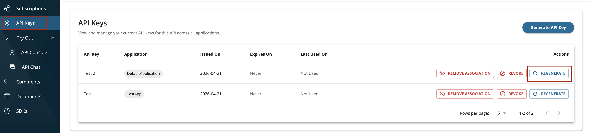](../../../../assets/img/learn/api-keys/regenerate-apikey.png)

## Revoking an API Key

Once an API key is revoked, it is immediately invalidated and any API calls using that key will be rejected. API keys can be revoked in two ways.

### Revoking via the Developer Portal

An API key can be revoked by the API consumer from the **API Keys** section of the API in the Developer Portal.

   [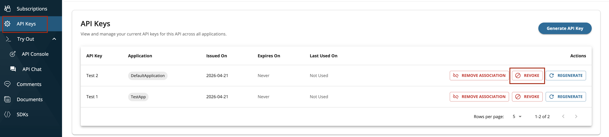](../../../../assets/img/learn/api-keys/revoke-apikey-consumer.png)

### Revoking via the Admin Portal

Administrators can revoke API keys via the Admin Portal. This allows centrally managing and invalidating keys across all APIs and applications without requiring Developer Portal access.

   [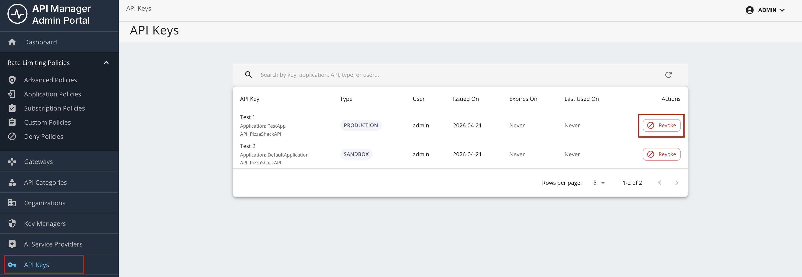](../../../../assets/img/learn/api-keys/revoke-apikey-admin.png)

## API key security restrictions for IP address and HTTP referrer

After issuing an API key for an API or an application, it can be used by anyone to invoke an API subscribed to an associated application. However, if an unauthorized party gets hold of the token, they can create unnecessary invocations to the APIs. To prevent this issue, you can define the authorized parties when generating a token. 

WSO2 API Manager allows API keys to be restricted based on two approaches.

### IP address restriction

The IP address restriction allows only the clients with specific IP addresses to use the token. The IP addresses can be specified
in the following formats.

- IPv4 (e.g., `192.168.1.2`)
- IPv6 (e.g., `2002:eb8::2`)
- IP range in CIDR notation (e.g. `152.12.0.0/13`, `1001:ab8::/14`)

**Generating an API key with an IP restriction**

1. Navigate to API-bound or Application-bound key generation window of the specific API or application in the Developer Portal.

2. Select `Preferred IP` option, add the IP addresses in the text input as shown below, and generate the key.

   [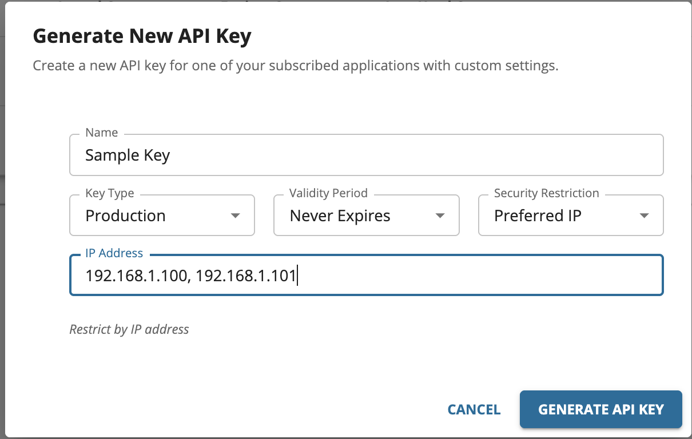](../../../../assets/img/learn/api-keys/ip-restrictions.png)

### HTTP referrer restriction

When the HTTP referrer restriction has been enabled, only the specific HTTP referrers can use the token. Therefore, by using this restriction, when API clients run on web browsers, you can limit the access to an API through only specific web pages. The referrer can be specified in the following formats.

- A specific URL with an exact path: `www.example.com/path`
- Any URL in a single subdomain, using a wildcard asterisk (*): `sub.example.com/*`
- Any subdomain or path URLs in a single domain, using wildcard asterisks (\*): `*.example.com/*`

**Generating an API key with the HTTP referrer restriction**

1. Navigate to API key generation window of that specific API or application in the Developer Portal.

2. Select `Preferred Referrer` option and add the referrers in the text input as shown below and generate the key.

   [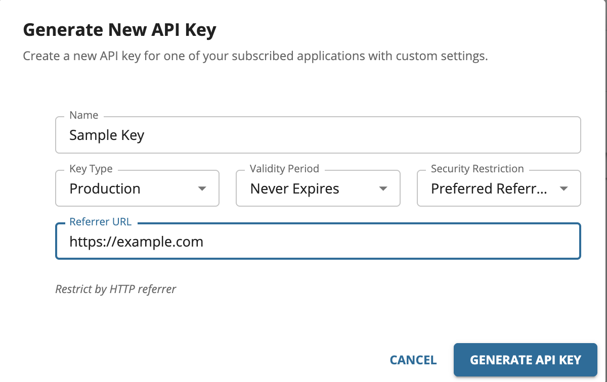](../../../../assets/img/learn/api-keys/referrer-restrictions.png)
