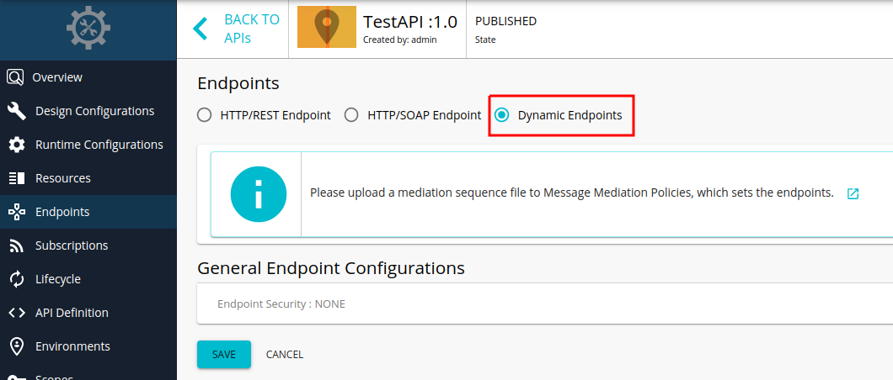

# Adding Dynamic Endpoints

You cannot dynamically construct the back-end endpoint of an API using the address endpoints in the WSO2 API Manager. To achieve the requirement of a dynamic endpoint, you can use the default endpoint instead. 

[](../../../../../assets/_versions/3.0.0/img/learn/api-gateway/message-mediation/dynamic-endpoints.png)  

The default endpoint sends the message to the address specified in the **To** header. The **To** header can be constructed dynamically. For example,

:::note

```xml
<sequence xmlns="http://ws.apache.org/ns/synapse" name="default-endpoint-seq">
    <property name="service_ep" expression="fn:concat('http://jsonplaceholder.typicode.com/', 'posts')"/>
    <header name="To" expression="get-property('service_ep')"/>
</sequence>
```

:::

In this example, you have constructed the `service_ep` property dynamically and assigned the value of this property to the **To** header. The default endpoint sends the message to the address specified in the **To** header, in this case, 
`http://jsonplaceholder.typicode.com/posts`. 

:::tip

For more details about working with dynamic endpoints, see [Endpoint Types](../../design-api/endpoints/endpoint-types.mdx).

:::

You can copy the content of the above sequence to an XML file and upload it to an API configured with a dynamic endpoint using Publisher Portal UI.  
For more information, visit [Creating and Uploading Manually in API Publisher](changing-the-default-mediation-flow-of-api-requests.mdx#creating-and-uploading-manually-in-api-publisher).
