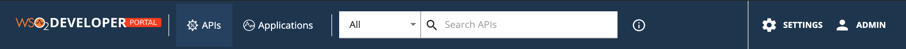
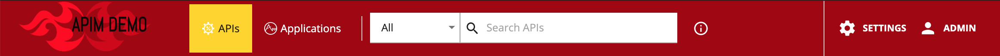

# Changing the Logo and Header Styles

The header section can be customized to match different design needs by configuring the `defaultTheme.js` file.

The `defaultTheme.js` file has all the parameters defining the look and feel of the developer portal. To learn more about `defaultTheme.js` refer [here](overriding-developer-portal-theme.mdx#overriding-the-default-theme).

The following is the default look and the configuration. The default header of the API Manager Developer Portal is shown below.

 

1. Open the `<API-M_HOME>/repository/deployment/server/jaggeryapps/devportal/site/public/theme/defaultTheme.js` file in a text editor and set the attributes accordingly as shown below which customizes the logo and the header of the developer portal.

    ```js
    appBar: {
        logo: '/site/public/images/logo.svg',
        logoHeight: 19,
        logoWidth: 208,
        background: '#1d344f',
        activeBackground: '#254061',
        showSearch: true,
        drawerWidth: 200,
    },
    ```

    | Option | type | Description |
    | ------ | -- | ----------- |
    | logo | string | Relative path to logo |
    | logoHeight | integer | Logo height in pixels |
    | logoWidth | integer | Logo width in pixels |
    | background | string | Background color of the header |
    | activeBackground | string | Background color of the selected header menu item |
    | drawerWidth | integer | Small resolutions will collopse the top menu in to a toggle drawer. This property sets the it's width in pixels |

#### Example

We can change the logo and header background as follows by changing the above parameters.

```js
 appBar: {
    logo: '/site/public/images/custom-logo.png',
    logoHeight: 66,
    logoWidth: 200,
    background: '#a10207',
    activeBackground: '#ffd500',
    showSearch: true,
    drawerWidth: 200,
},
```

Make sure you restart the server for the changes to take effect.


