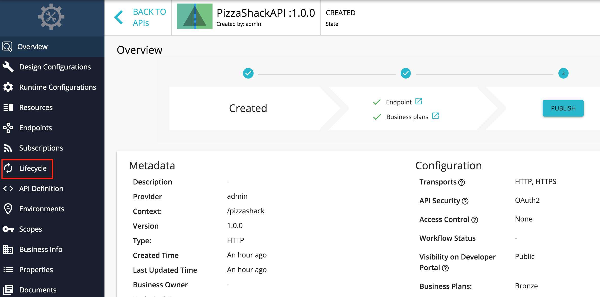
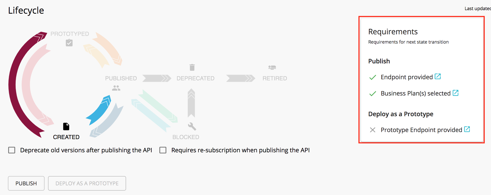
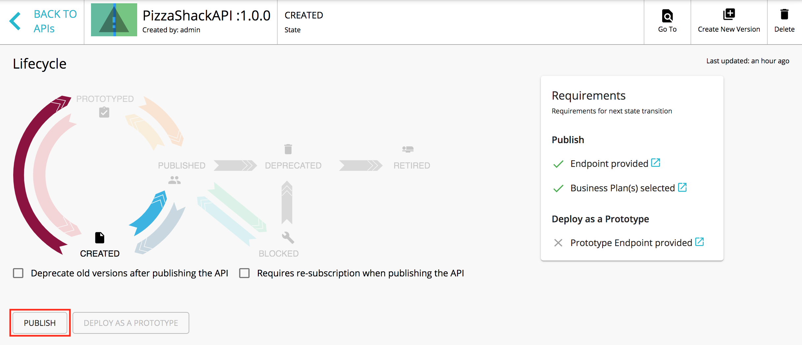
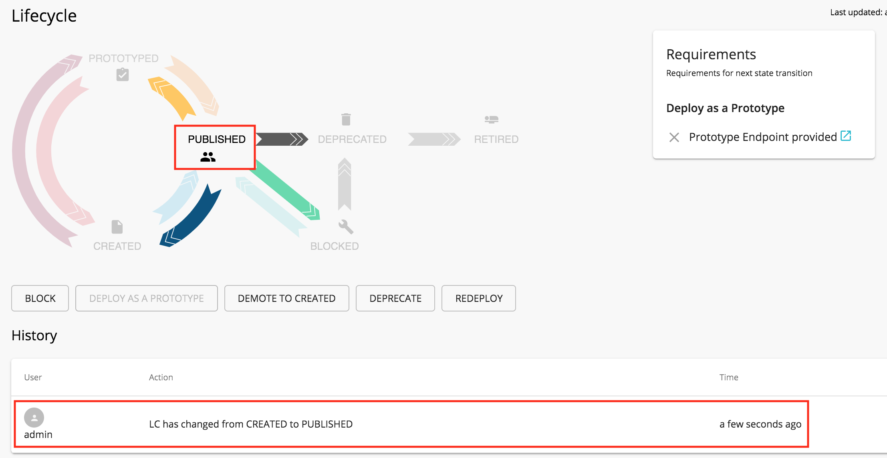

# Publish an API

**API Publishing** is the process of making the API visible in the Developer Portal and available for subscription. An API in the lifecycle state CREATED will have the  API metadata added to the Developer Portal, but not deployed to the API Gateway. Therefore, it is not visible to subscribers in the Developer Portal. When the API is published, it gets deployed on the API Gateway, and the API lifecycle state will be changed to **PUBLISHED**. 

Follow the steps below to publish an API using WSO2 API Manager.

1.  Sign in to the API Publisher (`https://localhost:9443/publisher`). 

     The list of APIs in the API Publisher appears. If there are no APIs created, [create an API](../create-api/create-a-rest-api.mdx) before starting.

2.  Click on an API that is in the **CREATED** state.

     

3.  Click **Lifecycle**.

     

     The lifecycle state transition grid appears. Before publishing an API, the following requirements have to be satisfied.

        -   Endpoint provided
        -   Business Plan(s) selected
    
    If any of the above requirements are not satisfied, it is indicated in the lifecycle page, and you need to navigate to relevant sections and provide the missing information such as endpoint URL and business plans.
  
    

    
4.  If the latter mentioned requirements are satisfied, click **PUBLISH** to push the API. 
    
     If required, you can select the following options when publishing the API. 

     -   **Require re-subscription when publish the API** : If selected, it invalidates the current user subscriptions and forces the users to subscribe again. 
     -   **Deprecate old versions after publish the API** : If selected, all prior versions of the API that are published will be set to the DEPRECATED state automatically.

      
        
     If the API is published successfully, the lifecycle state will shift to **PUBLISHED**. 

      
     
5. Nagivate to the Developer Portal (`https://<hostname>:9443/devportal`).
     
     Note that the API that you published is visible under the **APIs** listing.
