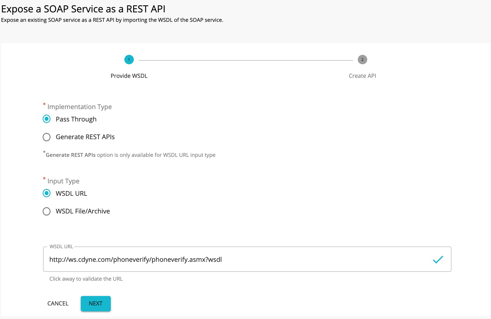
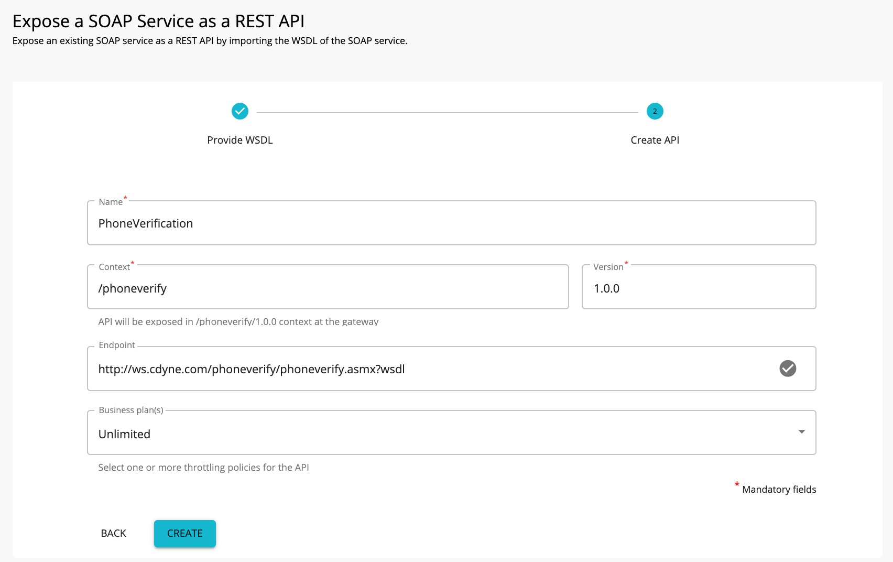
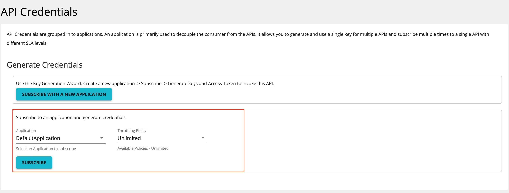
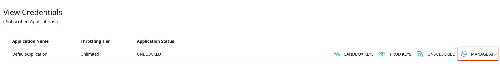
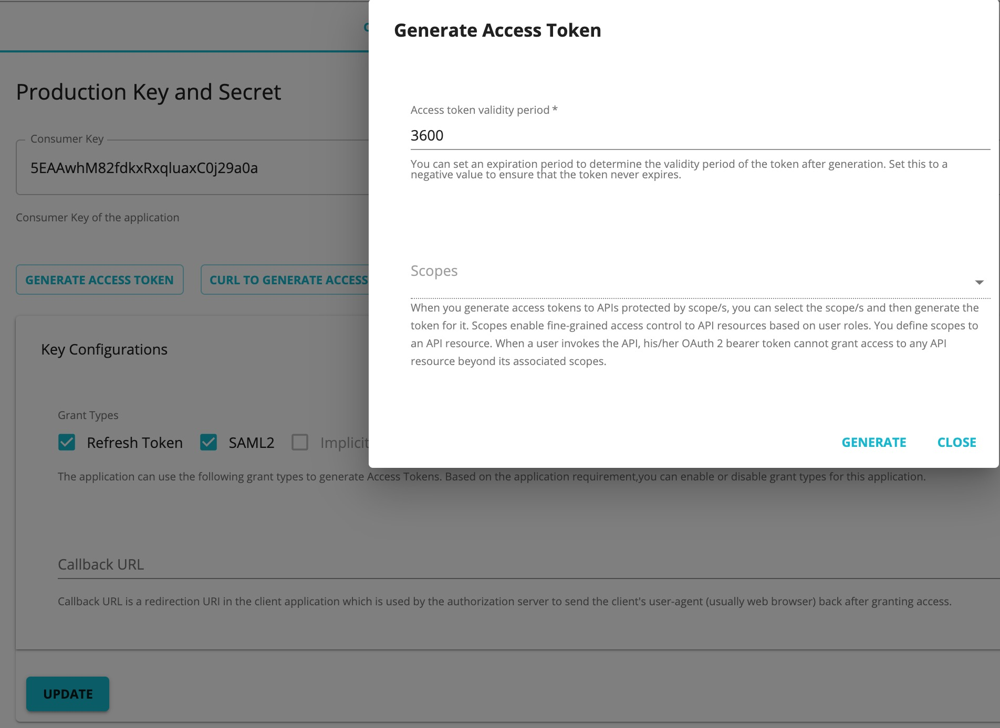
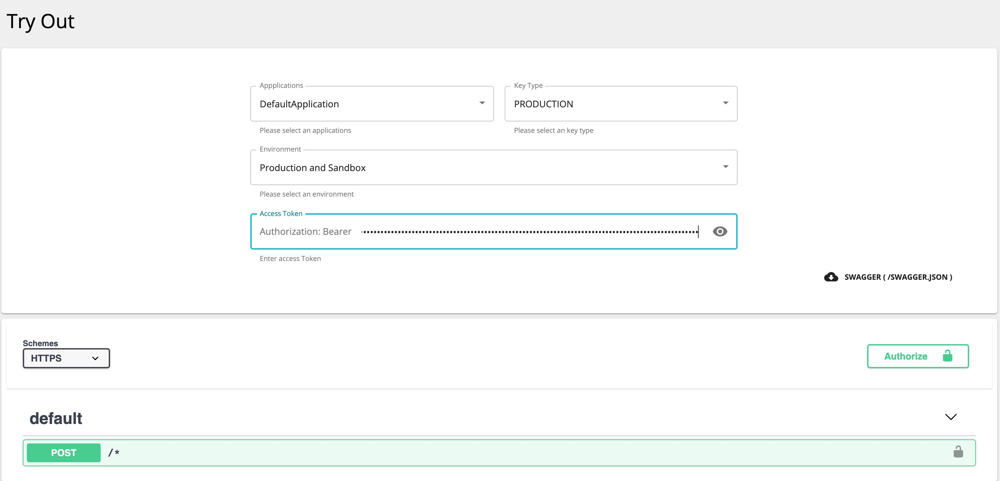
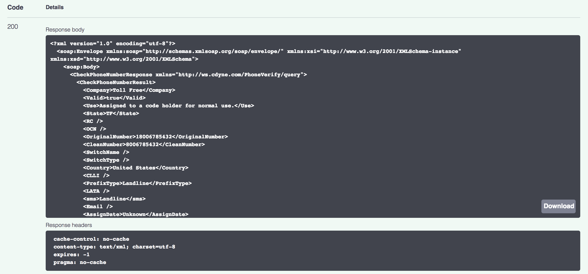

# Expose a SOAP service as a REST API

WSO2 API Manager supports the management of an existing SOAP and WSDL based services exposing as REST APIs.
The organizations who have SOAP/ WSDL based services, can easily bridge their existing services to REST without the cost of a major migration. WSO2 API Manager supports two kinds of services as one for performing a  "pass through" of the SOAP message to the backend and other one is generating [a RESTful api from the backend SOAP service](../../../../learn/design-api/create-api/generate-rest-api-from-soap-backend/).

This tutorial will explain the steps to design, publish and invoke a SOAP service as a RESTful API using **Pass Through**

<Steps>

### Design a SOAP service as a REST API {/* #step-1---design-a-soap-service-as-a-rest-api */}

1.  Sign in to the API Publisher and click **CREATE API**.
      

2.  Select **Pass Through** option and thereafter, select one of the following options:

     * WSDL URL - If you select this option, you need to provide an endpoint URL.

     * WSDL Archive/File - If you select this option, click Browse and upload either an individual WSDL file or a WSDL archive, which is a WSDL project that has multiple WSDLs.

     

{"Note"}

{"When uploading a WSDL archive, all the dependent wsdls/xsds that are referred in the parent WSDL file should reside inside the WSDL archive itself. If not, the validation will fail at the point of API creation."}

     This example uses the WSDL `http://ws.cdyne.com/phoneverify/phoneverify.asmx?wsdl` from CDYNE as the endpoint here, but you can use any SOAP backend of your choice.
        

3.  Click **NEXT** button to proceed to the next phase and Provide the information in the table below and click **CREATE** button.

    | Field   | Sample value       |
    |---------|--------------------|
    | Name    | PhoneVerification  |
    | Context | /phoneverify       |
    | Version | 1.0                |
    | Endpoint| http://ws.cdyne.com/phoneverify/phoneverify.asmx|
    | Business Plans| Unlimited|

    

4.  The created API appears in the publisher as follows.
    

5.  API definiton of the Created schema has been displayed at **API Definiton** tab.
     
  
    

{"Note"}

{"If you wish to add scopes to the resources that were created, navigate to "}<strong><em>{"Resources"}</em></strong>{" and expand the resources. Thereafter, creating new scopes and specify them under operation scope. If you specify a scope, you need to use the same scope when generating access tokens for the subscribed application to invoke the API. For more information on working with the scopes, see "}[{"OAuthscopes"}](../../../../learn/api-security/oauth2/oauth2-scopes/fine-grained-access-control-with-oauth-scopes/)

    
     

{"Note"}

{"Note that when creating this API, the default option of "}<strong>{"Rate limiting level"}</strong>{" , was selected to "}<strong>{"API Level"}</strong>{". For more information on setting advanced throttling policies, see "}[{"Enforce Throttling and Resource Access Policies"}](../../../../learn/rate-limiting/setting-throttling-limits/){"."}

     
5.  Navigate to **Life Cycle** and Click **Publish** button.
      You have now published SOAP API at the Developer portal.

### Invoke a SOAP service as a REST API. {/* #step-2---invoke-a-soap-service-as-a-rest-api */}

1.  Log in to the developer portal, navigate to **Credentials** tab and subscribe to  the api using (e.g.,DefaultApplication)
      

2.  Click the **MANAGE APP** button when prompted **View Credentials**.
    

3.  Click **GENERATED ACCESS TOKEN** and then it propmt popupto create an application access token.
    

5. Click **GENERATE** button, generated JWT access token can be seen at the popup and copy it.
     

    Let's invoke the API.

6. Navigate to **TryOut** tab and paste the token at Access token input field.
    

7. Expand the POST method and click **Try it out** . Enter the following, and click       **Execute** to invoke the API.
      <table><tbody><tr><td>{"SOAP Request"}</td><td><pre>{"         "}{"\n                <soap:Envelope xmlns:xsi=\"http://www.w3.org/2001/XMLSchema-instance\" xmlns:xsd=\"http://www.w3.org/2001/XMLSchema\" xmlns:soap=\"http://schemas.xmlsoap.org/soap/envelope/\">\n                <soap:Body>\n                    <CheckPhoneNumber xmlns=\"http://ws.cdyne.com/PhoneVerify/query\">\n                    <PhoneNumber>18006785432</PhoneNumber>\n                    <LicenseKey>18006785432</LicenseKey>\n                    </CheckPhoneNumber>\n                </soap:Body>\n            </soap:Envelope>\n      "}</pre></td></tr><tr><td>{"SOAP Action"}</td><td><pre>{"      http://ws.cdyne.com/PhoneVerify/query/CheckPhoneNumber\n      "}</pre></td></tr></tbody></table>

    

8.  Note the API response that appears on the console.
    

{"Note"}

{"You can also invoke this API using a third-party tool such as SOAP UI. For more information on how to invoke an API using a SOAP client, see "}[{"Invoke an API using a SOAP Client"}](../../../../learn/consume-api/invoke-apis/invoke-apis-using-tools/invoke-an-api-using-a-soap-client/){" ."}

</Steps>
