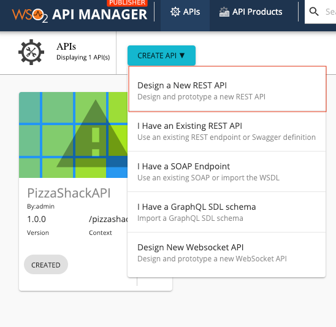
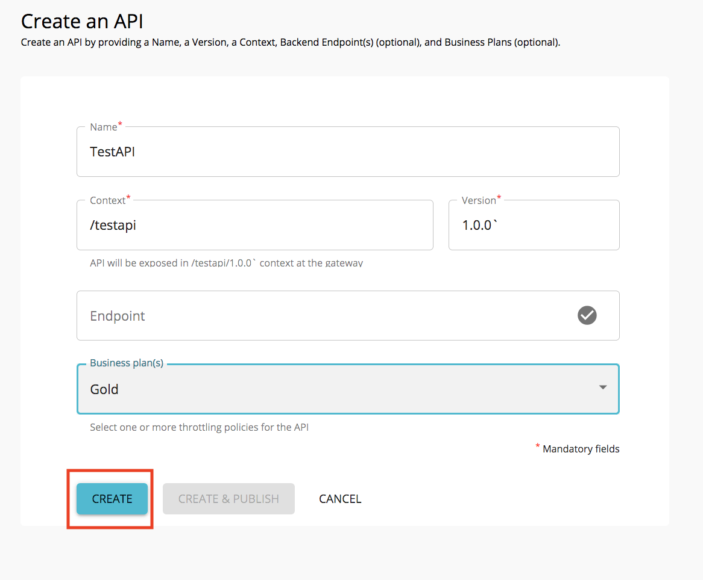
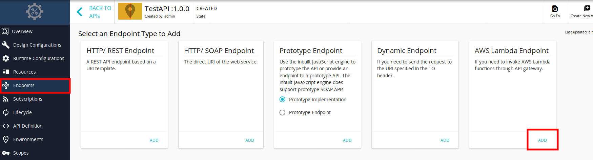
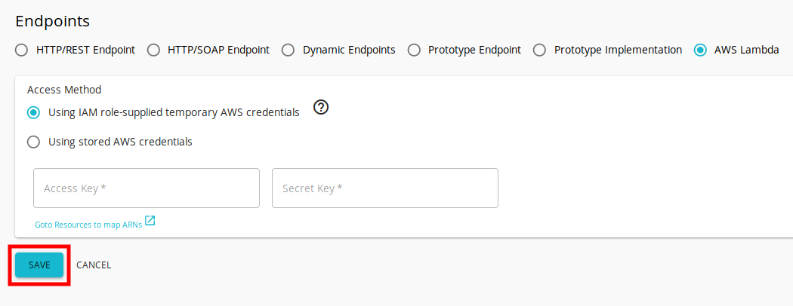
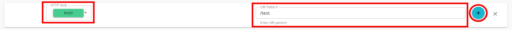
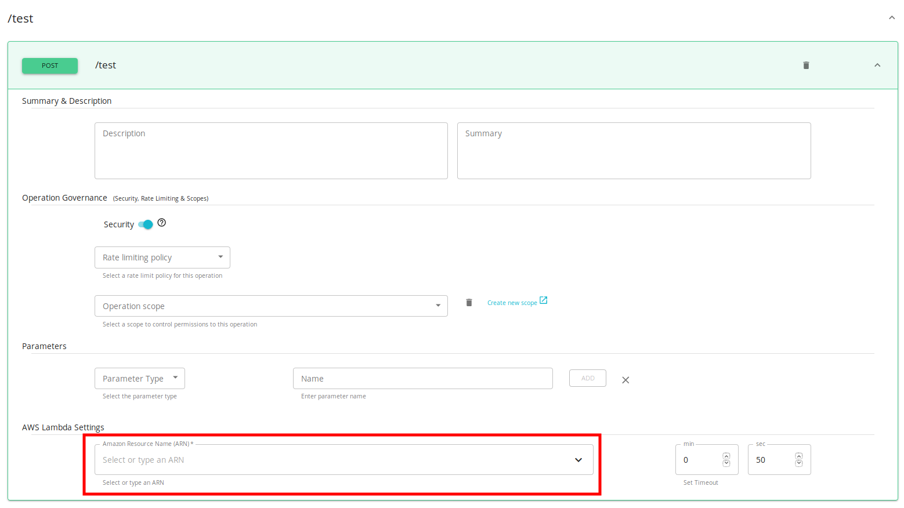
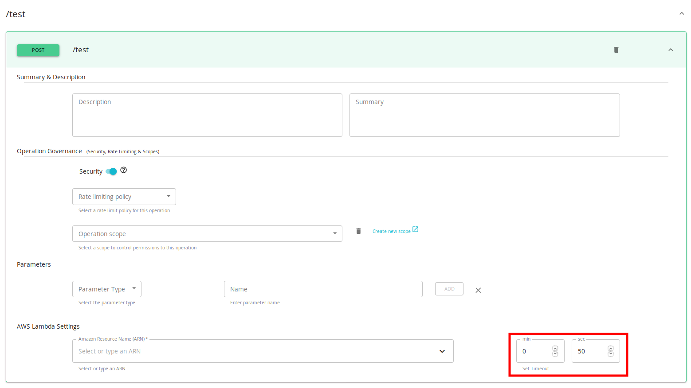
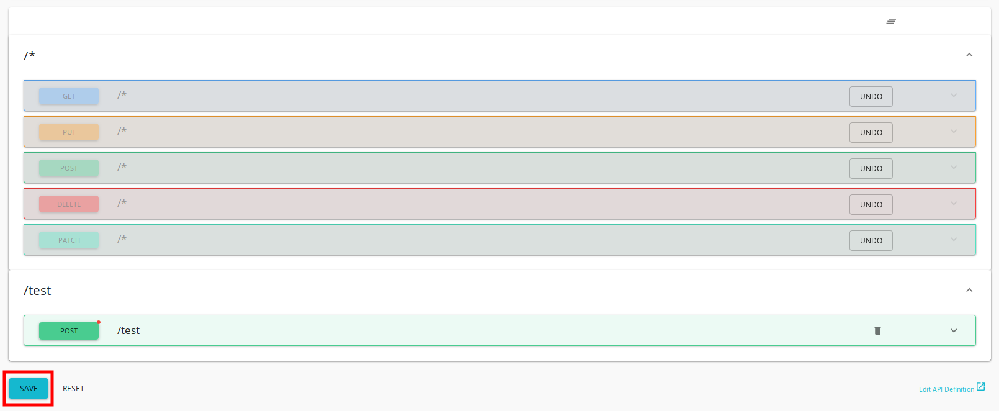
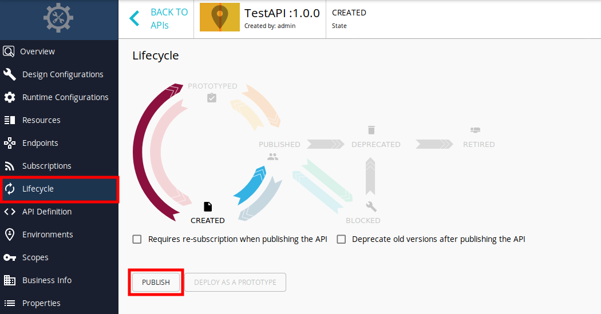

# Create and Publish an AWS Lambda API

When using AWS Lambda, you can execute your code without having to manage or provision servers. For more information on AWS Lambda, see [What is AWS Lambda?](https://docs.aws.amazon.com/lambda/latest/dg/welcome.html).

Follow the steps below to create and publish an AWS Lambda API:

<Steps>

## Design a REST API {/* #step-1---design-a-rest-api */}

1. Sign in to the API Publisher Portal `https://<hostname>:9443/publisher`.

2. Click **CREATE API** and then click **Design a New REST API**.

    

3. Enter the API details and click **CREATE**.  

    

    !!!note
         **You do not need to enter the Endpoint during the initial process of creating the API.**
         For more information on the possible API details that you can add, see [Create a REST API](../learn/design-api/create-api/create-a-rest-api.mdx)

Now, you have created a new REST API successfully. 

## Add an AWS Lambda endpoint {/* #step-2---add-an-aws-lambda-endpoint */}

1. Click **Endpoints** to navigate to Endpoints page.
2. Navigate to the **AWS Lambda** endpoint type and click **ADD**.

    

3. Select **Access Method**

    AWS SDK needs AWS credentials to invoke AWS Lambda functions. The access method defines as to how you provide those AWS credentials. You can provide AWS credentials manually by selecting the **Using stored AWS credentials** method. But if WSO2 API Manager is running on an Amazon EC2 instance, you can select the **Using IAM role-supplied temporary AWS credentials** method.

    !!!note
         When using the **IAM role-supplied temporary AWS credentials** method, you need to attach an IAM role so that it can grant permission to applications running on the Amazon EC2 instance.
         For more information on attaching an IAM role to EC2, see [Using an IAM Role to Grant Permissions to Applications Running on Amazon EC2 Instances](https://docs.aws.amazon.com/IAM/latest/UserGuide/id_roles_use_switch-role-ec2.html)

4. Click **Save**.

    

    !!!note
         You will get an error message if you have not set the Access Method properly.

## Map function-ARNs to resources {/* #step-3---map-function-arns-to-resources */}

!!!note
    For more information on ARNs, see [Amazon Resource Names (ARNs)](https://docs.aws.amazon.com/general/latest/gr/aws-arns-and-namespaces.html).

1. Click **Resources** to navigate to the Resources page.
2. Configure the resources.

     By default, the API will have five resources with `/*` as the URL pattern.

    1. Click delete, as shown below, to remove all the existing resources.

          

    2. Add a new resource.
          1. Select **POST** as HTTP Verb.
          2. Enter a meaningful name for URI Pattern.
          3. Click **(+)** to add a new resource.

          

3. Under AWS Lambda Settings, select or type Amazon Resource Name (ARN) for the resource.

    You can select already created AWS Lambda functions that are listed in the autocomplete box.

    

4. Optionally, change the AWS SDK Client Execution Timeout by changing the **Set Timeout** option.
     The default AWS SDK Client Execution Timeout is 50 seconds.

     - Min Timeout - 1 second
     - Max Timeout - 15 minutes

    

5. Click **SAVE**.

    

## Publish the AWS Lambda API {/* #step-4---publish-the-aws-lambda-api */}

1. Click **Lifecycle** to navigate to the API lifecycle.
2. Click **PUBLISH** to publish the API to the API Developer Portal.

    

You have successfully published the AWS Lambda API.

</Steps>
