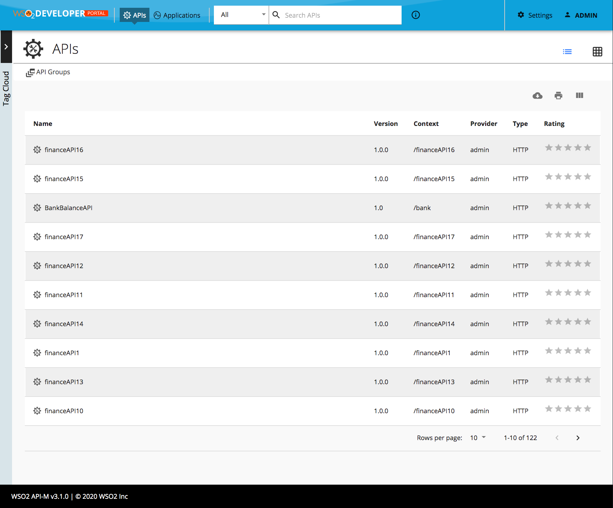

# Change Default View

By default the API Listing view is a grid view. 

Open `<API-M_HOME>/repository/deployment/server/jaggeryapps/devportal/site/public/theme/defaultTheme.js` file in a text editor.

The following configuration will change the default API listing to a table view.

```js
const Configurations = {
    custom: {
        defaultApiView: 'list',
    },
};
```


Changes done in the defaultTheme.js will be reflected directly in the devportal. ( It's not required to restart the server or rebuild the source code)


