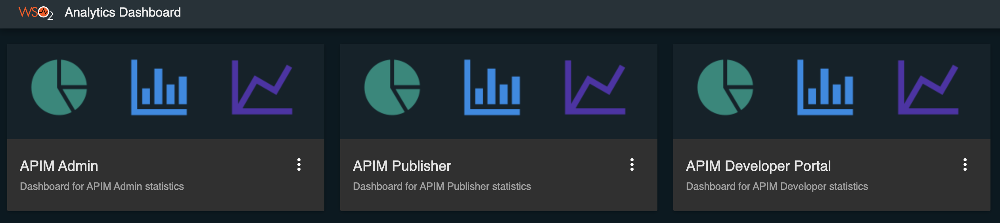

# Viewing API Statistics

API statistics related to both the API Publisher and the Developer Portal can be viewed using the **dashboard** runtime of the API-M Analytics server.

For instructions on how to set up Analytics, see [Configuring APIM Analytics](../configuring-apim-analytics.mdx). 
Once Analytics is set up, follow the instructions below to view statistics relevant to API Publisher and Developer Portal.

First, [invoke a few APIs](../../consume-api/invoke-apis/invoke-apis-using-tools/invoke-an-api-using-the-integrated-api-console.mdx) to generate traffic and see the statistics.

:::note

  The following widgets on the API Manager statistical dashboards, display real runtime statistics even when Analytics is not set up (as described in [Configuring APIM Analytics](../configuring-apim-analytics.mdx)).
  
  **Publisher Dashboard**
  
  + Overview Page
    + API Faults Summary
    + API Throttled Summary
    + Subscriptions Summary
    + Top Api Creators
    + Top App Creators
    + Top Subscriptions per API Provider
  + API and Application Statistics Page
    + APIs Created Over Time
    + Apps Created Over Time
  + Developer Statistics Page
    + Subscriptions Over Time
    + Developer Signups Over Time
  + Faults Page
    + Top Faulty APIs
    + Top Throttled APIs
  
  **Developer Portal Dashboard**
  
  + Registered Application Users

:::

:::warning

  Please note that our data summarization logic summarizes the data on a **per day** basis.

:::

The sections below explain how to access the statistical dashboards:

+ Log in to the Analytics Dashboard by accessing `<Protocol>://<Host>:<Port>/analytics-dashboard` (ex: [https://localhost:9643/analytics-dashboard](https://localhost:9643/analytics-dashboard)). 
+ After login in, you will see the **APIM Publisher**, **APIM Developer Portal** and the **APIM Admin** dashboards listed.
  
       

+ Click on the card of any desired dashboard to view that particular dashboard.
+ By using APIM Admin dashboard, administrators can generate a monthly API usage report. For more
 information see [Monthly API Usage Report](../monthly-api-usage-report.mdx).
+ Admin Portal Statistics can be viewed from the admin app.
    
Please refer below sub sections for more details about each dashboard.
    
-   [**API Publisher statistics**](#api-publisher-statistics)
-   [**Developer Portal statistics**](#developer-portal-statistics)
-   [**Admin Portal Statistics**](#admin-portal-statistics)

## API Publisher statistics

:::info

  Unlike the previous releases of API-M Analytics dashboards, Publisher statistics dashboard can be viewed by any user having Analytics role, Creator role or Publisher role.
  And these permissions can be changed as per your preferences by going to **Settings** options of the dashboard. More information can be found at [Managing Analytics Dashboard Permissions](../managing-dashboard-permissions.mdx) page.

:::
      
 API Publisher dashboard has 8 main pages namely **Overview**, **API and Application Statistics**, **Developer Statistics**, **Usage Summary**, **Devices**, **API Proxy Performance**, **Faults**, and **Geo Map**.
 
### Overview 
#### API Usage Summary
This widget displays the total number of API invocations within the last week by the subscribers of the logged in user's tenant and also displays the increase/decrease of API invocations compared to last week.

#### API Faults Summary
This widget displays the total number of fault API invocations within the last week by the subscribers of the logged in user's tenant and also displays the increase/decrease of fault API invocations compared to last week.

#### API Throttled Summary
This widget displays the total number of throttled API invocations by the subscribers of the logged in user's tenant and also displays the increase/decrease of throttled API invocations compared to last week.

 
#### Subscriptions Summary
This widget displays the total number of API subscriptions crated by the subscribers of the logged in user's tenant and also displays the increase/decrease of number of subscriptions created compared to last week.

#### API Availability

This widget displays a percentage of API availability for the logged in users's tenant.

:::note

  In order to view statistics of **API Availability** widget, it is required to enable alerts as described in [Configuring Alerts](../managing-alerts-with-real-time-analytics/configuring-alerts.mdx).

:::
      
  The availability of APIs statistics is directly related to the [Availability of APIs (health monitoring)](../managing-alerts-with-real-time-analytics/alert-types.mdx#availability-of-apis-api-health-monitoring) alert type. 
  

  
#### Top Rated APIs

This widget displays the total number of stars received (ratings) for each API of the logged in users's tenant. Along 
with the total number of stars received for each API, Top Rated APIs section of the widget displays the API creator of each API as well. 
By clicking on the search icon

, you can search by **API name** and **Ratings**.

#### Top API Creators

As the name depicts this widget displays the top API creators and the percerntage of APIs that each of them have created.
You can choose the limit of API creators that you want to see by giving the number under the limit field.

You also get a list view of API creators along with the number of APIs created by each API creator. 
This list can be searched either via API name or API count.

#### Top App Creators

As same as Top API Creators widget, Top App Creators widget displays a percentage of apps created by each app creator and also a list of app creators along with the number of apps they created with the filtering capabilities.

  
#### Top Subscriptions per API Provider

This widget displays the percentage of subscription count against each API provider. It also has a list view with the subscription count with the filtering capability based on the provider name and count.

###API and Application Statistics 
#### APIs Created Over Time

This widget displays the number of APIs published over a given time period.
You can filter based on the API created by you or APIs created by all.
It also has a list view along with the filtering capability based on API Name.

#### Apps Created Over Time

This widget displays number of applications created over a given period of time. Statistics can be filtered based on API creator, app creator and subscribed API.
This also has a list view with app name and created time which can be filtered based on the app name.

### Developer Statistics

#### Subscriptions Over Time

This widget displays the number of subscriptions created for an API over a given period.

#### Developer Signups Over Time

This widget displays the number of developers who signed up to the developer portal over time. 

### Usage Summary

#### Overall API Usage

This widget displays the number of subscriptions of each API with a graphical view of number of API invocations. 
It also has a list view of total number of API invocations across all versions.

#### API Version Usage Summary

This widget displays the API invocation counts for each of the APIs grouped by each API version.

#### Top API Users

This widget lists the users who has done the most number of API invocations. 
It also has several filters to search based on the creator of the API ( either All or Me ), API Name and API Version.

#### API Resource Usage Summary

This widget displays the number of API invocations made by resources for an API in a list view.

#### API Backend Usage Summary

This widget displays the number of total API invocations aggregated based on API Name, API Version, API Creator, API Context  and API Backend endpoint.

#### API usage by application

This widget displays the number of total invocations made for each API by each application.

#### API Last Access Summary

This widget is a list view of the last access times of an API, according to the version and the accessed subscriber.

### Devices

#### Top User Agents

This widget displays the percentage of API invocations using each browser. And the results can be filtered based on API Creator ( either All or Me), API Name and API version.

#### Top Platforms

This widget displays the percentage of API invocations done using different operating systems.
Results of this widget also can be filtered based on API Creator ( either All or Me), API Name and API version.

:::note

The above User-Agent and Platform information are extracted from the User-Agent header of the API requests. To customize the information to be extracted follow [Configuring User-Agent Parser](../configuring-apim-analytics.mdx#step-7-configure-user-agent-parser).

:::

### API Proxy Performance

#### API Latency Time

This widget displays the execution time of the APIs represented as a combination of throttling, In mediation, Out mediation, backend response time, and authentication time.
It also displays a comparison view of the latencies.

### Faults

#### Top Faulty APIs

A successful invocation is when an API receives the expected response. 
In Analytics, if a runtime exception that is related to the backend communication occurs, it is considered as a faulty invocation. 
However, authentication related issues are not considered as faulty invocations. 
A percentage of faulty invocations for each API is displayed in this widget and it also has a list view which displays the total number of faulty invocations for each API.

#### Top Throttled Out APIs

This widget displays a percentage of throttled out request counts for each API as well as a list view with throttled out request count.

### Geo Map

#### Geo Location Based Invocations

Geolocation based statistics are used to carryout detailed monitoring of geographic locations. 
You need to pass an x-forwarded-for header with the relevant IP in the API request in order to generate Geolocation based statistics. 
For more information, see [Using Geolocation Based Statistics](/api-platform/api-manager/3.1.0/learn/analytics/analyzing-apim-statistics-with-batch-analytics/using-geo-location-based-statistics/configuring-geolocation-based-statistics/).

 
## Developer Portal Statistics

:::info

  The Developer Portal Statistics Dashboard can be viewed by admin users and users who have the `internal/subscriber ` role. By default, the dashboard cannot be viewed by users having the `internal/analytics` role.
  However, these permissions can be changed based on your preferences using the **Settings** option in the dashboard. For more information, see [Managing Analytics Dashboard Permissions](../managing-dashboard-permissions.mdx) page.

:::

Log into the analytics-dashboard application and access developer portal statistics ( ex: [https://localhost:9643/analytics-dashboard/dashboards/apimdevportal](https://localhost:9643/analytics-dashboard/dashboards/apimdevportal) ) dashboard from there.

#### Faulty Invocation per Application

In a faulty API invocation, the message is mediated though the fault sequence. 
By default, the API Manager considers an API invocation to be faulty when the backend service is unavailable or if a runtime exception occurs that is related to the backend communication.
The total number of invocations made by each application that are faulty are represented in these statistics.

#### Top Application Users

This widget displays the users who made the largest number of API calls per application. 
You also can limit the number of users that needs to be listed by changing the limit filter in the UI.

     
#### Registered Application Users

The statistics for this widget takes the number of users shared across each application in to consideration. 

To enable application sharing among users within the same organization, see [Sharing Applications](../../consume-api/manage-application/sharing-applications/sharing-applications.mdx).

#### Resource Usage of Application

This widget displays the usage of resources of the APIs by each application.

#### API Usage of Application

This widget displays the number of invocations made for each API by each application.

## Admin Portal Statistics

Log in to the Admin Portal ( `https://localhost:9443/admin` ). 
API Availability is the only statistical view that exists in the Admin Portal. Admin users can view API Availability statistics by navigating to **ANALYTICS &gt; API AVAILABILITY** .

#### Availability of APIs

The status of the APIs (all API versions) represented in a tabular view.

<table><thead></thead><tbody><tr className={"odd"}><td>{"Status"}</td><td>

{"This indicates the status of the API. There are two possible values; "}<strong>{"Available"}</strong>{" and "}<strong>{"Limited"}</strong>{" ."}

<strong>{"Available"}</strong>{" - This status indicates that the API has traffic with normal successful invocations. By default, if an API receives successful invocations for at least one out of five invocations within 30000 milliseconds, the status of the API becomes "}<strong>{"Available"}</strong>{" ."}

{"Note"}

{"Note that only the APIs that have traffic are represented in this tabular representation."}

<strong>{"Limited"}</strong>{" - If an API receives an alert due to one of the reasons indicated in [Availability of APIs (health monitoring)](../managing-alerts-with-real-time-analytics/alert-types.mdx#availability-of-apis-api-health-monitoring), the API status changes to "}<strong>{"Limited"}</strong>{" ."}

{"Note"}

{"For more information on how to view the generated alerts, see [Viewing Alerts](../managing-alerts-with-real-time-analytics/viewing-alerts.mdx)"}

</td></tr></tbody></table>

The availability of APIs statistics is directly related to the [Availability of APIs (health monitoring)](../managing-alerts-with-real-time-analytics/alert-types.mdx#availability-of-apis-api-health-monitoring) alert type.

## Date Range Picker

This can be used to configure the **time period** and **granularity mode** of the data which should be visualized in the widgets listed above.

The following diagram shows the configurable options in this widget.  

The time period can be defined, either choosing from `Quick Ranges` or defining `Custom Ranges`. For the quick ranges `1 Min`, `15 Min`, `1 Hour`, `1 Day`, `7 Days`, `1 Month`, `3 Months`, `6 Months`, and `1 Year` options are provided.
For `Custom Ranges` users can define the start date as `From` and end date as `To`.

For `Quick Ranges` the **granularity mode** selected as default and for `Custom Ranges`, users can choose from `second`, `minute`, `hour`, `day`, `month` and `year`.

Generally, the widgets will visualize the data retrieved during the initialization. But if the users are required to update the widget with new data since the widget's initial load, they can toggle the `sync button`
(

) marked at the upper right corner of the diagram.

:::note

    During the `synced mode` the `To` value of the Date Range Picker will be updated to the current timestamp every 30 seconds and all the widgets will retrieve the data for the updated time period. This mode can be useful to present the dashboard in a non-interactive display.    

:::
