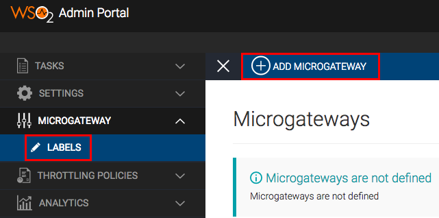
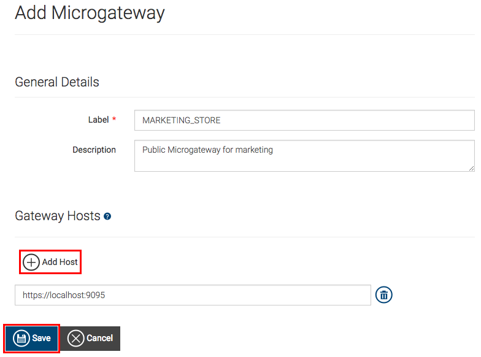
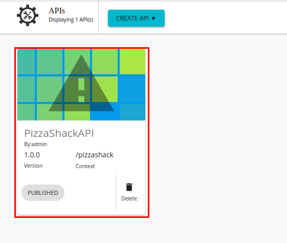
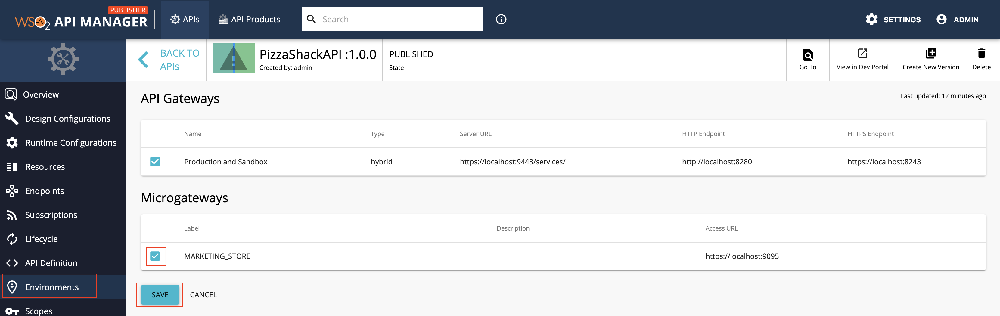
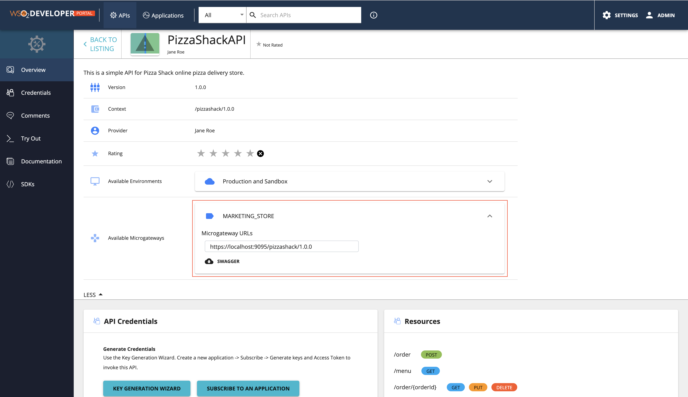

# Grouping APIs with Microgateway Labels

If required, you can create a [WSO2 API Microgateway](https://wso2.com/api-management/api-microgateway/) distribution for a group of APIs. Therefore, if you need to group APIs in order to import it later into the WSO2 Microgateway, you need to create a Microgateway label and add the label to the respective APIs that belong to the group.

{"Note"}

{"For more information on WSO2 API Microgateway, see "}<a href={"https://docs.wso2.com/display/MG300/API+Microgateway+Documentation"}>{"API Microgateway Documentation"}</a>{"."}

<Steps>

## Create a Microgateway label {/* #step-1---create-a-microgateway-label */}

1.  Sign in to the Admin Portal.
     
     `https://<hostname>:9443/admin` 
   
     Example: `https://localhost:9443/admin`

     Let's use `admin` as your username and password to sign in.

2.  Add a new Microgateway label.

     Click **LABELS** under **MICROGATEWAY**, and then click **ADD MICROGATEWAY**.

     

3.  Create a new label, add a host, and click **Save.**

     <table><tbody><tr><td>{"Label"}</td><td>{"MARKETING_STORE"}</td></tr><tr><td>{"Host"}</td><td><code>{"https://localhost:9095"}</code></td></tr></tbody></table>

     

## Assign the Microgateway label to an API {/* #step-2---assign-the-microgateway-label-to-an-api */}

{"Note"}

{"Repeat this step if you wish to add multiple APIs to the API group."}

1.  Sign in to the API Publisher using `admin` as the username and password.

     `https://<hostname>:9443/publisher` 
   
     Example: `https://localhost:9443/publisher`

2.  Create a new API or skip this step if you wish to use an existing API.
     Let's deploy the sample Pizzashack API by clicking **Deploy Sample API** (If you have not done so already).

3.  Click on the API to edit its configurations.

    

4.  Click **Environments**.

5.  Select the newly created Microgateway label.

    

6.  Click **Save** to attach it to the Pizzashack API.

7. Similarly, you can assign the `MARKETING_STORE` Microgateway label for other APIs as well.

## View the Microgateway labels {/* #step-3---view-the-microgateway-labels */}

Sign in to the Developer Portal using `admin` as the username and password.

`https://<hostname>:9443/devportal` 
   
Example: `https://localhost:9443/devportal`

The attached Microgateways appear in the **Overview** tab of the API.

</Steps>
