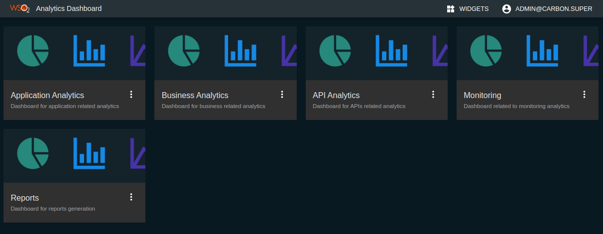

# Overview of API Analytics

APIs are widely used in Business Integrations and are becoming a key part of driving an Organization's Business strategy. Ensuring the proper functioning of the APIs, getting feedback on the performance and deriving business insights from APIs are becoming equally important. WSO2 API Manager Analytics does this by integrating with WSO2 API Manager to provide statistics, reports, and graphs on the APIs deployed in WSO2 API Manager. It further allows configuring Alerts to notify about unusual behaviors and error conditions in near real-time.

In order to make the data easily available, WSO2 API Manager Analytics offers different Dashboards that show different views of the APIs to different user groups. Application Developers, API Publishers, DevOps, and Program Managers can use these Dashboards to learn about different perspectives of the underlying API ecosystem.

## Accessing the statistical dashboards

Follow the instructions below to access the statistical dashboards.

:::info

For instructions on how to set up Analytics, see [Configuring APIM Analytics](configuring-apim-analytics.mdx)

:::

1. Sign in to the Analytics Dashboard.

     `<protocol>://<host>:<port>/analytics-dashboard`

     Example: 
     
     [https://localhost:9643/analytics-dashboard](https://localhost:9643/analytics-dashboard)
     
     After you sign in, you will see the following dashboards listed.
     <ul><li><a href={"#business-analytics-dashboard"}>{"Business Analytics"}</a></li><li><a href={"#application-analytics-dashboard"}>{"Application Analytics"}</a></li><li><a href={"#api-analytics-dashboard"}>{"API Analytics"}</a></li><li><a href={"#monitoring-dashboard"}>{"Monitoring"}</a></li><li><a href={"#monthly-api-usage-report"}>{"Reports"}</a></li></ul>
  
       

2. Click on the card of any desired dashboard to view that particular dashboard.

## Overview on the statistical dashboards

<table><tbody><tr><th colSpan={"2"}><b><a href={"/api-platform/api-manager/3.2.0/learn/analytics/viewing-api-statistics/business-analytics-dashboard"}>{"Business Analytics Dashboard"}</a></b></th></tr><tr><th>{"Information Provided"}</th><td><ul><li>{"Long-term historical trends about API Latency, Traffic Volume, and Errors."}</li><li>{"Statistics such as the most used APIs, API subscribing frequency, and Developer Sign-Ups over time that shows different aspects of the API adoption."}</li></ul></td></tr><tr><th>{"Targeted Audience"}</th><td>{"This is targeted for Program Managers who need to see a holistic view of the APIs, Developers, and Application and shows data about all APIs without any restriction."}</td></tr><tr><th>{"Permission Needed"}</th><td>{"The "}<code>{"internal/analytics"}</code>{" role is needed to view this dashboard."}</td></tr><tr><td colSpan={"2"}>{"For more details, see the "}<a href={"/api-platform/api-manager/3.2.0/learn/analytics/viewing-api-statistics/business-analytics-dashboard"}>{"Business Analytics"}</a>{" section."}</td></tr></tbody></table>

______

<table><tbody><tr><th colSpan={"2"}><b><a href={"/api-platform/api-manager/3.2.0/learn/analytics/viewing-api-statistics/application-analytics-dashboard"}>{"Application Analytics Dashboard"}</a></b></th></tr><tr><th>{"Information Provided"}</th><td>{"This dashboard shows statistics for applications that are created by the viewer assuming a Developer role. This includes registered application users, top application users, API usage of an application, etc."}</td></tr><tr><th>{"Targeted Audience"}</th><td>{"Provided for Application Developers to view the statistics related to their applications."}</td></tr><tr><th>{"Permission Needed"}</th><td>{"The "}<code>{"internal/subscriber"}</code>{" role is needed to view this dashboard."}</td></tr><tr><td colSpan={"2"}>{"For more details, see the "}<a href={"/api-platform/api-manager/3.2.0/learn/analytics/viewing-api-statistics/application-analytics-dashboard"}>{"Application Analytics"}</a>{" section."}</td></tr></tbody></table>

______

<table><tbody><tr><th colSpan={"2"}><b><a href={"/api-platform/api-manager/3.2.0/learn/analytics/viewing-api-statistics/api-analytics-dashboard"}>{"API Analytics Dashboard"}</a></b></th></tr><tr><th>{"Information Provided"}</th><td><ul><li>{"The ability to compare and contrast the usage of different APIs created by the logged-in user."}</li><li>{"The performance and fault statistics of individual APIs. "}

{"Note"}

{"When an API is restricted to a Publisher it will not appear under this dashboard."}

</li></ul></td></tr><tr><th>{"Targeted Audience"}</th><td>{"Provided for the API creators to view the statistics related to their APIs."}</td></tr><tr><th>{"Permission Needed"}</th><td>{"The "}<code>{"internal/publisher"}</code>{" role is needed to view this dashboard."}</td></tr><tr><td colSpan={"2"}>{"For more details, see the "}<a href={"/api-platform/api-manager/3.2.0/learn/analytics/viewing-api-statistics/api-analytics-dashboard"}>{"API Analytics"}</a>{" section."}</td></tr></tbody></table>

______

<table><tbody><tr><th colSpan={"2"}><b><a href={"/api-platform/api-manager/3.2.0/learn/analytics/viewing-api-statistics/monitoring-dashboard"}>{"Monitoring Dashboard"}</a></b></th></tr><tr><th>{"Information Provided"}</th><td>{"Provides a short-term historical view about Latency, Traffic Volume, and Errors of APIs with drill-downs to narrow down errors and isolate the cause of the issues."}</td></tr><tr><th>{"Targeted Audience"}</th><td>{"This dashboard is targeted for DevOps and SysAdmins who overlook the health and availability aspects of the APIs."}</td></tr><tr><th>{"Permission Needed"}</th><td>{"Currently, the "}<code>{"internal/analytics"}</code>{" role is needed to view this dashboard. However, a different role can be assigned by editing role mappings as described in "}<a href={"(/api-platform/api-manager/3.2.0/learn/analytics/managing-dashboard-permissions"}>{"Managing Analytics Dashboard Permissions"}</a>{"."}</td></tr><tr><td colSpan={"2"}>{"For more details, see the "}<a href={"/api-platform/api-manager/3.2.0/learn/analytics/viewing-api-statistics/monitoring-dashboard"}>{"Monitoring Dashboard"}</a>{" section."}</td></tr></tbody></table>

______

<table><tbody><tr><th colSpan={"2"}><b><a href={"/api-platform/api-manager/3.2.0/learn/analytics/monthly-api-usage-report"}>{"Reports Dashboard"}</a></b></th></tr><tr><th>{"Information Provided"}</th><td>{"Users can download a PDF report of the API usage statistics for the selected month. Later this report can be used for billing purposes. "}

{"Note"}

{"You can customize the format and structure of this dashboard as explained in the "}<a href={"/api-platform/api-manager/3.2.0/learn/analytics/monthly-api-usage-report/#customizing-the-report"}>{"Monthly API Usage Report"}</a>{" section."}

</td></tr><tr><th>{"Targeted Use case"}</th><td>{"This can be used to accomplish the API monetization use cases."}</td></tr><tr><th>{"Permission Needed"}</th><td>{"Currently, this is restricted to users with the "}<code>{"admin"}</code>{" role only."}</td></tr><tr><td colSpan={"2"}>{"For more details, see the "}<a href={"/api-platform/api-manager/3.2.0/learn/analytics/monthly-api-usage-report"}>{"Monthly API Usage Report"}</a>{" section."}</td></tr></tbody></table>

## Customizing the Analytics Dashboards

Apart from the latter mentioned default dashboards, the users can create custom dashboards based on their specific requirements as explained in **[Customizing Analytics Dashboards](customizing-analytics-dashboards.mdx)**.
