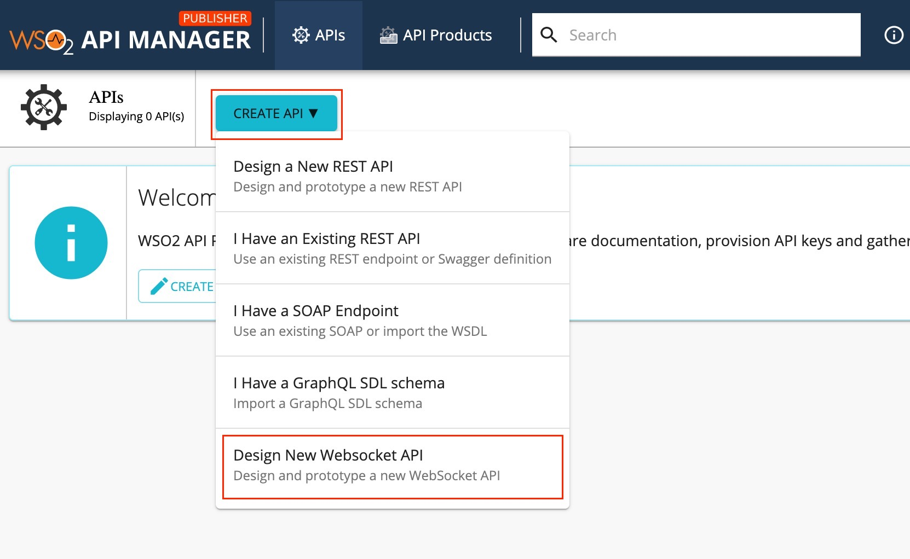
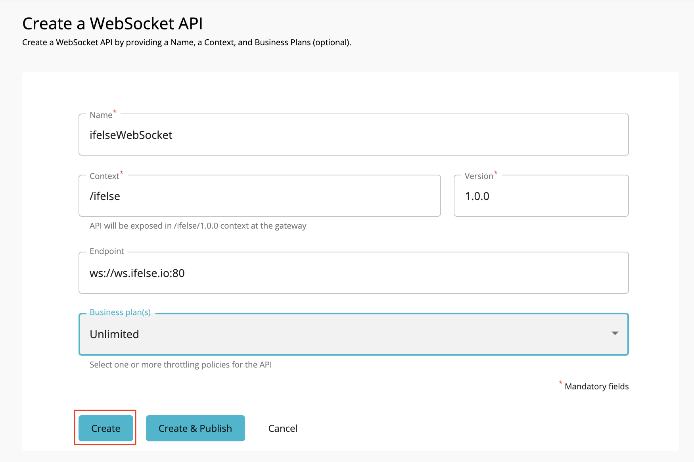
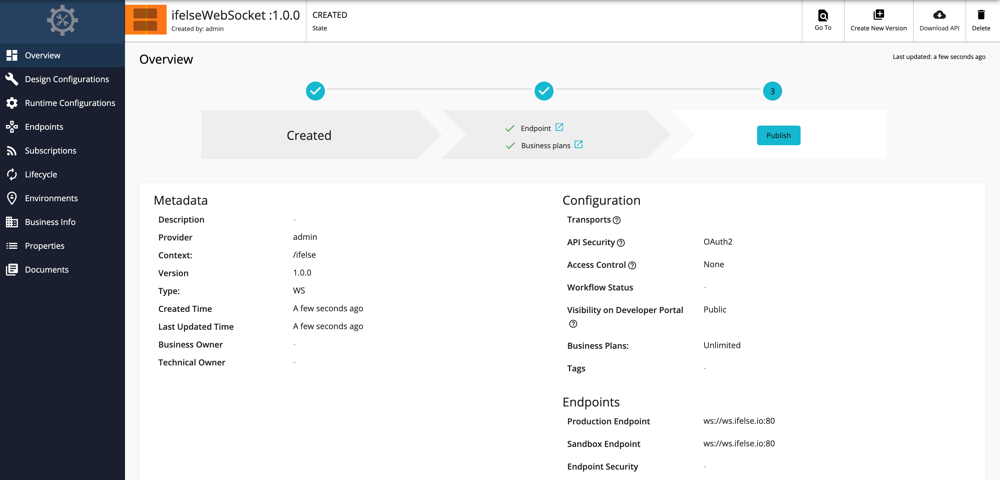
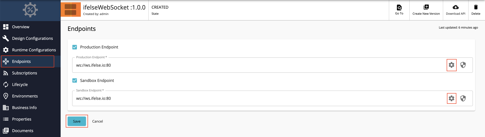
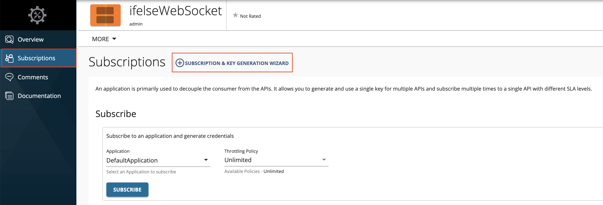
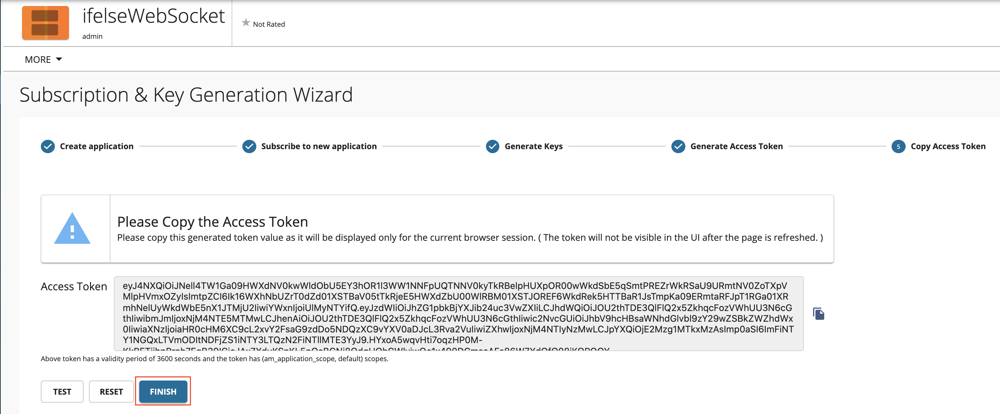

# Create and Publish a WebSocket API

Follow the instructions in this tutorial to design and publish API with a WebSocket backend, and thereafter invoke it using the **wscat** WebSocket client.

<div className={"admonition note"}><p className={"admonition-title"}>{"Note"}</p><p>{"For more information on WebSocket APIs, see "}<a href={"/api-platform/api-manager/3.2.0/learn/design-api/create-api/create-a-websocket-api"}>{"Create a WebSocket API"}</a>{"."}</p></div>

<Steps>

## Design a WebSocket API {/* #step-1---design-a-websocket-api */}

1. Sign in to the API Publisher.
   
    `https://<hostname>:9443/publisher` 
   
    Example: `https://localhost:9443/publisher`

    Let's use `admin` as your username and password to sign in.

2.  Click **CREATE API** and then click **Design a New WebSocket API**.

     <div className={"admonition note"}><p className={"admonition-title"}>{"Note"}</p><p>{"The "}<b>{"CREATE"}</b>{" button will only appear for a user who has the "}<code>{"creator"}</code>{" role permission."}</p></div>
    
     [](../../../../assets/img/learn/create-websocket-api.jpg)

3.  Enter the details of the new WebSocket API.

    <table><thead><tr><th>{"Field"}</th><th>{"Sample value"}</th></tr></thead><tbody><tr><td>{"Name"}</td><td>{"ifelseWebSocket"}</td></tr><tr><td>{"Context"}</td><td>{"/ifelse"}</td></tr><tr><td>{"Version"}</td><td>{"1.0.0"}</td></tr><tr><td>{"Endpoint"}</td><td><p>{"Use one of the following endpoints."}</p><ul><li>{"ws://ws.ifelse.io:80"}</li><li>{"wss://ws.ifelse.io:443"}</li></ul></td></tr><tr><td>{"Business Plan"}</td><td>{"Unlimited"}</td></tr></tbody></table>
    
    [](../../../../assets/img/learn/create-web-socket-api.png)

    <div className={"admonition note"}><p className={"admonition-title"}>{"Note"}</p><p>{"The "}<strong>{"CREATE & PUBLISH"}</strong>{" option will appear only if the optional fields "}<strong>{"Endpoint"}</strong>{" and "}<strong>{"Business plan(s)"}</strong>{" are provided by a user who has "}<code>{"publisher"}</code>{" permission. You need to add a Name, Context, Version, and a valid Endpoint (For non-secured WebSockets enter the protocol as "}<code>{"ws://"}</code>{" or for secured WebSockets enter the protocol as "}<code>{"wss://"}</code>{") to create the API."}</p></div>

4.  Click **CREATE**. 

     The overview page of the created WebSocket API appears.

     [](../../../../assets/img/learn/overview-websocket-api.png)

5.  Optionally, enter the endpoint configurations.

     1. Click **Endpoint**.
     
     2. Click the **Endpoint Advanced Configurations** link as shown below and update the endpoint related configurations as required.
     
         For more information, see the following sections on endpoint related configurations.

         - [Endpoint Timeouts](../design-api/endpoints/resiliency/endpoint-timeouts.mdx)
         - [Endpoint Suspension](../design-api/endpoints/resiliency/endpoint-suspension.mdx)
         - [Prevent API Suspension](../design-api/endpoints/resiliency/prevent-api-suspension.mdx)

     [](../../../../assets/img/learn/endpoint-view-of-websocket-api.png)

Now, you have created and configured the WebSocket API successfully.

## Publish the WebSocket API {/* #step-2---publish-the-websocket-api */}

Click **LIFECYCLE** to navigate to the API lifecycle and click **PUBLISH** to publish the API to the API Developer Portal.

## Invoke a WebSocket API {/* #step-3---invoke-a-websocket-api */}

1. Sign in to the Develepor Portal.
   
     `https://<hostname>:9443/devportal` 
   
      Example: `https://localhost:9443/devportal`

2. Click on the WebSocket API.
   
     The API overview appears.

3. Subscribe to the API.

    1. Click **SUBSCRIPTION & KEY GENERATION WIZARD**.
    
         This wizard takes you through the steps of creating a new application, subscribing, generating keys, and generating an access token to invoke the API. 

         <div className={"admonition note"}><p className={"admonition-title"}>{"Note"}</p><p>{"You can use any application (e.g., JWT or OAuth) to subscribe to the API."}</p></div>

         [](../../../../assets/img/learn/websocket-api-credential-page.png)

    2. Copy the authorization token that appears.

         [](../../../../assets/img/learn/websocket-api-key-generation-wizard.png)

4. Try out the operations.
     
      1.  Install wscat client. 

           `npm install -g wscat`

      2.  Invoke the API by using an authorization header by executing the following command.
        
           ```java
           wscat -c ws://localhost:9099/ifelse/1.0.0 -H "Authorization: Bearer [accesstoken]" 
           ```

           ```java
           wscat -n -c wss://localhost:8099/ifelse/1.0.0 -H "Authorization: Bearer [accesstoken]"
           ```

          <div className={"admonition note"}><p className={"admonition-title"}>{"Note"}</p><p>{"There are clients (especially browsers) that do not allow to add headers to the WebSocket handshake. In such cases, you can send the access token for the WebSocket API invocation as a query parameter named "}<code>{"access_token"}</code>{" by using the command below:"}</p></div>

           ```java
           wscat -c "ws://localhost:9099/ifelse/1.0.0?access_token=[accesstoken]" 
           ```
  
           ```java
           wscat -n -c "wss://localhost:8099/ifelse/1.0.0?access_token=[accesstoken]"
           ```

      <div className={"admonition note"}><p className={"admonition-title"}>{"Note"}</p><p><b>{"BasicAuth"}</b>{" and "}<b>{"API Key"}</b>{" do not work for the security of WebSocket APIs."}</p></div>

You have successfully created and published your first WebSocket API, subscribed to it, obtained an access token for testing, and tested your API with the access token.

</Steps>
