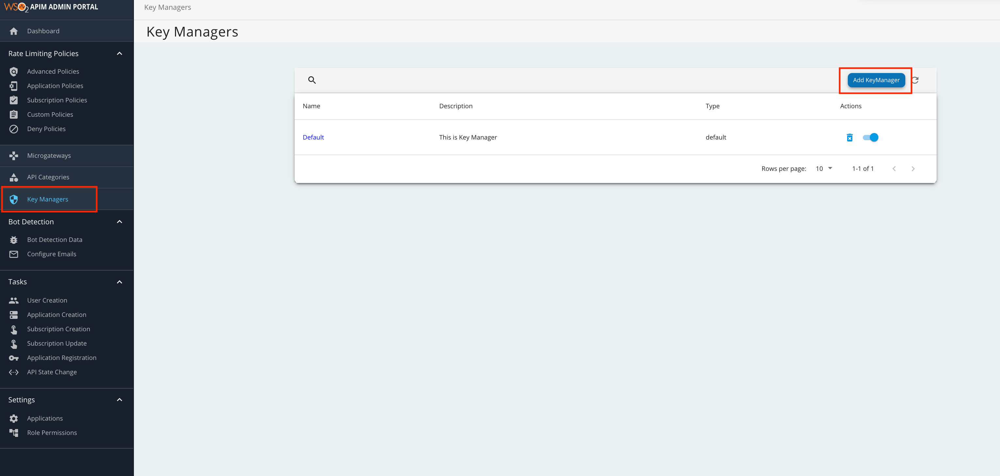

# Configure a Custom Key Manager

WSO2 API Manager is capable of integrating with any external OAuth Authorization Server to manage the OAuth clients and tokens that are required by WSO2 API Manager. Therefore, you need to use a custom Key Manager connector for this purpose. 

<Steps>

## Create a Key Manager connector bundle {/* #step-1---create-a-key-manager-connector-bundle */} 

You need to write a custom Key Manager connector as explained below.

:::tip

The following are some out-of-the-box connectors that you can use as references.

  - [Okta Connector](https://github.com/wso2-extensions/apim-km-okta/)

  - [Keycloak Connector](https://github.com/wso2-extensions/apim-keymanager-keycloak/)

:::

1. Create a Maven project.

      Let's download the sample project from [here](../../../../assets/attachments/administer/custom.auth.client.zip).
   
      However, when manually creating a Maven project, you will need to follow the following steps.

      1. Define a class that implements the `KeyManagerConnectorConfiguration` interface that is responsible for managing the configurations related to the Authorization Server. 
   
      2. Define a class that extends the `AbstractKeyManager` abstract class which is responsible for managing OAuth clients and the tokens that are needed by WSO2 API Manager.

2. Implement `KeyManagerConnectorConfiguration`.

      In the sample project, this has been implemented in the `org.wso2.custom.client.CustomOAuthClient.java` class.

      The following are the methods that the `KeyManagerConnectorConfiguration` interface uses to carry out various related operations.

     <table><colgroup><col width={"30%"} /><col width={"70%"} /></colgroup><thead><tr className={"header"}><th><b>{"Method"}</b></th><th><b>{"Description"}</b></th></tr></thead><tbody><tr className={"odd"}><td><strong>{"getImplementation"}</strong></td><td>
{"Provides the fully qualified class name of the implementation that corresponds to the "}<code>{"KeyManager"}</code>{" interface."}
</td></tr><tr className={"even"}><td><strong>{"getJWTValidator"}</strong></td><td>
{"Provides the fully qualified class name of the implementation that corresponds to the "}<code>{"JWTValidator"}</code>{"."}
</td></tr><tr className={"odd"}><td><strong>{"getConnectionConfigurations"}</strong></td><td>
{"Provides the list of configurations that need to appear in the Admin Portal in order to connect with the Key Manager."}
</td></tr><tr className={"even"}><td><strong>{"getApplicationConfigurations"}</strong></td><td>
{"Provides the list of configurations that are needed to create OAuth applications in the OAuth server in the Developer Portal."}
</td></tr><tr className={"odd"}><td><strong>{"getType"}</strong></td><td>
{"Type of connector. For example, Okta."}
</td></tr><tr className={"even"}><td><strong>{"getDisplayName"}</strong></td><td>
{"Display name to show in the Admin Portal."}
</td></tr><tr className={"odd"}><td><strong>{"getDefaultScopesClaim"}</strong></td><td>
{"The default scope claim available in JWT if it is different than the "}<b>{"scope"}</b>{"."}
</td></tr><tr className={"even"}><td><strong>{"getDefaultConsumerKeyClaim"}</strong></td><td>
{"The default consumer key claim available in JWT if it is different to "}<b>{"azp"}</b>{", which is the Authorized party - the party to which the ID token was issued."}
</td></tr></tbody></table>
  
3. Extend `AbstractKeyManager`.

      The `AbstractKeyManager` implements the `KeyManager` interface. For more information on the operations carried out on the `KeyManager` interface, see [Extending the Key Manager Interface](/api-platform/api-manager/4.0.0/develop/extending-api-manager/extending-key-management/extending-the-key-manager-interface).

      In the sample project, the `AbstractKeyManager` interface has been extended using the `org.wso2.custom.client.CustomOAuthClient.java` class.

4. If you need to customize the `JWTValidation` interface, you need to [extend the JWTValidator](/api-platform/api-manager/4.0.0/develop/extending-api-manager/extending-key-management/extending-key-validation).

5. Build the project.

      Navigate to the `<PROJECT_HOME>` directory and execute the following command.
      
      `mvn clean install`

      This will create a custom Key Manager connector JAR.
     
## Deploy the bundle in the WSO2 API-M Server {/* #step-2---deploy-the-bundle-in-the-wso2-api-m-server */}

1. Stop the API-M server if it is already running. 

2. Copy the JAR file that is generated in the `custom.key.manager` component target directory, and add it in to the `<API-M Server>/repository/components/dropins/` directory.

3. Start the Server

## Configure the connector using the Admin Portal {/* #step-3---configure-the-connector-using-the-admin-portal */}

1. Sign in to the Admin Portal.

      `https://<hostname>:9443/admin`
     
      `https://localhost:9443/admin`

2. Add a new Key Manager.

     1. Click **Key Managers** and then click **Add Key Manager**.

           

     2. Add the following Key Manager configurations.

           The following table provides definitions for each of the Key Manager configurations.

          <table><tbody><tr className={"header"}><th>{"Configuration"}</th><th>{"Description"}</th><th></th></tr><tr className={"odd"}><td>{"Name"}</td><td>{"The name of the authorization server."}</td><td>{"Mandatory"}</td></tr><tr className={"even"}><td>{"Display Name"}</td><td>{"A name to display in the UI."}</td><td>{"Mandatory"}</td></tr><tr className={"odd"}><td>{"Description"}</td><td>{"A brief description of the Key Manager."}</td><td>{"Optional"}</td></tr><tr className={"even"}><td>{"Key Manager Type"}</td><td>{"The type of the Key Manager to be selected."}</td><td>{"Mandatory"}</td></tr><tr className={"odd"}><td>{"Well-known-url"}</td><td>
{"The well-known URL of the Authorization Server (Key Manager). "} {" If the well-known URL is provided, other endpoints can be imported. "} {" e.g., "}<code>{"https://dev-599740.okta.com/oauth2/default/.well-known/oauth-authorization-server"}</code>
</td><td>{"Optional"}</td></tr><tr className={"even"}><td>{"Issuer"}</td><td>{"The issuer that consumes or validates access tokens. "} {"e.g., "}<code>{"https://dev-599740.okta.com/oauth2/default"}</code></td><td>{"Optional"}</td></tr><tr className={"odd"}><td><b>{"Key Manager Endpoints"}</b></td><td></td><td></td></tr><tr className={"even"}><td>{"Client Registration Endpoint"}</td><td>
{"The endpoint that verifies the identity and obtains profile information of the end-user based on the authentication performed by an authorization server."}
</td><td>{"Optional if the well-known URI is provided."}</td></tr><tr className={"odd"}><td>{"Introspection Endpoint"}</td><td>{"The endpoint that allows authorized protected resources to query the authorization server to determine the set of metadata for a given token that was presented to them by an OAuth client."}</td><td>{"Optional if the well-known URI is provided."}</td></tr><tr className={"even"}><td>{"Token Endpoint"}</td><td>{"The endpoint that issues the access tokens."}</td><td>{"Optional if the well-known URI is provided."}</td></tr><tr className={"odd"}><td>{"Revoke Endpoint"}</td><td>{"The endpoint that revokes the access tokens."}</td><td>{"Optional if the well-known URI is provided."}</td></tr><tr className={"even"}><td>{"Userinfo Endpoint"}</td><td>{"The endpoint that allows clients to verify the identity of the end-user based on the authentication performed by an authorization server, as well as to obtain basic profile information about the end-user."}</td><td>{"Optional"}</td></tr><tr className={"odd"}><td>{"Authorize Endpoint"}</td><td>{"The endpoint is used to obtain an authorization grant from the resource owner via the user-agent redirection."}</td><td>{"Optional"}</td></tr><tr className={"even"}><td>{"Scope Management Endpoint"}</td><td>{"The endpoint is used to manage the scopes."}</td><td>{"Optional"}</td></tr><tr className={"odd"}><td><b>{"Connector Configurations"}</b></td><td></td><td></td></tr><tr className={"even"}><td>{"API Key"}</td><td>{"The API key that was generated from the Authorization Server."}</td><td>{"Mandatory"}</td></tr><tr className={"odd"}><td>{"Client ID"}</td><td>{"The client ID that was generated from the Authorization Server."}</td><td>{"Mandatory"}</td></tr><tr className={"even"}><td>{"Client Secret"}</td><td>{"The client secret that was generated from the Authorization Server."}</td><td>{"Mandatory"}</td></tr><tr className={"odd"}><td><b>{"Claim URIs"}</b></td><td>{"This provides claim URIs for the consumer key and the scopes."}</td><td>{"Mandatory"}</td></tr><tr className={"even"}><td>{"Consumer Key Claim URI"}</td><td>{"The claim URI for consumer key e.g., cid"}</td><td>{"Mandatory"}</td></tr><tr className={"odd"}><td>{"Scopes Claim URI"}</td><td>{"The claim URI for scopes e.g., scp"}</td><td>{"Mandatory"}</td></tr><tr className={"even"}><td>{"Grant Types"}</td><td>{"The supported grant types."}</td><td>{"Optional"}</td></tr><tr className={"odd"}><td><b>{"Certificates"}</b></td><td></td><td></td></tr><tr className={"even"}><td>{"PEM"}</td><td>{"Either copy and paste the certificate in PEM format or upload the PEM file."}</td><td>{"Optional"}</td></tr><tr className={"odd"}><td>{"JWKS"}</td><td>{"The JSON Web Key Set (JWKS) endpoint is a read-only endpoint. This URL returns the Okta's public key set in JSON web key set format. This contains the signing key(s) that the Relying Party (RP) uses to validate signatures from Okta. "} {" e.g., https://dev-599740.okta.com/oauth2/default/v1/keys"}</td><td>{"Optional"}</td></tr><tr className={"even"}><td><b>{"Advanced Configurations"}</b></td><td></td><td></td></tr><tr className={"odd"}><td>{"Token Generation"}</td><td>{"This enables the token generation process via the Authorization Server."}</td><td>{"Optional"}</td></tr><tr className={"even"}><td>{"Out Of Band Provisioning"}</td><td>{"This enables the provisioning of Auth clients that have been created without the use of the Developer Portal, such as previously created Auth clients."}</td><td>{"Optional"}</td></tr><tr className={"even"}><td>{"OAuth App Creation"}</td><td>{"This enables the creation of Auth clients."}</td><td>{"Optional"}</td></tr><tr className={"odd"}><td><b>{"Token Validation Method"}</b></td><td>{"The method used to validate the JWT signature. This is mandatory if the Token Validation Method is "}<b>{"introspect"}</b></td><td></td></tr><tr className={"even"}><td>{"Self Validate JWT"}</td><td>{"The "}<code>{"kid"}</code>{" value is used to validate the JWT token signature. If the `"}<code>{"kid"}</code>{" value is not present, the "}<code>{"gateway_certificate_alias"}</code>{" is used."}</td><td>{"Optional"}</td></tr><tr className={"odd"}><td>{"Use introspect"}</td><td>{"The JWKS endpoint is used to validate the JWT token signature. If this option is used to validate the tokens it is mandatory to add a Token Handling Option For Okta it should be "}<b>{"JWT"}</b>{" and it is required to specify a claim mapping as a unique identifier."} {" e.g., "} {"Claim Key : iss"} {" Claim Value : https://dev-599740.okta.com/oauth2/default"}</td><td>{"Optional"}</td></tr><tr className={"even"}><td><b>{"Token Handling Options"}</b></td><td>{"This provides a way to validate the token for this particular Authorization Server."}</td><td>{"Optional "} {"This is mandatory if the token validation method is "}<b>{"introspect"}</b></td></tr><tr className={"odd"}><td>{"REFERENCE"}</td><td>{"The tokens that match a specific regular expression (regEx) are validated."}</td><td></td></tr><tr className={"even"}><td>{"JWT"}</td><td>{"The tokens that match a specific JWT are validated."}</td><td></td></tr><tr className={"odd"}><td>{"CUSTOM"}</td><td>{"The tokens that match a custom pattern are validated."}</td><td></td></tr><tr className={"even"}><td><b>{"Claim Mappings"}</b></td><td>{"Local and remote claim mapping."}</td><td>{"Optional"}</td></tr></tbody></table>

## Generate the keys using the custom Key Manager {/* #step-4---generate-the-keys-using-the-custom-key-manager */}

1. Sign in to the Developer Portal.

    `https://<hostname>:9443/devportal`
     
    `https://localhost:9443/devportal`

2. Click **Applications**.
3. Create a new application or use the default application.
4. Select the Key  Manager.

5. Click **Generate Keys**.

    :::tip

    If you want to generate the tokens with scopes, make sure that those scopes are defined in the Authorization Server.

    :::

</Steps>
