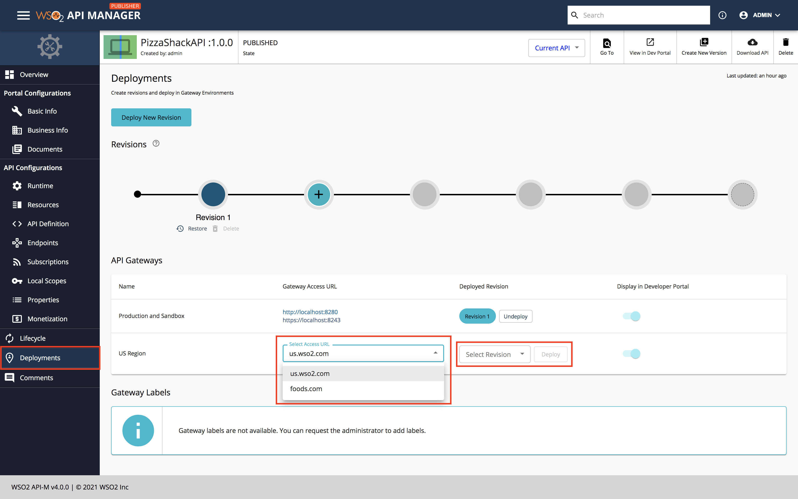
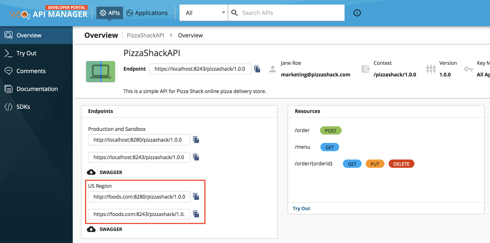
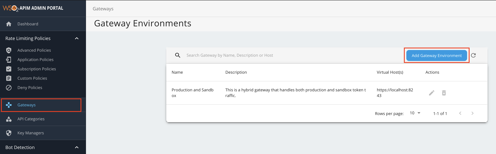

# Exposing APIs via Custom Hostnames

Virtual hosts (VHosts) enable you to expose APIs using specific hostnames that correspond to a Gateway environment. Each Gateway environment will have a minimum of one VHost. Admin users can manage Gateways by creating, updating, and deleting Gateway environments via the Admin Portal. Each Gateway environment will contain the details of each of the VHosts, which are the custom hostnames, that are applicable to that Gateway environment. As a result, API publishers can use the VHosts to group their APIs by selecting a virtual host when deploying an API to Gateway environment(s). In addition, application developers can access APIs by using the defined access URLs of the virtual host.

## Using an existing Gateway environment to expose APIs via custom hostnames

Follow the instructions below to use the default Gateway environment to expose APIs via custom hostnames:

<Steps>

### Define the custom hostnames {/* #step-1---define-the-custom-hostnames */}

Each Gateway environment definition contains details related to a specific Gateway. Define the VHosts, which contain the custom hostnames in the `deployment.toml` file, which is the central configuration file.

1. Open to the `<APIM-HOME>/repository/conf/deployment.toml` file.

2. Define the VHosts.

     Let's add `us.wso2.com` and `foods.com` as the custom VHosts and `food` as the custom context.

    :::note


    - When the WSO2 API Manager server is running, the default Gateway environment and also the Gateway environments that you added via the `deployment.toml` file are displayed in the Gateway environments list page in the Admin Portal in read-only mode.
    - If a VHost is not defined, the default VHost details are assigned to the Gateway environment.
    - It is not mandatory to specify a context for the VHost.

    :::

    ```toml
    [[apim.gateway.environment]]
    name = "Default"
    display_name = "US Region"
    type = "hybrid"
    display_in_api_console = true
    description = "Gateway environment deployed in the US region."
    show_as_token_endpoint_url = true
    service_url = "https://localhost:${mgt.transport.https.port}/services/"
    username= "${admin.username}"
    password= "${admin.password}"
    ws_endpoint = "ws://localhost:9099"
    wss_endpoint = "wss://localhost:8099"
    http_endpoint = "http://localhost:${http.nio.port}"
    https_endpoint = "https://localhost:${https.nio.port}"
    websub_event_receiver_http_endpoint = "http://localhost:9021"
    websub_event_receiver_https_endpoint = "https://localhost:8021"

    [[apim.gateway.environment.virtual_host]]
    ws_endpoint = "ws://us.wso2.com:9099"
    wss_endpoint = "wss://us.wso2.com:8099"
    http_endpoint = "http://us.wso2.com/gateway"
    https_endpoint = "https://us.wso2.com/gateway"
    websub_event_receiver_http_endpoint = "http://us.wso2.com:9021"
    websub_event_receiver_https_endpoint = "https://us.wso2.com:8021"

    [[apim.gateway.environment.virtual_host]]
    ws_endpoint = "ws://foods.com:9099"
    wss_endpoint = "wss://foods.com:8099"
    http_endpoint = "http://foods.com:8280"
    https_endpoint = "https://foods.com:8243"
    websub_event_receiver_http_endpoint = "http://foods.com:9021"
    websub_event_receiver_https_endpoint = "https://foods.com:8021"
    ```

3. [Start WSO2 API Manager](../../../install-and-setup/install/installing-the-product/running-the-api-m.mdx#starting-the-server).

      This will start WSO2 API Manager in the all-in-one mode, which includes the default Gateway as well.

### Assign the custom hostname to an API {/* #step-2---assign-the-custom-hostname-to-an-api */}


<div className="admonition note">
<p className="admonition-title">Note</p>
<p>Repeat this step if you wish to add multiple APIs to the API group.</p>
</div> 


1.  Sign in to the API Publisher using `admin` as the username and password.

     `https://<hostname>:9443/publisher` 
   
     Example: `https://localhost:9443/publisher`

2.  Create a new API or skip this step if you wish to use an existing API.
     
     Let's deploy the sample Pizzashack API by clicking **Deploy Sample API** (If you have not done so already).

3.  Click on the API to edit its configurations.

     [](https://apim.docs.wso2.com/en/4.0.0/assets/img/includes/deploy/select-api.png)

4.  Click **Deployments**.

5.  Select the newly created Gateway environment, Virtual Host (foods.com), and a Revision.

     [Create a new revision](../../../design/create-api/create-api-revisions.mdx) if no revisions exist.

6. Click **Deploy** to attach the Virtual Host to the Pizzashack API.
   
    :::info

    Similarly, you can assign the same Virtual Host to other APIs as well.

    :::


[](../../../../../assets/_versions/4.0.0/img/deploy/deploy-api-with-vhost.png)


### View the custom hostnames {/* #step-3---view-the-custom-hostnames */}


Follow the instructions below to view the custom endpoint URLs of the API, which consists of the custom hostnames:

1. Sign in to the Developer Portal using `admin` as the username and password.

     `https://<hostname>:9443/devportal` 
   
     Example: `https://localhost:9443/devportal`

2. Click on the specific API.

3. Click **Overview**.

     The custom endpoint URLs of the API, which include the custom hostnames, appear.


[](../../../../../assets/_versions/4.0.0/img/deploy/virtual-host-in-devportal.png)

</Steps>


## Using a new Gateway environment to expose APIs via custom hostnames

Follow the instructions below to use a new custom Gateway environment to expose APIs via custom hostnames:

<Steps>

### Create a Gateway environment {/* #step-1---create-a-gateway-environment */}

Each Gateway environment definition contains details related to a specific Gateway. You can create a Gateway environment that includes VHosts using either one of the following methods.

#### Option 1: Create a Gateway environment via the Admin Portal

1. [Start WSO2 API Manager](../../../install-and-setup/install/installing-the-product/running-the-api-m.mdx#starting-the-server).

      This will start WSO2 API Manager in the all-in-one mode, which includes the default Gateway as well.

2.  Sign in to the Admin Portal.
     
     `https://<hostname>:9443/admin` 
   
     Example: `https://localhost:9443/admin`

     Let's use `admin` as your username and password to sign in.

3.  Add a new Gateway Environment.

     1. Click **Gateways**, and then click **Add Gateway Environment**.

         [](../../../../../assets/img/deploy/add-gateway-environment-menu.png)

     2. Enter a name, display name, description, and a virtual host.

         The virtual hosts will define each of the custom hostnames. It is mandatory to specify a VHost when you create a Gateway environment.

          | **Environment** | **Display Name** | **Description**                               | **Virtual Host** |
          |-------------|--------------|-------------------------------------------|--------------|
          | us-region   | US Region    | Gateway environment deployed in the US region. | us.wso2.com  |

          <a href="/api-platform/api-manager/assets/img/deploy/add-gateway-environment.png">
              
          </a>
          
     3. Optionally, click **Advanced Settings** to add a HTTP(S) context and custom ports.

          <a href="/api-platform/api-manager/assets/img/deploy/vhost-advanced-settings.png">
              
          </a>

        :::note

        You can change the ports of each protocol of the Virtual Host and add an optional HTTP(s) context.

        :::

        Let's add `gateway` as the HTTP(S) context for the Virtual Host `us.wso2.com`.

        Add another virtual host `foods.com` by clicking **New VHost** and click **Save** to save the environment.

#### Option 2:Create a Gateway environment using the configuration file

Follow the instructions below to use the `deployment.toml` file, which is the central configuration file, to configure a Gateway environment that consists of virtual hosts:

1. Open to the `<APIM-HOME>/repository/conf/deployment.toml` file.

2. Create a Gateway environment.

     Create a Gateway environment with the following Gateway configurations, which include `us.wso2.com` and `foods.com` as the custom VHosts and `food` as the custom context.

    :::note


    - When the WSO2 API Manager server is running, the Gateway environments, which you added via the `deployment.toml` file, are displayed in the Gateway environments list page in the Admin Portal in read-only mode. 
    - Therefore, ensure to add the VHosts that correspond to the Gateway at the time of adding the Gateway environment itself.
    - If a VHost is not defined, the default VHost details are assigned to the Gateway environment.
    - It is not mandatory to specify a context for the VHost.

    :::

    ```toml
    [[apim.gateway.environment]]
    name = "us-region"
    display_name = "US Region"
    type = "hybrid"
    display_in_api_console = true
    description = "Gateway environment deployed in the US region."
    show_as_token_endpoint_url = true
    service_url = "https://localhost:${mgt.transport.https.port}/services/"
    username= "${admin.username}"
    password= "${admin.password}"
    ws_endpoint = "ws://localhost:9099"
    wss_endpoint = "wss://localhost:8099"
    http_endpoint = "http://localhost:${http.nio.port}"
    https_endpoint = "https://localhost:${https.nio.port}"
    websub_event_receiver_http_endpoint = "http://localhost:9021"
    websub_event_receiver_https_endpoint = "https://localhost:8021"

    [[apim.gateway.environment.virtual_host]]
    ws_endpoint = "ws://us.wso2.com:9099"
    wss_endpoint = "wss://us.wso2.com:8099"
    http_endpoint = "http://us.wso2.com/gateway"
    https_endpoint = "https://us.wso2.com/gateway"
    websub_event_receiver_http_endpoint = "http://us.wso2.com:9021"
    websub_event_receiver_https_endpoint = "https://us.wso2.com:8021"
   

    [[apim.gateway.environment.virtual_host]]
    ws_endpoint = "ws://foods.com:9099"
    wss_endpoint = "wss://foods.com:8099"
    http_endpoint = "http://foods.com:8280"
    https_endpoint = "https://foods.com:8243"
    websub_event_receiver_http_endpoint = "http://foods.com:9021"
    websub_event_receiver_https_endpoint = "https://foods.com:8021"
    ```

3. [Start WSO2 API Manager](../../../install-and-setup/install/installing-the-product/running-the-api-m.mdx#starting-the-server).

      This will start WSO2 API Manager in the all-in-one mode, which includes the default Gateway as well.

### Start the second Gateway {/* #step-2---start-the-second-gateway */}

Extract WSO2 API Manager to a new directory. Let's refer to this directory as `APIM-HOME-2`.

1. Open the `<APIM-HOME-2>/repository/conf/deployment.toml` file.

2. Set the port offset in the `server` section.

    ```toml
    [server]
    hostname = "localhost"
    node_ip = "127.0.0.1"
    offset = 3
    ```

2. Assign the Gateway environment label `us-region`, which is the name of the Gateway environment that you previously created.

    ```toml
    [apim.sync_runtime_artifacts.gateway]
    gateway_labels = ["us-region"]
    ```

3. Update the Traffic Manager configurations of the second server to connect to the Traffic Manager deployed with the first server. 

    ```toml
    [apim.throttling]
    username = "$ref{super_admin.username}"
    password = "$ref{super_admin.password}"
    service_url = "https://localhost:9443/services/"
    throttle_decision_endpoints = ["tcp://localhost:5672","tcp://localhost:5672"]
    
    [[apim.throttling.url_group]]
    traffic_manager_urls = ["tcp://localhost:9611"]
    traffic_manager_auth_urls = ["ssl://localhost:9711"]
    ```

4. Save and close the `<APIM-HOME-2>/repository/conf/deployment.toml` file. 

5. [Start the second WSO2 API Manager server](../../../install-and-setup/install/installing-the-product/running-the-api-m.mdx#starting-the-server).

### Assign the custom hostname to an API {/* #step-3---assign-the-custom-hostname-to-an-api */}


<div className="admonition note">
<p className="admonition-title">Note</p>
<p>Repeat this step if you wish to add multiple APIs to the API group.</p>
</div> 


1.  Sign in to the API Publisher using `admin` as the username and password.

     `https://<hostname>:9443/publisher` 
   
     Example: `https://localhost:9443/publisher`

2.  Create a new API or skip this step if you wish to use an existing API.
     
     Let's deploy the sample Pizzashack API by clicking **Deploy Sample API** (If you have not done so already).

3.  Click on the API to edit its configurations.

     [](https://apim.docs.wso2.com/en/4.0.0/assets/img/includes/deploy/select-api.png)

4.  Click **Deployments**.

5.  Select the newly created Gateway environment, Virtual Host (foods.com), and a Revision.

     [Create a new revision](../../../design/create-api/create-api-revisions.mdx) if no revisions exist.

6. Click **Deploy** to attach the Virtual Host to the Pizzashack API.
   
    :::info

    Similarly, you can assign the same Virtual Host to other APIs as well.

    :::


[](../../../../../assets/_versions/4.0.0/img/deploy/deploy-api-with-vhost.png)

### View the custom hostnames {/* #step-4---view-the-custom-hostnames */}


Follow the instructions below to view the custom endpoint URLs of the API, which consists of the custom hostnames:

1. Sign in to the Developer Portal using `admin` as the username and password.

     `https://<hostname>:9443/devportal` 
   
     Example: `https://localhost:9443/devportal`

2. Click on the specific API.

3. Click **Overview**.

     The custom endpoint URLs of the API, which include the custom hostnames, appear.


[](../../../../../assets/_versions/4.0.0/img/deploy/virtual-host-in-devportal.png)

</Steps>
