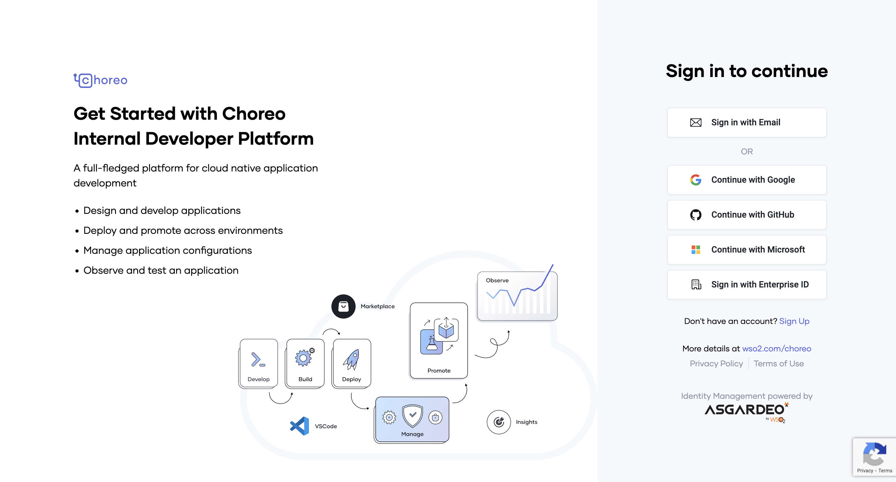
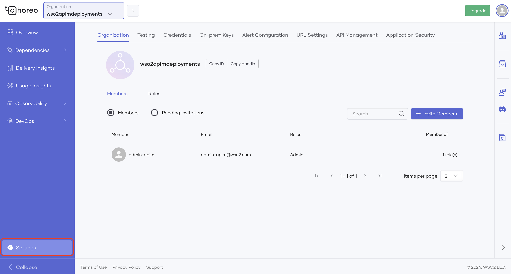

# API Analytics Getting Started Guide

API Manager offers analytics as a cloud service. Therefore, you need to register with the analytics cloud in order to use API Manager Analytics. Follow the instructions below to get started with analytics:

<Steps>

## Sign in to Choreo {/* #step-1---sign-in-to-choreo */}

Follow the instructions below to sign in to Choreo.

1. Navigate to Choreo using the following URL. 
    
     <a href="https://console.choreo.dev/?apianalytics=true?utm_source=apim_docs">https://console.choreo.dev</a>.

2. Sign-in to Choreo.
   
    [](../../../assets/img/observe/sign-in-choreo.png)

## Register your environment {/* #step-2---register-your-environment */}

Follow the instructions below to register your on-premise environment:

1. Click the **Settings** on the bottom left corner.

     [](../../../assets/img/observe/settings-menu.png)

2. If you are a member of multiple organizations, select the appropriate organization from the top left-hand corner. 
   
     For more information on handling users with role-based access control in organizations, see [Role-based Access Control for API Analytics](role-based-access-control.mdx).

     [](../../../assets/img/observe/organization-selector.png)

3. Select the **On-prem Keys** tab and click **Generate keys**.

     [](../../../assets/img/observe/on-prem-key.png)

4. Enter a suitable name for your environment (e.g., customer1-dev).

5. Click **Generate**.
   
      <div className={"admonition info"}><p className={"admonition-title"}>{"Info"}</p><p>{"The validity period of the key and the number of keys that you are allowed to generate vary based on the type of user as explained below:"}</p><table><tbody><tr><th><b>{"User Type"}</b></th><th><b>{"Descrption"}</b></th><th><b>{"Validity Period"}</b></th><th><b>{"Number of Keys Allowed"}</b></th></tr><tr><td>{"Free user"}</td><td>{"Refers to users who do not have a valid subscription for Choreo."}</td><td>{"2 weeks"}<br /><p><b>{"NOTE:"}</b>{" The validity of the keys can be temporarily extended by "}<a href={"https://wso2.com/contact/"}>{"contacting sales"}</a>{" and submitting a request."}</p></td><td>{"3 keys"}</td></tr><tr><td>{"Subscription customers"}</td><td>{"Refers to users who have a valid subscription for Choreo."}</td><td>{"1 year"}</td><td>{"unlimited"}</td></tr></tbody></table></div>

6. Copy the key that was generated before closing the dialog box.

## Configure the Gateway {/* #step-3---configure-the-gateway */}

The Gateway configuration process varies based on the Gateway that you are using.

If your system connects to the service through a proxy server/firewall, you need to grant access to the following endpoints to access the Choreo Analytics Cloud service to publish data.

| Host                                             | Port | Protocol |
|--------------------------------------------------|------|----------|
| `analytics-prod-incoming.servicebus.windows.net` | 5671 | AMQP     |
| `analytics-prod-incoming.servicebus.windows.net` | 5672 | AMQP     |
| `analytics-event-auth.choreo.dev`                | 443  | HTTPS    |

### API Gateway


Follow the instructions below to publish analytics data to the analytics cloud via the API Gateway:

1. Open the `<API-M_HOME>/repository/conf/deployment.toml` file and update the `[apim.analytics]` config segment as follows:

     ```toml
     [apim.analytics]
     enable = true
     config_endpoint = "https://analytics-event-auth.choreo.dev/auth/v1"
     auth_token = "<use token that you generate>"
     ```

      <div className={"admonition note"}><p className={"admonition-title"}>{"Note"}</p><ul><li><p>{"This is the basic configuration that you need to publish analytics data to the analytics cloud."}</p></li><li>{"If you need to change the following default values of the Worker Thread Count, Queue Size or Client Flushing Delay, see the "}<a href={"/api-platform/api-manager/4.1.0/api-analytics/gateways/configure-synapse-gateway/#advanced-configurations"}>{"Advanced configurations"}</a>{". "}<table><tbody><tr><th><b>{"Parameter"}</b></th><th><b>{"Default Value"}</b></th></tr><tr><td><code>{"worker.thread.count"}</code></td><td>{"1 thread"}</td></tr><tr><td><code>{"queue.size"}</code></td><td>{"20000 requests"}</td></tr><tr><td><code>{"client.flushing.delay"}</code></td><td>{"10 seconds"}</td></tr></tbody></table></li></ul></div>

2. Enter the on-premise token, which you obtained via the Choreo Portal in the **Register your environment** step, as the Auth token field.
   
3. Restart the API Gateway.


## View the Analytics Dashboards {/* #step-4---view-the-analytics-dashboards */}

Invoke APIs and open 
<a href="https://console.choreo.dev/insights/overview">Choreo Insights</a> to view the dashboards.

For more detailed information on the Choreo Insights dashboards and their usage, go to the [View API Insights](https://wso2.com/choreo/docs/insights/view-api-insights/) page of the Choreo documentation.

</Steps>

## What's Next?

Enterprises and companies who want to use the Choreo Insights collaboratively can utilize the organization concept in Choreo. For more information, see [Role-based Access Control for API Analytics](role-based-access-control.mdx).
