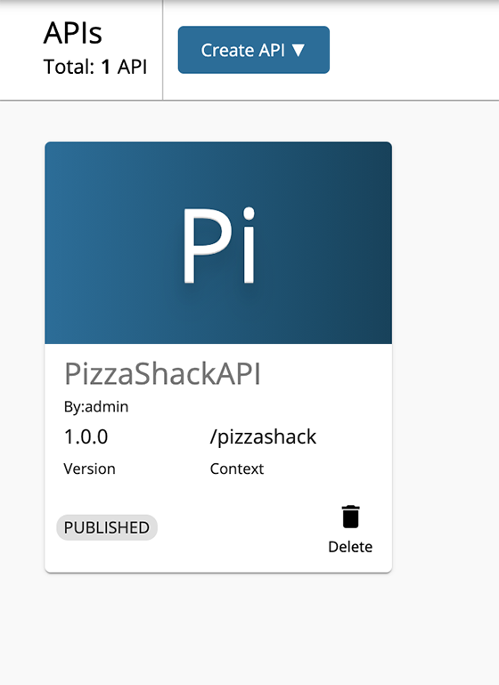
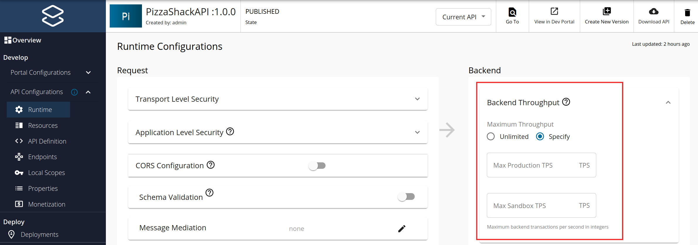

# Setting Maximum Backend Throughput Limits

You can define the maximum backend throughput setting to limit the total number of calls a particular API in API Manager is allowed to make to the backend. While the [other rate limiting levels](setting-throttling-limits.mdx) define the quota the API invoker gets, they do not ensure that the backend is protected from overuse. The maximum backend throughput configuration limits the quota the backend can handle. The request count is calculated and rate limiting occurs at the node level. 


:::note

- **[Configure Rate Limiting for the API Gateway Cluster](advanced-topics/configuring-rate-limiting-api-gateway-cluster.mdx)** so that the request counters will be replicated across the API Gateway cluster when working with multiple API Gateway nodes. 
- Configuring Rate Limiting for the API Gateway cluster is not applicable if you have a clustered setup.

:::
 

Follow the instructions below to set a maximum backend throughput for a given API:

1.  Sign in to the WSO2 API Publisher `https://<hostname>:9443/publisher`.

2.  Click on the API for which you want to set the maximum backend throughput.
    
    [](../../../../assets/img/learn/select-api.png)
    
3.  Navigate to **API Configurations** and click **Runtime**.

4.  Select the **Specify** option for the maximum backend throughput and specify the limits of the Production and Sandbox endpoints separately, as the two endpoints can come from two servers with different capacities.

    [](../../../../assets/img/learn/learn-throttling-maxtps.png)
    
5.  Save the API.
    
     When the maximum backend throughput quota is reached for a given API, more requests will not be accepted for that particular API. The following error message will be returned for all the throttled out requests.

    ```json
    {
      "fault": {
        "code": 900801,
        "message": "API Limit Reached",
        "description": "API not accepting requests"
      }
    }
    ```
