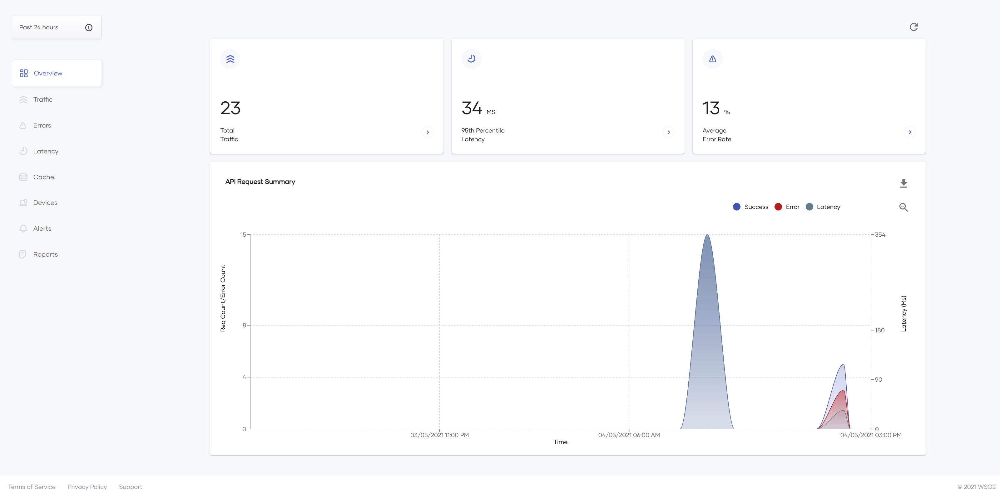
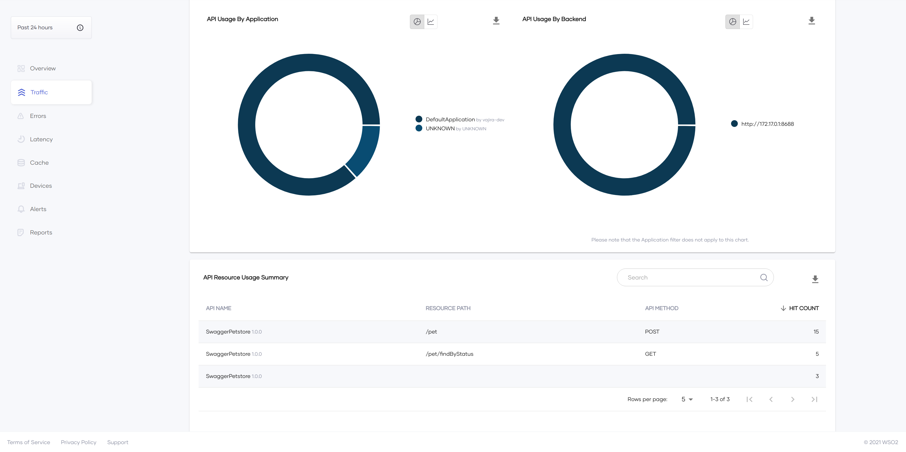
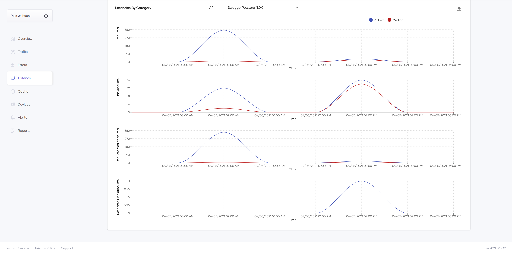
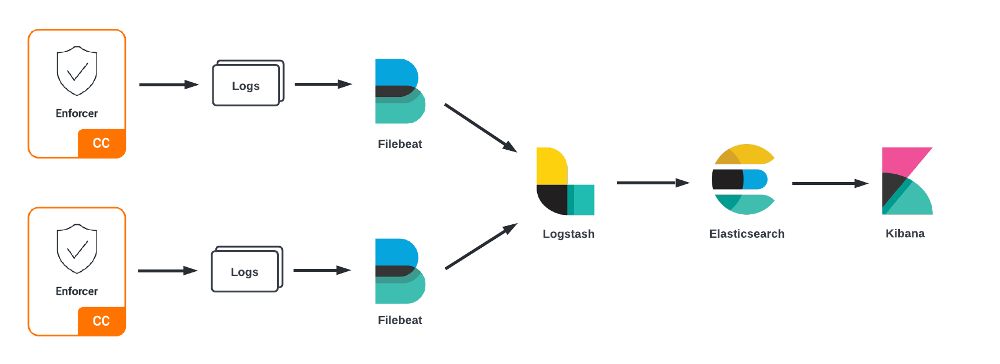

# Configuring Analytics for Choreo Connect

Choreo Connect is capable of publishing fine-grained analytics events which can then be used to generate reports, dashboards, statistics, and graphs for the APIs deployed on Choreo Connect.
Choreo Connect can not only publish analytics data to the Choreo platform but also to platforms that support the ELK stack. The following subsections will explain in detail how you could enable and configure analytics for each platform to gain insights into the services exposed via Choreo Connect.

:::tip

To learn more on the analytics-related concepts, see [Choreo Connect Analytics - Concepts](concepts/choreo-connect-analytics.mdx).

:::

Configure Analytics for Choreo Connect using one of the following methods:

- [Choreo Portal Analytics for Choreo Connect](configure-analytics.mdx#configuring-choreo-portal-analytics)
- [ELK Analytics for Choreo Connect](configure-analytics.mdx#configuring-elk-analytics)

## Configuring Choreo Portal Analytics

Follow the instructions below to configure Choreo Portal Analytics for Choreo Connect.

<Steps>

### Set up Analytics {/* #step-1---set-up-analytics */}

Follow the instructions below to configure analytics with Choreo:

1. Sign in to <a href="https://console.choreo.dev/login/">https://console.choreo.dev/login/</a>.
2. Go to <a href="https://console.choreo.dev/user-settings/onpremkeys">https://console.choreo.dev/user-settings/onpremkeys</a> and generate an on-prem-key.
3. Open the `docker-compose.yaml` file, which based on your setup is located in the `<CHOREO-CONNECT_HOME>/docker-compose/choreo-connect` or `<CHOREO-CONNECT_HOME>/docker-compose/choreo-connect-with-apim` directory.

    :::info

    You can configure Choreo Connect to publish Analytics to the Choreo cloud via the [standalone mode](getting-started/deploy/cc-as-a-standalone-gateway-on-docker.mdx#step-3-start-choreo-connect) or via the [with Control Plane mode](getting-started/quick-start-guide-docker-with-apim.mdx#step-3-start-choreo-connect-and-api-manager).

    :::

4. Locate the environment variables section under the `enforcer` and change the following variables.

    ```yml
    environment:
        ...
        analytics_authURL=https://analytics-event-auth.choreo.dev/auth/v1
        analytics_authToken=<your-on-prem-key>
    ```

5. Enable analytics before starting Choreo Connect. First of all, navigate to the configuration file location. 
Open the Choreo Connect configuration file according to the deployment type you are using.

<details>
<summary>Click here to see the configuration file location for your Choreo Connect deployment.</summary>

Navigate to the correct folder path and open the `config.toml` or `config-toml-configmap.yaml` file based on your Choreo Connect deployment.

| **Deployment** | **Mode**| **File name** | **Directory** |
|----------------|---------|---------------|---------------|
| Docker Compose |[Choreo Connect as a Standalone Gateway](concepts/as-a-standalone-gateway.mdx)| `config.toml` | `<CHOREO-CONNECT_HOME>/docker-compose/choreo-connect/conf/` |
| Docker Compose |[Choreo Connect with WSO2 API Manager as a Control Plane](concepts/apim-as-control-plane.mdx) | `config.toml` | `<CHOREO-CONNECT_HOME>/docker-compose/choreo-connect-with-apim/conf/` |
| Kubernetes |[Choreo Connect as a Standalone Gateway](concepts/as-a-standalone-gateway.mdx)| `config-toml-configmap.yaml` | `<CHOREO-CONNECT_HOME>/k8s-artifacts/choreo-connect/` |
| Kubernetes |[Choreo Connect with WSO2 API Manager as a Control Plane](concepts/apim-as-control-plane.mdx)| `config-toml-configmap.yaml` | `<CHOREO-CONNECT_HOME>/k8s-artifacts/choreo-connect-with-apim/` |


1. Locate the [Analytics](configurations/analytics-configurations.mdx) section.

1. Enable analytics by using the following configurations. 

      ```toml
      [analytics]
      enabled = true
      [analytics.adapter]
          bufferFlushInterval = "1s"
          bufferSizeBytes = 16384
          gRPCRequestTimeout = "20s"
      [analytics.enforcer]
          [analytics.enforcer.configProperties]
          authURL = "$env{analytics_authURL}"
          authToken = "$env{analytics_authToken}"

          [analytics.enforcer.LogReceiver]
          port = 18090
          maxMessageSize = 1000000000
          maxHeaderLimit = 8192
          #keep alive time of the external authz connection
          keepAliveTime = 600

          [analytics.enforcer.LogReceiver.threadPool]
              coreSize = 10
              maxSize = 100
              #keep alive time of threads in seconds
              keepAliveTime = 600
              queueSize = 1000
      ```

</details>

### Try it out {/* #step-2---try-it-out */}

Follow the instructions below to generate some traffic in order to be able to view the Analytics in the Choreo cloud:

1. Deploy your API.
    
     [Deploy your API in API Manager](deploy-api/deploy-rest-api-in-choreo-connect.mdx#step-3-deploy-the-api-in-api-manager) based on your setup.

2. Invoke the API a few times.

     For more information, see [Invoke the API](deploy-api/deploy-rest-api-in-choreo-connect.mdx#step-4-invoke-the-api).

3. Go to <a href="https://console.choreo.dev/insights">Choreo Insights</a> to view the statistics. 

     Here are some of the graphs generated in the Choreo cloud.

     [](../../../../../assets/img/deploy/choreo-analytics-overview.png)

     [](../../../../../assets/img/deploy/choreo-analytics-traffic.png)

     [](../../../../../assets/img/deploy/choreo-analytics-latency.png)

</Steps>

##  Configuring ELK Analytics

Follow the instructions below to configure ELK Analytics for Choreo Connect:

[](../../../../../assets/img/deploy/choreo-elk-analytics-data-flow.png)

The Enforcer component in Choreo Connect can log analytics-related data to be used by Filebeat in ELK Stack. Data flow for the ELK Analytics can be depicted as given above.

<Steps>

### Configure Choreo Connect {/* #step-1---configure-choreo-connect */}

<Steps>

#### Configure the config.toml file {/* #step-11---configure-the-configtoml-file */}

1. 
Open the Choreo Connect configuration file according to the deployment type you are using.

<details>
<summary>Click here to see the configuration file location for your Choreo Connect deployment.</summary>

Navigate to the correct folder path and open the `config.toml` or `config-toml-configmap.yaml` file based on your Choreo Connect deployment.

| **Deployment** | **Mode**| **File name** | **Directory** |
|----------------|---------|---------------|---------------|
| Docker Compose |[Choreo Connect as a Standalone Gateway](concepts/as-a-standalone-gateway.mdx)| `config.toml` | `<CHOREO-CONNECT_HOME>/docker-compose/choreo-connect/conf/` |
| Docker Compose |[Choreo Connect with WSO2 API Manager as a Control Plane](concepts/apim-as-control-plane.mdx) | `config.toml` | `<CHOREO-CONNECT_HOME>/docker-compose/choreo-connect-with-apim/conf/` |
| Kubernetes |[Choreo Connect as a Standalone Gateway](concepts/as-a-standalone-gateway.mdx)| `config-toml-configmap.yaml` | `<CHOREO-CONNECT_HOME>/k8s-artifacts/choreo-connect/` |
| Kubernetes |[Choreo Connect with WSO2 API Manager as a Control Plane](concepts/apim-as-control-plane.mdx)| `config-toml-configmap.yaml` | `<CHOREO-CONNECT_HOME>/k8s-artifacts/choreo-connect-with-apim/` |

</details>


2. Change the analytics section based on the following configurations.

    The following configuration will enable the default reporter class (`org.wso2.am.analytics.publisher.reporter.elk.ELKMetricReporter`).

    ```toml
    [analytics]
       enabled = true
       type = "ELK"
    ```
   
::::note[If you want to use a custom reporter class]

If you want to use any other reporter class, follow the instructions below:
 
1. Compile the new custom reporter implementation as a JAR file.
2. Mount it to the `/home/wso2/lib/dropins` directory within the Enforcer by adding the JAR file to the choreo-connect-1.x.x/docker-compose/resources/enforcer/dropins directory.

    :::note

    If you use Choreo Connect with Helm Charts, please refer to the documentation [here](production-deployment-guideline.mdx#mount-files-into-the-dropins-directory-optional) to add a JAR file into the dropins directory.

    :::
3. Set the value of the `publisher.reporter.class` property to the class name of the new reporter implementation in the `config.toml` file as follows:
    
    ```toml
    [analytics]
       enabled = true
       type = "ELK"

    [analytics.enforcer]
       [analytics.enforcer.configProperties]
          "publisher.reporter.class" = "org.wso2.am.analytics.publisher.sample.reporter.CustomReporter"
    ```

::::

#### Enable logs {/* #step-12---enable-logs */}

The following are the two options that are available to retrieve the analytics logs.

- <a href="#logtoconsole">Log to console</a>
- <a href="#logtofile">Log to file</a>

Update the `choreo-connect-1.x.x/docker-compose/choreo-connect(-with-apim)/conf/log4j2.properties` file based on the selected analytics logs retrieval method as follows in order to configure the Filebeat agent.

<a name="logtoconsole">
<b>Log to console</b>
</a>

1. Add a reporter to the loggers list.

     ```
     loggers = reporter, ... (list of other available loggers)
     ```

2. Add the following configurations after the loggers.

    ```
    logger.reporter.name = org.wso2.am.analytics.publisher.reporter.elk
    logger.reporter.level = INFO
    logger.reporter.additivity = false
    logger.reporter.appenderRef.rolling.ref = ENFORCER_CONSOLE
    ```

<a name="logtofile">
<b>Log to file</b>
</a>

1. Add `ENFORCER_ANALYTICS` to the appenders list.

    ```
    appenders = ENFORCER_ANALYTICS, ... (list of other available appenders)
    ```

2. Add the following configuration after the appenders.

    ```
    appender.ENFORCER_ANALYTICS.type = RollingFile
    appender.ENFORCER_ANALYTICS.name = ENFORCER_ANALYTICS
    appender.ENFORCER_ANALYTICS.fileName = logs/enforcer_analytics.log
    appender.ENFORCER_ANALYTICS.filePattern = /logs/enforcer_analytics-%d{MM-dd-yyyy}.log
    appender.ENFORCER_ANALYTICS.layout.type = PatternLayout
    appender.ENFORCER_ANALYTICS.layout.pattern = [%d] - %m%ex%n
    appender.ENFORCER_ANALYTICS.policies.type = Policies
    appender.ENFORCER_ANALYTICS.policies.time.type = TimeBasedTriggeringPolicy
    appender.ENFORCER_ANALYTICS.policies.time.interval = 1
    appender.ENFORCER_ANALYTICS.policies.time.modulate = true
    appender.ENFORCER_ANALYTICS.policies.size.type = SizeBasedTriggeringPolicy
    appender.ENFORCER_ANALYTICS.policies.size.size=10MB
    appender.ENFORCER_ANALYTICS.strategy.type = DefaultRolloverStrategy
    appender.ENFORCER_ANALYTICS.strategy.max = 20
    appender.ENFORCER_ANALYTICS.filter.threshold.type = ThresholdFilter
    appender.ENFORCER_ANALYTICS.filter.threshold.level = DEBUG
    ```

3. Add a reporter to the loggers list.

    ```
    loggers = reporter, ... (list of other available loggers)
    ```

4. Add the following configurations after the loggers.

    ```
    logger.reporter.name = org.wso2.am.analytics.publisher.reporter.elk
    logger.reporter.level = INFO
    logger.reporter.additivity = false
    logger.reporter.appenderRef.rolling.ref = ENFORCER_ANALYTICS
    ```

:::note

If you use a custom reporter class, update the `logger.reporter.name` property accordingly.

:::

</Steps>

### Set up the ELK Stack {/* #step-2---set-up-the-elk-stack */}

1. [Configure and setup the following elements in ELK Stack](../../../api-analytics/on-prem/elk-installation-guide.mdx#step-3-configure-security-in-elk).

     - Elasticsearch 
     - Kibana 
     - Logstash
     - Filebeat

2. Configure the log file input source.

     1. Open the `filebeat.yml` file.
     2. Configure the container log files as the input source.

        ```yml
          filebeat.inputs:
          - type: container
            enabled: true
            paths:
              - /var/lib/docker/containers/*/*.log
            include_lines: ['(apimMetrics):']
        ```

### Publish an API {/* #step-3---publish-an-api */}

Publish an API to Choreo Connect either via API Manager or apictl.

### Invoke requests {/* #step-4---invoke-requests */}

Invoke a few requests (success and failure).

### View the dashboards {/* #step-5---view-the-dashboards */}

Check the Kibana dashboard. 

You will notice that the populated data appears in [different dashboards](../../../api-analytics/on-prem/elk-installation-guide.mdx#dashboards).

</Steps>


## See Also

<LinkCards>

- [Publishing Analytics Events to External Systems](../../../api-analytics/samples/publishing-analytics-events-to-external-systems.mdx)

</LinkCards>
