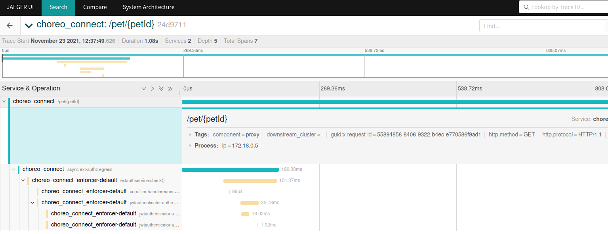
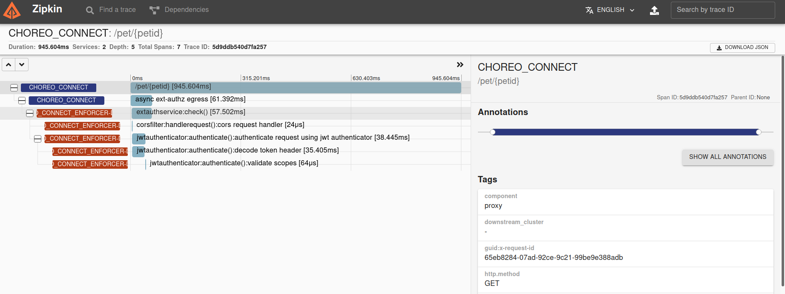
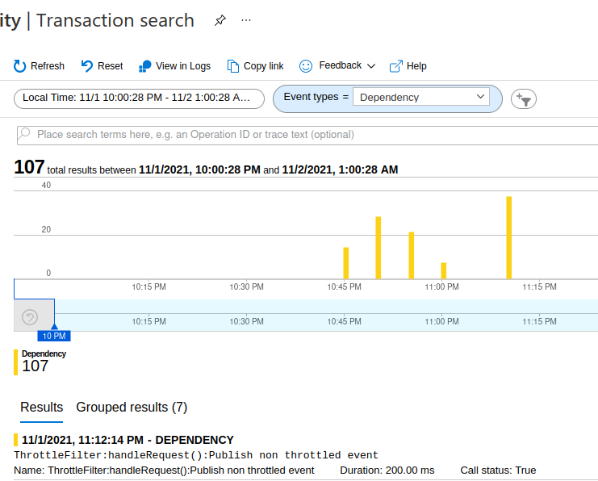
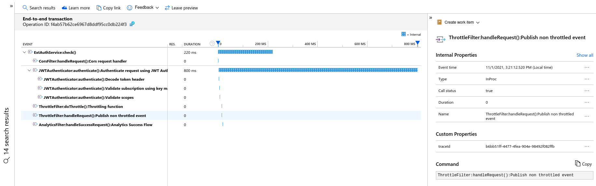
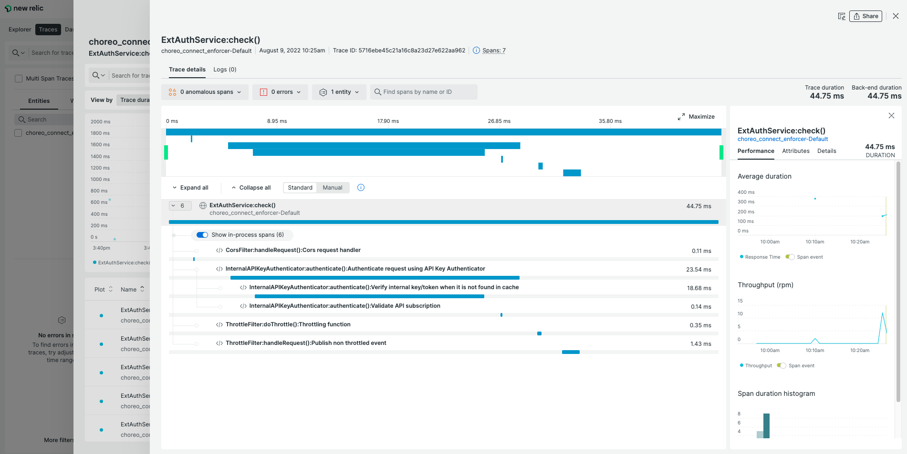

# Distributed Tracing

Performance issues, errors, and exceptions are unfortunate events that may occur in a production environment. In order to identify such an event, observing the production environment is essential. Choreo Connect provides the ability to observe how the requests are handled via an OpenTelemetry based distributed tracing implementation. By connecting Choreo Connect to one of the supported distributed tracing systems, users are able to easily debug and identify production issues.

Supported distributed tracing systems,

- Jaeger
- Zipkin
- Azure Application Insights
- OTLP gRPC supported telemetry backends

## Configure Distributed Tracing

:::note

If you are trying out tracing capabilities of Choreo Connect and do not have an actual deployment of Jaeger or Zipkin, you can start Choreo Connect together with Jaeger/Zipkin by adding one of the below containers to product docker-compose file.

<Tabs>
<TabItem value="tab-0" label="Jaeger">

```yaml
jaeger:
  image: jaegertracing/all-in-one:1.27
  environment:
    - COLLECTOR_ZIPKIN_HOST_PORT=9411
  ports:
    - "5775:5775"
    - "16686:16686"
    - "14268:14268"
```

</TabItem>
<TabItem value="tab-1" label="Zipkin">

```yaml
zipkin:
  image: openzipkin/zipkin
  container_name: zipkin
  ports:
    - "9411:9411"
```

</TabItem>
</Tabs>

:::

### Jaeger

When using **Jaeger** for tracing, the format is same as for **Zipkin** to publish spans from Choreo Connect. Therefore, the tracer type is configured as `zipkin`. Follow these steps to configure Choreo Connect with Jaeger.

1. Set following environment variable to `jaeger` container/pod.
    ```
    COLLECTOR_ZIPKIN_HOST_PORT=9411
    ```
1. 
Open the Choreo Connect configuration file according to the deployment type you are using.

<details>
<summary>Click here to see the configuration file location for your Choreo Connect deployment.</summary>

Navigate to the correct folder path and open the `config.toml` or `config-toml-configmap.yaml` file based on your Choreo Connect deployment.

| **Deployment** | **Mode**| **File name** | **Directory** |
|----------------|---------|---------------|---------------|
| Docker Compose |[Choreo Connect as a Standalone Gateway](../concepts/as-a-standalone-gateway.mdx)| `config.toml` | `<CHOREO-CONNECT_HOME>/docker-compose/choreo-connect/conf/` |
| Docker Compose |[Choreo Connect with WSO2 API Manager as a Control Plane](../concepts/apim-as-control-plane.mdx) | `config.toml` | `<CHOREO-CONNECT_HOME>/docker-compose/choreo-connect-with-apim/conf/` |
| Kubernetes |[Choreo Connect as a Standalone Gateway](../concepts/as-a-standalone-gateway.mdx)| `config-toml-configmap.yaml` | `<CHOREO-CONNECT_HOME>/k8s-artifacts/choreo-connect/` |
| Kubernetes |[Choreo Connect with WSO2 API Manager as a Control Plane](../concepts/apim-as-control-plane.mdx)| `config-toml-configmap.yaml` | `<CHOREO-CONNECT_HOME>/k8s-artifacts/choreo-connect-with-apim/` |

</details>


1. Add the following configuration.

    ```toml
    [tracing]
      enabled = true
      type = "zipkin"
      [tracing.configProperties]
        host = "jaeger"
        port = "9411"
        endpoint = "/api/v2/spans"
        instrumentationName = "CHOREO-CONNECT"
        maximumTracesPerSecond = "2"
        maxPathLength = "256"
    ``` 

1. Start Choreo Connect.
1. [Create and Deploy an API](../getting-started/quick-start-guide-docker-with-apim.mdx).
1. Invoke the newly created API and open Jaeger UI to view the traces. Navigate to `http://localhost:16686` if you have updated the Docker Compose file with an instance of Jaeger as mentioned at the beginning.

You will be able to browse through the request traces and expand each trace to view complete trace details.



### Zipkin

Follow these steps to configure WSO2 Choreo Connect with Zipkin.

1. 
Open the Choreo Connect configuration file according to the deployment type you are using.

<details>
<summary>Click here to see the configuration file location for your Choreo Connect deployment.</summary>

Navigate to the correct folder path and open the `config.toml` or `config-toml-configmap.yaml` file based on your Choreo Connect deployment.

| **Deployment** | **Mode**| **File name** | **Directory** |
|----------------|---------|---------------|---------------|
| Docker Compose |[Choreo Connect as a Standalone Gateway](../concepts/as-a-standalone-gateway.mdx)| `config.toml` | `<CHOREO-CONNECT_HOME>/docker-compose/choreo-connect/conf/` |
| Docker Compose |[Choreo Connect with WSO2 API Manager as a Control Plane](../concepts/apim-as-control-plane.mdx) | `config.toml` | `<CHOREO-CONNECT_HOME>/docker-compose/choreo-connect-with-apim/conf/` |
| Kubernetes |[Choreo Connect as a Standalone Gateway](../concepts/as-a-standalone-gateway.mdx)| `config-toml-configmap.yaml` | `<CHOREO-CONNECT_HOME>/k8s-artifacts/choreo-connect/` |
| Kubernetes |[Choreo Connect with WSO2 API Manager as a Control Plane](../concepts/apim-as-control-plane.mdx)| `config-toml-configmap.yaml` | `<CHOREO-CONNECT_HOME>/k8s-artifacts/choreo-connect-with-apim/` |

</details>


1. Add the following configuration.

    ```toml
    [tracing]
      enabled = true
      type = "zipkin"
      [tracing.configProperties]
        host = "zipkin"
        port = "9411"
        endpoint = "/api/v2/spans"
        instrumentationName = "CHOREO-CONNECT"
        maximumTracesPerSecond = "2"
        maxPathLength = "256"
    ``` 

1. Start Choreo Connect.
1. [Create and Deploy an API](/api-platform/api-manager/4.2.0/deploy-and-publish/deploy-on-gateway/choreo-connect/getting-started/quick-start-guide/quick-start-guide-docker-with-apim/).
1. Invoke the newly create API and open Zipkin UI to view the traces. Navigate to `http://localhost:9411` if you have updated the Docker Compose file with an instance of Zipkin as mentioned at the beginning. 
1. Filter traces by `serviceName=choreo_connect` query.

You will be able to see all traces. Detailed trace view will look like below.



### Azure Application Insights

Follow these steps to configure WSO2 Choreo Connect with Azure Application Insights.

1. First you need to obtain the `ConnectionString` from the Azure portal.
    * Log in to the Azure portal.
    * Copy the `Connection String` from the overview page of `Application Insights` resource. E.g., 
    ```
    InstrumentationKey=ab71943f-xxxx-xxxx-xxxx-fb2eb69ae11d;IngestionEndpoint=https://region.applicationinsights.azure.com/
    ```

1. 
Open the Choreo Connect configuration file according to the deployment type you are using.

<details>
<summary>Click here to see the configuration file location for your Choreo Connect deployment.</summary>

Navigate to the correct folder path and open the `config.toml` or `config-toml-configmap.yaml` file based on your Choreo Connect deployment.

| **Deployment** | **Mode**| **File name** | **Directory** |
|----------------|---------|---------------|---------------|
| Docker Compose |[Choreo Connect as a Standalone Gateway](../concepts/as-a-standalone-gateway.mdx)| `config.toml` | `<CHOREO-CONNECT_HOME>/docker-compose/choreo-connect/conf/` |
| Docker Compose |[Choreo Connect with WSO2 API Manager as a Control Plane](../concepts/apim-as-control-plane.mdx) | `config.toml` | `<CHOREO-CONNECT_HOME>/docker-compose/choreo-connect-with-apim/conf/` |
| Kubernetes |[Choreo Connect as a Standalone Gateway](../concepts/as-a-standalone-gateway.mdx)| `config-toml-configmap.yaml` | `<CHOREO-CONNECT_HOME>/k8s-artifacts/choreo-connect/` |
| Kubernetes |[Choreo Connect with WSO2 API Manager as a Control Plane](../concepts/apim-as-control-plane.mdx)| `config-toml-configmap.yaml` | `<CHOREO-CONNECT_HOME>/k8s-artifacts/choreo-connect-with-apim/` |

</details>


1. Add the following configuration.

    <Tabs>
    <TabItem value="tab-0" label="Configuration">

    ```toml
    [tracing]
      enabled = true
      type = "azure"
      [tracing.configProperties]
        connectionString = {APPLICATIONINSIGHTS_CONNECTION_STRING}
        instrumentationName = "CHOREO-CONNECT"
        maximumTracesPerSecond = "2"
    ```

    </TabItem>
    <TabItem value="tab-1" label="Example">

    ```toml
    [tracing]
      enabled = true
      type = "azure"
      [tracing.configProperties]
        connectionString = "InstrumentationKey=ab71943f-xxxx-xxxx-xxxx-fb2eb69ae11d;IngestionEndpoint=https://xxxxxx.applicationinsights.azure.com/"
        instrumentationName = "CHOREO-CONNECT"
        maximumTracesPerSecond = "2"
    ```

    </TabItem>
    </Tabs>

1. Start Choreo Connect.
1. [Create and Deploy an API](/api-platform/api-manager/4.2.0/deploy-and-publish/deploy-on-gateway/choreo-connect/getting-started/quick-start-guide/quick-start-guide-docker-with-apim/).
1. Invoke the newly create API.
1. Now open "Azure Application Insights" Trasaction search window and select `Dependency` for `Event types` filter  
    

You will be able to see all traces. Detailed trace view will look like below.



### OpenTelemetry protocol (OTLP)

 OTLP is a vendor agnostic protocol defined as a part of [OpenTelemetry](https://opentelemetry.io/) project to publish telemetry data to any telemetry backend that supports OTLP. Most of the open source and commercial telemetry backends have native OTLP support or provide OTLP support in the form of a separate distribution. Refer the [OpenTelemetry vendor support](https://opentelemetry.io/vendors/) documentation for more information.

#### Configure Choreo Connect to publish OTLP traces to a Jaeger backend

1. Update the Docker compose files with the following configuration to start a Jaeger service with OTLP gRPC collector enabled.

    <Tabs>
    <TabItem value="tab-0" label="Configuration">

    ```yaml
    jaeger:
      image: jaegertracing/all-in-one:1.37
      environment:
        - COLLECTOR_OTLP_ENABLED=true
      ports:
        - "16686:16686"
        - "4317:4317"
    ```

    </TabItem>
    </Tabs>

    :::warning

    Note that only Jaeger versions 1.35 and above support OTLP gRPC telemetry data collection. Also, it is required to set the environment variable `COLLECTOR_OTLP_ENABLED=true`.

    :::

1. 
Open the Choreo Connect configuration file according to the deployment type you are using.

<details>
<summary>Click here to see the configuration file location for your Choreo Connect deployment.</summary>

Navigate to the correct folder path and open the `config.toml` or `config-toml-configmap.yaml` file based on your Choreo Connect deployment.

| **Deployment** | **Mode**| **File name** | **Directory** |
|----------------|---------|---------------|---------------|
| Docker Compose |[Choreo Connect as a Standalone Gateway](../concepts/as-a-standalone-gateway.mdx)| `config.toml` | `<CHOREO-CONNECT_HOME>/docker-compose/choreo-connect/conf/` |
| Docker Compose |[Choreo Connect with WSO2 API Manager as a Control Plane](../concepts/apim-as-control-plane.mdx) | `config.toml` | `<CHOREO-CONNECT_HOME>/docker-compose/choreo-connect-with-apim/conf/` |
| Kubernetes |[Choreo Connect as a Standalone Gateway](../concepts/as-a-standalone-gateway.mdx)| `config-toml-configmap.yaml` | `<CHOREO-CONNECT_HOME>/k8s-artifacts/choreo-connect/` |
| Kubernetes |[Choreo Connect with WSO2 API Manager as a Control Plane](../concepts/apim-as-control-plane.mdx)| `config-toml-configmap.yaml` | `<CHOREO-CONNECT_HOME>/k8s-artifacts/choreo-connect-with-apim/` |


<Tabs>
<TabItem value="tab-0" label="Configuration">

```toml
[tracing]
  enabled = true
  type = "otlp"
  [tracing.configProperties]
    # maximum length of the request path to extract and include in the HttpUrl tag.
    maxPathLength = "256"
    # jaeger host
    host = "jaeger"
    # jaeger port for OTLP gRPC collector
    port = "4317"
    # library Name to be tagged in traces (`otel.library.name`).
    instrumentationName = "CHOREO-CONNECT"
    # maximum number of sampled traces per second string
    maximumTracesPerSecond = "2"
    # connection timeout for the otlp service
    connectionTimeout = "20"
    endpoint = "/api/v2/spans"
```

</TabItem>
</Tabs>

</details>

1. Start Choreo Connect.
1. [Create and Deploy an API](/api-platform/api-manager/4.2.0/deploy-and-publish/deploy-on-gateway/choreo-connect/getting-started/quick-start-guide/quick-start-guide-docker-with-apim/).
1. Invoke the newly created API and open Jaeger UI to view the traces. Navigate to `http://localhost:16686` if you have updated the Docker Compose file with an instance of Jaeger as given above.

You will be able to browse through the request traces and expand each trace to view complete trace details.

#### Configure Choreo Connect to publish OTLP traces to New Relic OTLP gRPC collector

1. Create an account in New Relic portal and generate a license key to publish traces. [New Relic OTLP guide](https://docs.newrelic.com/docs/more-integrations/open-source-telemetry-integrations/opentelemetry/opentelemetry-setup/)

1. 
Open the Choreo Connect configuration file according to the deployment type you are using.

<details>
<summary>Click here to see the configuration file location for your Choreo Connect deployment.</summary>

Navigate to the correct folder path and open the `config.toml` or `config-toml-configmap.yaml` file based on your Choreo Connect deployment.

| **Deployment** | **Mode**| **File name** | **Directory** |
|----------------|---------|---------------|---------------|
| Docker Compose |[Choreo Connect as a Standalone Gateway](../concepts/as-a-standalone-gateway.mdx)| `config.toml` | `<CHOREO-CONNECT_HOME>/docker-compose/choreo-connect/conf/` |
| Docker Compose |[Choreo Connect with WSO2 API Manager as a Control Plane](../concepts/apim-as-control-plane.mdx) | `config.toml` | `<CHOREO-CONNECT_HOME>/docker-compose/choreo-connect-with-apim/conf/` |
| Kubernetes |[Choreo Connect as a Standalone Gateway](../concepts/as-a-standalone-gateway.mdx)| `config-toml-configmap.yaml` | `<CHOREO-CONNECT_HOME>/k8s-artifacts/choreo-connect/` |
| Kubernetes |[Choreo Connect with WSO2 API Manager as a Control Plane](../concepts/apim-as-control-plane.mdx)| `config-toml-configmap.yaml` | `<CHOREO-CONNECT_HOME>/k8s-artifacts/choreo-connect-with-apim/` |


<Tabs>
<TabItem value="tab-0" label="Configuration">

```toml
[tracing]
  enabled = true
  type = "otlp"
  [tracing.configProperties]
    # maximum length of the request path to extract and include in the HttpUrl tag.
    maxPathLength = "256"
    # New Relic OTLP gRPC collector endpoint
    connectionString = "https://otlp.nr-data.net"
    # auth header name
    authHeaderName = "api-key"
    # auth header value
    authHeaderValue = "<INGEST_LICENSE_KEY>"
    # library Name to be tagged in traces (`otel.library.name`).
    instrumentationName = "CHOREO-CONNECT"
    # maximum number of sampled traces per second string
    maximumTracesPerSecond = "2"
    # connection timeout for the otlp service
    connectionTimeout = "20"
```

</TabItem>
<TabItem value="tab-1" label="Example">

```toml
[tracing]
  enabled = true
  type = "otlp"
  [tracing.configProperties]
    # maximum length of the request path to extract and include in the HttpUrl tag.
    maxPathLength = "256"
    # New Relic OTLP gRPC collector endpoint
    connectionString = "https://otlp.nr-data.net"
    # auth header name
    authHeaderName = "api-key"
    # auth header value
    authHeaderValue = "e8f478ae6d3c97f845e16b6cfba0ea5e95e3NRAL"
    # library Name to be tagged in traces (`otel.library.name`).
    instrumentationName = "CHOREO-CONNECT"
    # maximum number of sampled traces per second string
    maximumTracesPerSecond = "2"
    # connection timeout for the otlp service
    connectionTimeout = "20"
```

</TabItem>
</Tabs>

</details>

1. Start Choreo Connect.
1. [Create and Deploy an API](/api-platform/api-manager/4.2.0/deploy-and-publish/deploy-on-gateway/choreo-connect/getting-started/quick-start-guide/quick-start-guide-docker-with-apim/).
1. Invoke the newly created API and go to New Relic Tracing dashboard to view the traces.

You will be able to browse through the request traces and expand each trace to view complete trace details.



:::info

Similarly any telemetry backend that supports OTLP gRPC telemetry data collection can be used by setting up related values for `connectionString`, `authHeaderName` and `authHeaderValue`.

:::
