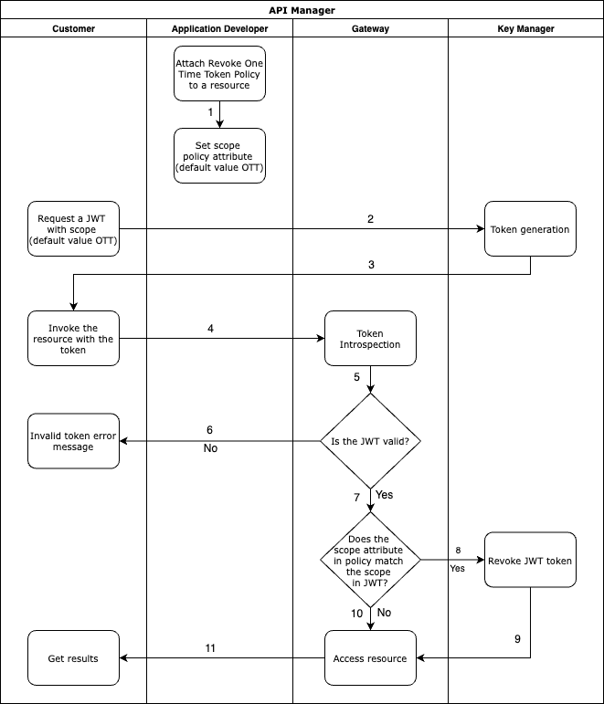
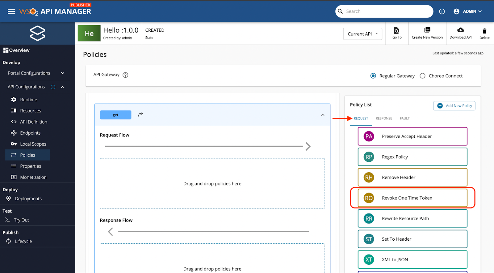

# Revoke One Time Tokens Policy

The [JWT access tokens](../api-security/oauth2/access-token-types/jwt-tokens.mdx) issued in the Gateway can be used to access the dedicated API resource as many times as the user needs. However, if the application developer wants to restrict this ability by providing only one chance to access the resource then One Time Token can be used. One Time Token is a JWT that will be revoked after single usage. This feature is **only available for JWT access tokens**.

## Workflow

The high level workflow of revocation of One Time Tokens is illustrated below.

[](../../../../assets/img/design/api-policies/revocation-workflow.png)

- You can attach the policy to the relevant resource that follows path 1.

- You can generate a one-time token and access the resource through the following flow.
    ```
        2 → 3 →  4 → 5 → 7 → 8 → 9 → 11
    ```

- If the same token is used for the API invocation after the first call, it will fail. It refers to the path below. 
    ```
        4 → 5 → 6
    ```

## Enabling One Time Tokens

This feature is only supported for the [Regular Gateway and the Request flow](overview.mdx). In order to enable this feature for the JWTs, two conditions need to be fulfilled.

1. Attach the ‘Revoke One Time Token’ policy to the required API resource
2. Add the relevant scope to the JWT

### Attach the ‘Revoke One Time Token’ policy

This step can be done by following the steps listed [here](attach-policy.mdx). The below diagram shows which policy to select. You can apply the policy to the whole API or a designated API resource depending on the use case. 

The policy has one attribute called scope. If a JWT in your application has the same scope that is mentioned in the policy, it will be identified as a One Time Token. The default value of the scope is “OTT”. However, this can be changed to any name the user prefers.

[](../../../../assets/_versions/4.2.0/img/design/api-policies/attach-policy.png)

### Add the relevant scope to the JWT

The second step is to add the scope that was defined in the scope attribute of the ‘Revoke One Time Token’ policy. Further information on adding scope to JWTs can be found [here](../api-security/oauth2/oauth2-scopes/fine-grained-access-control-with-oauth-scopes.mdx).
