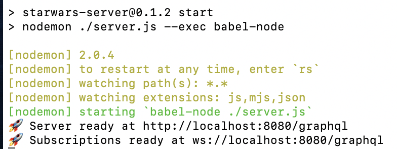
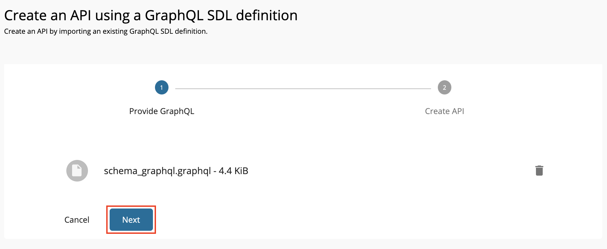
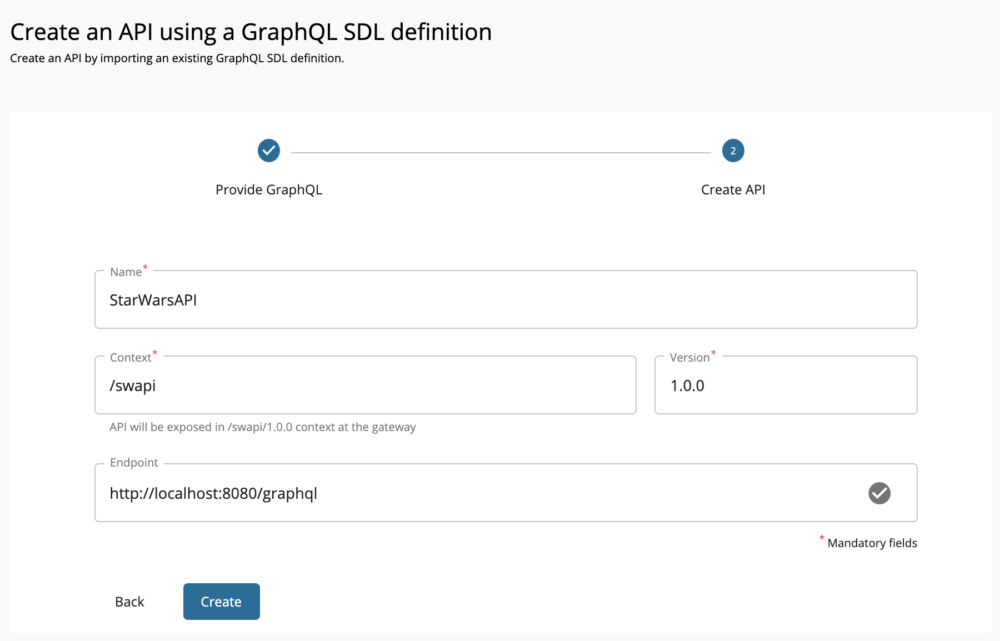
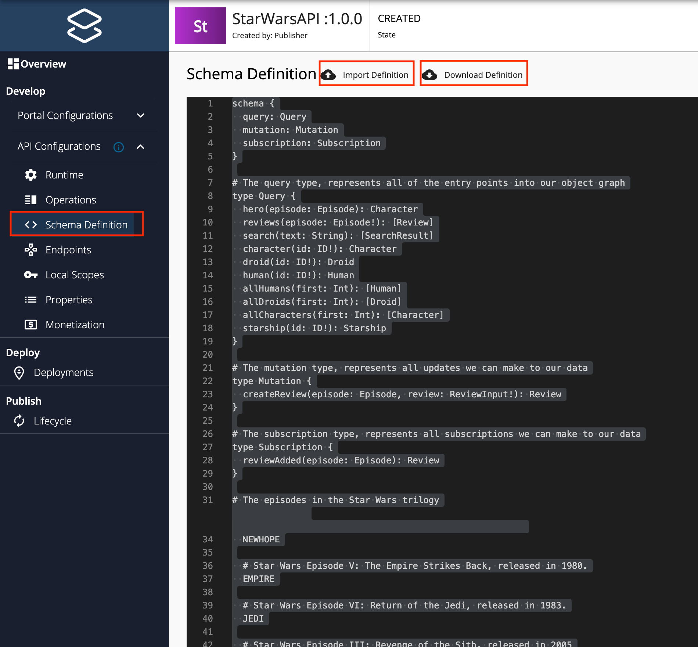
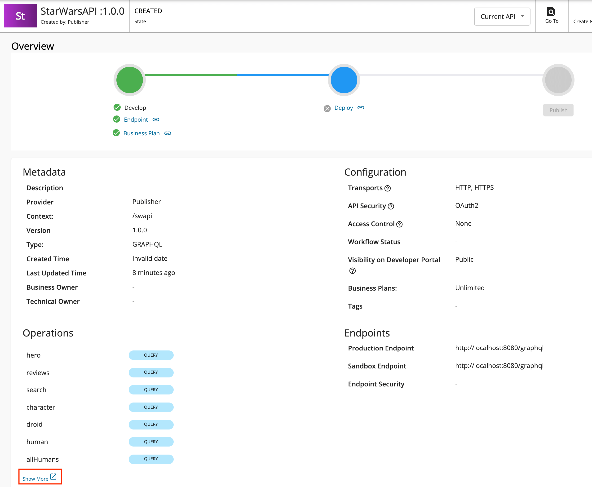
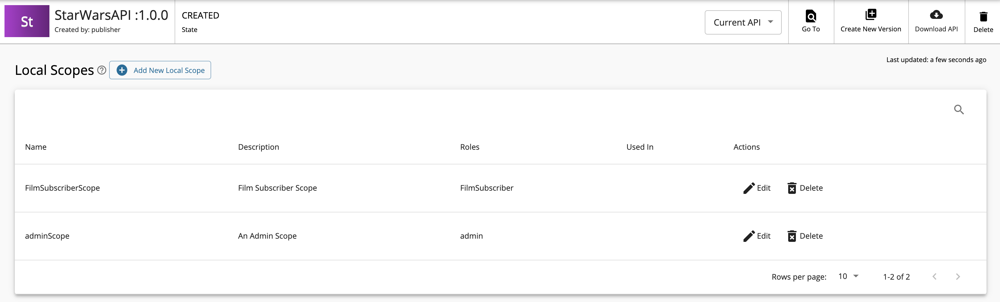
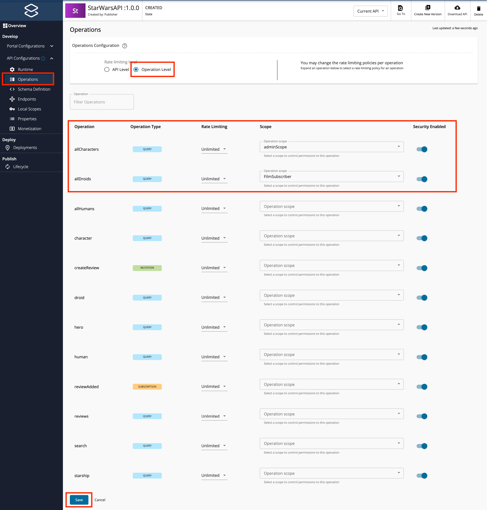
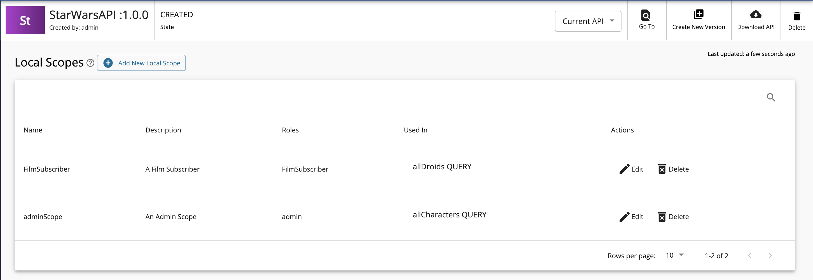

# Create a GraphQL API

GraphQL, which has been developed by Facebook, is a data query language for APIs. When using GraphQL, users can explicitly specify as to what data they need from an API. GraphQL APIs are an alternative to REST-based APIs. 

You can use a Schema Definition Language (SDL) schema to design a GraphQL API in WSO2 API Manager (WSO2 API-M) similar to creating SOAP APIs using WSDLs and developing REST APIs using OpenAPI Specifications (a.k.a. Swagger Definitions).

All GraphQL schemas generally have three operation root types, which are namely query, mutation, and subscription. Therefore, every request against a GraphQL endpoint of a GraphQL server should have a payload starting with any one of the root types, including its related operation name. You can manage the security, authorization, and rate limiting aspect of each operation based on its operation name. 

:::note

GraphQL client supports only `graphql-transport-ws` protocol but the Gateway supports both the `graphql-transport-ws` and `graphql-ws` protocols.

:::

Follow the instructions below to design a GraphQL API.

### Create a GraphQL API


<Steps>

### Start the GraphQL backend server {/* #step-1---start-the-graphql-backend-server */}

Let's use the Star Wars sample backend server as the backend for the GraphQL API.

1. Clone the [WSO2 API Manager Samples](https://github.com/wso2/samples-apim) repository.

    ```
    git clone https://github.com/wso2/samples-apim

    ```

2. Navigate to `graphql-backend` directory.

    ```
    cd samples-apim/graphql-backend
    ```

3. Run `npm install` to install the necessary node modules.

4. Run `npm start` to start the server.

    Once the above steps are done, the Star Wars server will be running on `http://localhost:8080`.

    [](../../../../assets/img/learn/cli-output.png)

    You can use `http://localhost:8080/graphql` as the endpoint when creating the GraphQL API.

### Design a GraphQL API {/* #step-2---design-a-graphql-api */}

1. Sign in to the API Publisher Portal.
   
    `https://<hostname>:9443/publisher` 
   
    Example: `https://localhost:9443/publisher`

    Let's use `admin` as the username and password to sign in.

2. Click **Create API** and then click **Import GraphQL SDL**.

     [](../../../../assets/_versions/4.2.0/img/learn/create-graphql-schema-option.png)

3. Import the schema by dragging and dropping the file or by uploading the file, and click **Next**.

       Let's use the [StarWarsAPI schema definition](../../../../assets/attachments/learn/schema_graphql.graphql) to create the schema file. 

       <div className={"admonition note"}><p className={"admonition-title"}>{"Note"}</p><ul><li><p>{"You need to define the SDL Schema based on the "}[{"GraphQL schema design best practices"}](https://graphql.org/learn/best-practices/){"."}</p></li><li>{"The file extension can be either "}<code>{".graphql"}</code>{", "}<code>{".txt"}</code>{", or "}<code>{".json"}</code>{"."}</li><li>{"The file name can be any name, which is based on your preference."}</li></ul></div>

     [](../../../../assets/img/learn/import-graphql-schema-via-file.png)

4. Enter the GraphQL API related details and click **Create**.
    
    Let's create an API named "StarWarsAPI" using the following sample data.

      <table><thead><tr className={"header"}><th><div><div><b>{"Field"}</b></div></div></th><th><div><div><b>{"Description"}</b></div></div></th></tr></thead><tbody><tr><td><p>{"Name"}</p></td><td><p>{"StarWarsAPI"}</p></td></tr><tr><td><p>{"Context"}</p></td><td><p><code>{"/swapi"}</code></p></td></tr><tr><td><p>{"Version"}</p></td><td><p>{"1.0.0"}</p></td></tr><tr><td><p>{"Endpoint"}</p></td><td><p>{"http://localhost:8080/graphql"}</p><p></p><ul><li>{"When you provide the HTTP URL as the backend endpoint, WSO2 API-M will internally derive the corresponding WebSocket URL "}<code>{"ws://localhost:8080/graphql"}</code>{"."}</li><li>{"Thereafter, the API Gateway will use this WebSocket URL as the backend subscription endpoint of the GraphQL API."}</li></ul><p></p></td></tr></tbody></table>

       [](../../../../assets/img/learn/create-graphql-api-details.png)

5. Optionally, modify the existing GraphQL schema definition.

    1. Navigate to **Develop**, **API Configurations**, and click **Schema Definition**.

    2. Click **Download Definition**.

         The existing GraphQL API schema gets downloaded.

         [](../../../../assets/img/learn/download-schema-definition.png)

    3. Update the schema definition as required.

    4. Click **Import Definition** to import the updated schema definition.

6. Update the GraphQL API operations as required.

    Instead of resources, which get populated for REST APIs, operations get populated for GraphQL APIs.

    1. Click **Show More** under the **Operations** section in the **Overview** page to navigate to the operations page.

         [](../../../../assets/img/learn/operations.png)  
     
    2. Update the operations as required.
         
        The Publisher can add Rate Limiting policies, scopes and enable/disable security for each of the GraphQL API operations.

        1. **Create scopes**.

            Repeat the following sub-steps to create two scopes named `adminScope` and `FilmSubscriberScope`.

            1. Click **Local Scopes**, and then click **Create Scopes**.

                [](../../../../assets/img/learn/add-scope.png)

            2. Enter the required details.

                   <div className={"admonition note"}><p className={"admonition-title"}>{"Note"}</p><p></p><ul><li>{"The role that you enter "}<b>{"should be a valid role that already exists in WSO2 API Manager"}</b>{". Make sure to assign the role to the user."}</li><li>{"For more information, see "}<a href={"https://apim.docs.wso2.com/en/latest/administer/managing-users-and-roles/managing-users"}>{"Adding Users"}</a>{" and "}<a href={"https://apim.docs.wso2.com/en/latest/administer/managing-users-and-roles/managing-user-roles"}>{"Adding User Roles"}</a>{"."}</li></ul><p></p></div>
                  
                   Enter the following details for this example scenario.

                   | **Name** | **Role** |
                   |----------|----------|
                   | `FilmSubscriber` | `FilmSubscriber` |
                   | `adminScope` | `admin` |

                   [](../../../../assets/img/learn/create-scope.png)

            3. Press `Enter` to add each role. 

            4. Click **Save**.

                 [](../../../../assets/img/learn/starwars-scope-list.png)

         2. **Define the operation level configurations**.

            1. Click **Operations**.
            
            2. Click **Operation Level** to apply Rate Limiting for operations.

                [](../../../../assets/img/learn/update-operations.png) 

            3. Select a Rate Limiting Policy, scope, and enable or disable security for each of the operations. 

                   Apply the following scopes to the respective operations.

                   | **Operation** | **Scope** |
                   |----------|----------|
                   | `allDroids` |`FilmSubscriber` |
                   | `allCharacters` |`adminScope` |
            
            4. Click **Save**.

                 If you check the list of scopes, it should appear as follows:

                 [](../../../../assets/img/learn/scope-list.png)


:::note

For more information on the payload, see [GraphQL operations](#graphql-operations).

:::

Now, you have successfully created and configured a GraphQL API. 

Next, let's deploy your API in the [WSO2 API Gateway](../../deploy-and-publish/deploy-on-gateway/deploy-api/deploy-an-api.mdx) and [Publish your API](../../deploy-and-publish/publish-on-dev-portal/publish-an-api.mdx).

</Steps>

### GraphQL operations

The following sub-sections explain as to how authorization, security, and throttling affect API operations.

#### Authorization for GraphQL operations
A scope acts as a limiting factor on what API resources can be accessed using an access token and thereby defines the authorization aspect for API requests.

- **Authorization for a single operation**

    When a query has a single operation, the access token should include the scope that is attached to that specific operation to be able to invoke the API.

- **Authorization for multiple operations**
 
    When a query has multiple operations, the access token should include all the scopes that are attached to the operations that correspond to that specific API to be able to invoke the API.

#### Security for GraphQL operations
Security can be enabled or disabled for GraphQL operations. Security is enabled for GraphQL operations by default.

- **Security for a single operation**

    When a query has an operation that has security enabled, the users need to enter their credentials to invoke the respective API. However, when security is disabled for the operation, the users can invoke the respective API without entering their credentials.

- **Security for multiple operations**
  
    The API request takes into consideration the security configurations of all the operations that belong to the API. When a query has security enabled for one of the operations that belong to a specific API, then security is automatically applied for all the operations. Therefore, in such cases, users have to use their credentials when invoking that respective API.

#### Rate limiting for GraphQL operations
Rate limiting is set to unlimited, and thereby disabled by default. 

- **Rate limiting for a single operation**

    When a query has an operation with a rate limiting policy applied to it, the respective rate limiting policy is taken into account to rate limit the request when it exceeds the desired limit. 

- **Rate limiting for multiple operations**

    WSO2 API Manager checks all the operation related rate limiting policies when determining the overall rate limit. When the requests exceed the minimum rate limit, which corresponds to the operations in the query, they will be throttled out.
   
## See Also

Learn more on the concepts that you need to know when creating a GraphQL API:

-   [Endpoints](../endpoints/endpoint-types.mdx)
-   [API Security](../api-security/api-authentication/secure-apis-using-oauth2-tokens.mdx)
-   [Rate Limiting](../rate-limiting/graphql-api/overview-query-limits-for-graphql.mdx)
-   [Life Cycle Management](../lifecycle-management/api-lifecycle.mdx)
-   [API Monetization](../api-monetization/monetizing-an-api.mdx)
-   [API Visibility](../advanced-topics/control-api-visibility-and-subscription-availability-in-developer-portal.mdx)
-   [API Documentation](../api-documentation/add-api-documentation.mdx)
-   [Custom Properties](adding-custom-properties-to-apis.mdx)

- Try out the tutorial on <a href="/api-platform/api-manager/4.2.0/tutorials/create-and-publish-a-graphql-api">Creating and Publishing a GraphQL API</a>.
