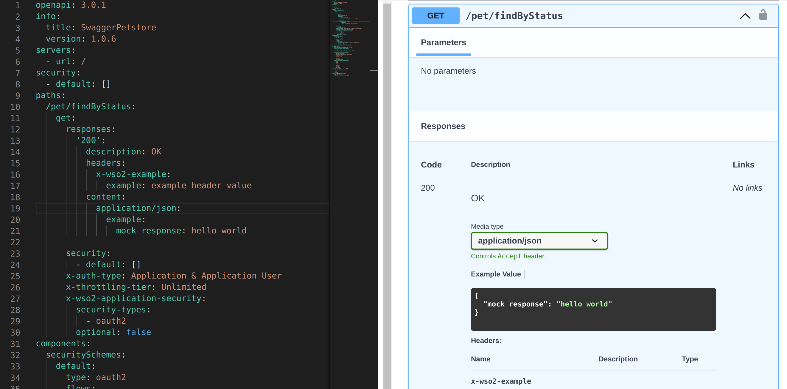
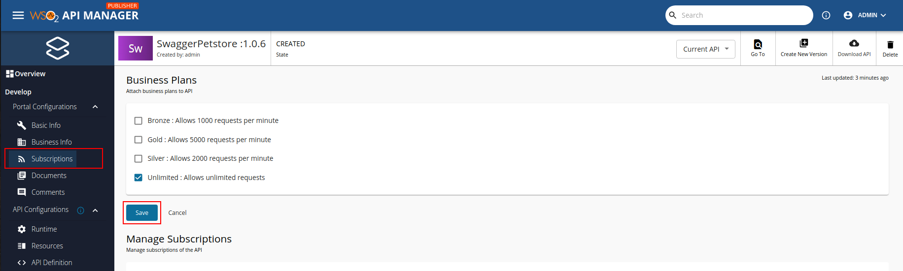
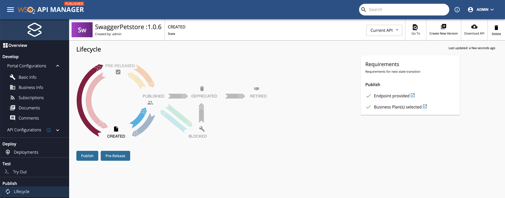
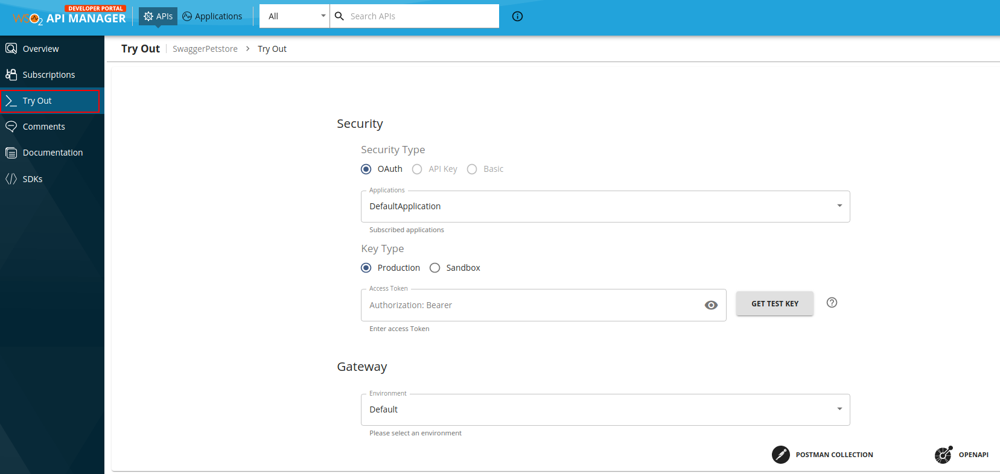
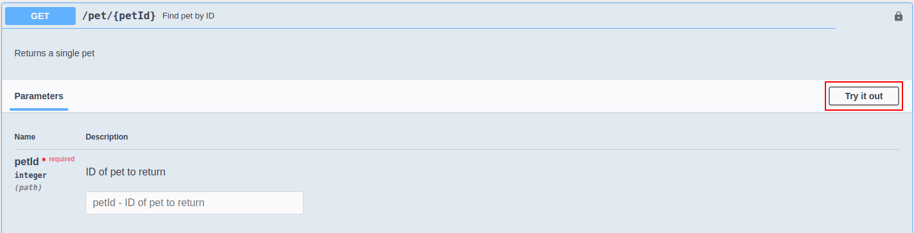

# Mock Implementation with Choreo Connect

This Mock Implementation allows you to generate mock responses based on examples provided in the OpenAPI specification and directly get the response. For non-default cases, the exact response can be requested using the `Prefer` and `Accept` headers.

:::warning

This is currently supported only when [Choreo Connect](../../deploy-and-publish/deploy-on-gateway/choreo-connect/getting-started/choreo-connect-overview.mdx) is used as the Gateway.

:::

<Steps>

## Create the interface of the API {/* #step-1---create-the-interface-of-the-api */}

Follow the instructions below to enable mock response generation based on the OpenAPI specification:

1. Start the WSO2 API Manager server with Choreo Connect as the gateway.

2. Open API Publisher in the browser and create a REST API with the following values. 

    | **Field**    | **Value**                        |
    |----------|-------------------------------------|
    | Name     | SwaggerPetstore                     |
    | Context  | /v3                                 |
    | Version  | 1.0.6                               |
    | Endpoint | Leave the endpoint field empty. |

## Implement the API {/* #step-2---implement-the-api */}

<Steps>

### Update the OpenAPI Specification {/* #step-21---update-the-openapi-specification */}

1. Navigate to **API Definition** under **API Configurations** to view the OpenAPI specification.

2. Click **edit** to add mock examples to required resources.

    [](../../../../assets/img/learn/prototype-api/mock-impl-edit-api-definition.png)

    Replace the default resources with the resource definitions given below.

3. Add response examples to OpenAPI Specification.    

    Add the following resource which includes an response example. For HTTP status specific examples and content type specific responses, have a look at [Mock Implementation with OpenAPI examples](#mock-implementation-with-openapi-examples).

    ```yaml
    /pet/{petId}:
      get:
        responses:
          '200':
            description: OK
            headers:
              x-wso2-example:
                example: example header value
            content:
              application/json:
                example:
                  mock response: hello world
    ```


4. After adding examples to the OpenAPI specification, remember to click **Update Content** and **Save**.

### Change the Endpoint Type {/* #step-22---change-the-endpoint-type */}

6. Navigate to **Endpoints** under **API Configurations**.

7. Select **Mock Implementation** as the endpoint type by clicking **Add**. 

8. Select Choreo Connect as the gateway type. 

9. Click **proceed** if a dialog box appears to disregard "mock endpoint implementation scripts". 

10. View the mock examples that would be returned for each resource. If you need to modify the examples, you have to edit the API definition as mentioned before.

11. Click **Save** to enable mock implementation with OAS examples.

</Steps>


## Deploy the API {/* #step-3---deploy-the-api */}

[Deploy the API](../../deploy-and-publish/deploy-on-gateway/deploy-api/deploy-an-api.mdx) in order to make the API available in the respective Gateway.

## Test the API via the Publisher {/* #step-4---test-the-api-via-the-publisher */}

Once deployed to the Gateway, you can [test the REST type APIs via the Publisher Portal](../../../design/create-api/create-rest-api/test-a-rest-api).

## Publish the API as a Prototype {/* #step-5---publish-the-api-as-a-prototype */}

:::warning


:::
		- By default, from WSO2 API Manager 4.1.0 onwards, security is enabled for all the resources of the Prototype API. As a result, you need a subscription to invoke the API.
    - Skip this step if you have [disabled security](../../../design/api-security/api-authentication/disable-security/) for all the resources in the API.

		Follow the instructions below to attach Business Plans to the API.

		1. Navigate to **Portal Configurations** and click **Subscriptions**.

		2. Select the required Business Plans and click **Save**.

    [](../../../../assets/img/learn/prototype-api/create-prototype-api-subscription.png)

Follow the instructions below to publish the API to the Developer Portal as a Prototype:

1. Navigate to the **Lifecycle** page listed under **Publish**.  
    
    For both options, **When creating an API with the Mock Implementation** and **When creating an API with an actual backend URL**, you will have the option to either promote your API to the **PRE-RELEASED** state or to the **PUBLISHED** state in the API lifecycle.

    [](../../../../assets/img/learn/prototype-api/backend-url-lifecycle.png)

2. Click **Pre-Release** to publish the API as a Prototype API to the Developer Portal.

## Invoke the API {/* #step-6---invoke-the-api */}

1. Click **View in Dev Portal** to navigate to the Developer Portal.

    :::note

    If you have enabled security for the prototype API, follow the [Subscribe to an API](../../consume/manage-subscription/subscribe-to-an-api.mdx) guide to subscribe and obtain an access token to invoke the prototype API.

    :::

2. Click **Try Out** to navigate to the API Console.

3. If you have enabled security, you can either use the access token that you got from the above step or use the **GET TEST KEY** option.
     
    :::note

    Skip this step if you have [disabled security for the API](../api-security/api-authentication/disable-security.mdx), and leave the **Access Token** field empty.

    :::

     [](../../../../assets/_versions/4.2.0/img/learn/prototype-api/create-prototype-api-dev-portal-tryout-petstore.png)

4. Expand the method you just updated with the mock response and click **Try it out**.

     [](../../../../assets/img/learn/prototype-api/create-api-prototype-tryout-click.png)

5. Click **Execute** to invoke the API.

    - You can use the `Prefer` header and the `Accept` header to get different examples for a resource if multiple examples were defined for the resource.

    - Use the `Prefer` header to specify which `code` and/or `example` should be returned as the response for the mock request.

    - Check **Example** in the section given below on how to invoke with `Prefer` header.

</Steps>

## Mock Implementation with OpenAPI examples

:::note

With OpenAPI 3.0 you can provide the expected payloads and headers in the following formats. 

:::

  **Single Example for an Operation**

<Tabs>
<TabItem value="tab-0" label="Format">

```yaml
<resource path>:
  <operation>:
    responses:
      <response code>:
        description: <description>
        headers:
          <header>:
            example: <header example value>
        content:
          <media type>:
            example: <example>
```

</TabItem>
<TabItem value="tab-1" label="Example">

```yaml
/pet/findByStatus:
  get:
    responses:
      '200':
        description: OK
        headers:
          x-wso2-example:
            example: example header value
        content:
          application/json:
            example:
              mock response: hello world
```

</TabItem>
</Tabs>

  **Multiple Examples for an Operation**

<Tabs>
<TabItem value="tab-0" label="Format">

```yaml
<resource path>:
  <operation>:
    responses:
      <response code>:
        description: <description>
        headers:
          <header>:
            example: <header example value>
        content:
          <media type>:
            examples: 
              <example reference>
                value: <example>
```

</TabItem>
<TabItem value="tab-1" label="Example">

```yaml
/pet/findByStatus:
  get:
    responses:
      50X:
        description: Service Unavailable
        headers:
          x-wso2-example:
            example: example header value
        content:
          application/json:
            examples:
              ref1:
                value:
                  mock response: hello world
              ref2:
                value:
                  mock response: Welcome
      default:
        description: default response
        headers:
          x-wso2-example:
            example: default header value
        content:
          application/json:
            examples:
              ref1:
                value:
                  mock response: default hello world
              ref2:
                value:
                  mock response: default Welcome
```

</TabItem>
</Tabs>

  | **Place Holder** | **Usage** |
  |-----------------|--------------------|
  | `response code` | Can be 3 digit status code or a wildcard format like 2XX. `default` can be also provided instead of a particular status code. |   
  | `header` | Header name. You can provide multiple headers similarly under `headers`. |   
  | `media type` | Mock response content type. Provide allowed content types for the resource. When accept header is presented in a request, Choreo Connect will return the content which suited to accepted media type among them. |   
  | `example` | Provide the content body as a simple string or as an object. If an object is given as the `example`, it will be parsed to JSON format. |   

  

  For more information on OpenAPI response body example specifications, visit [Request and Response Body Examples](https://swagger.io/docs/specification/adding-examples/).

:::note

You can find a complete OpenAPI example for Mock Implementation here: [OpenAPI for Mock Implementation](https://github.com/wso2/product-microgateway/blob/main/samples/openAPI-definitions/mock-impl-sample.yaml)

If you take the example in **Multiple Examples for an Operation** mentioned previously and update the OpenAPI definition with it, you can use `Prefer` header and `Accept` header to get different examples for same resource operation.
  Using `Prefer` header you can specify which `code` and/or `example` should be returned as the response.

Invoking `GET` for `/pet/findByStatus` will return the default example as given below.

<Tabs>
<TabItem value="tab-0" label="Request">

```bash
curl -X GET https://localhost:9095/v3/1.0.6/pet/findByStatus
```

</TabItem>
<TabItem value="tab-1" label="Response">

```bash
< HTTP/1.1 200 OK
< content-type: application/json
< x-wso2-example: "default header value"
< 
{"mock response":"default hello world"}
```

</TabItem>
</Tabs>

Invoking `GET` for `/pet/findByStatus` with the header `Prefer` will return the matched example for the particular code and the example reference.

<Tabs>
<TabItem value="tab-0" label="Request">

```bash
curl -H 'Prefer: code=503, example=ref2' -X GET https://localhost:9095/v3/1.0.6/pet/findByStatus
```

</TabItem>
<TabItem value="tab-1" label="Response">

```bash
< HTTP/1.1 503 Service Unavailable
< content-type: application/json
< x-wso2-example: "example header value"
< 
{"mock response":"Welcome"}
```

</TabItem>
</Tabs>

:::

  

:::tip[Behavioral Characteristics]


The following are the behavioral characteristics of Mock Implementation with Choreo Connect.

**Preferred Status Code in the Prefer Header**   

- If the request has a valid integer value as the **code** preference, 
    Choreo Connect picks the most matched response example from the OpenAPI specification by checking the exact codes and
    wild cards matches. Status code of the response will be same as the code preference given in the request. 
      
- If the request does not have a code preference,
    Choreo Connect will check for examples under `default` responses. If no default responses are defined, 
    then picks a one out of the response examples. 
      
**Accept Type in the Accept Header** 
      
- If the request has accept-types,
    Choreo connect will pick examples defined under a matching media type. 
      
- If the request does not have accept-types, 
    Choreo connect will check for examples with 'application/json' as the media type. If there are no examples for 'application/json', then picks one out of available media-type examples.

**Preference not found** or **Example not provided**
        
- If the request has an example preference provided with the `Prefer` or `Accept` header, but does not match any of the cases above or has no matching examples, then `501, Not Implemented` status code would be returned with `900871` error code. The same error response will be returned if the invoked resource does not contain any mock response examples in the OpenAPI definition.

:::


## See also

<LinkCards>

- [Deploy a REST API with a Mock Implementation in Choreo Connect](../../deploy-and-publish/deploy-on-gateway/choreo-connect/deploy-api/deploy-rest-api-with-mock-impl.mdx)    
- [Expose an existing backend implementation as a Pre-Released API](backend-url-prototype-api.mdx) 

</LinkCards>
