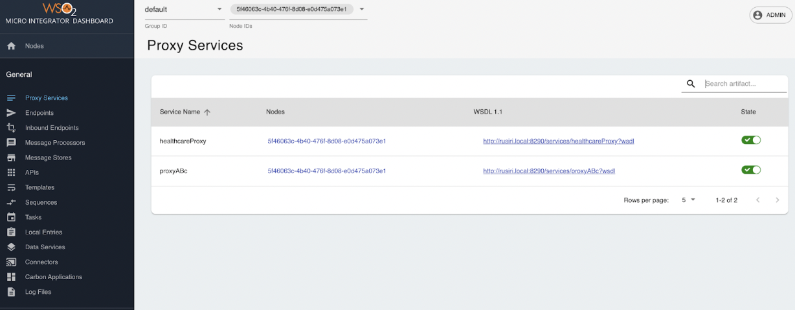
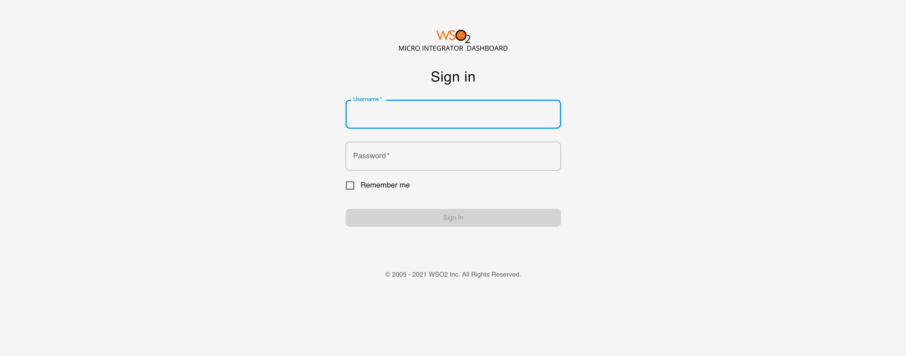

# Monitoring MI Artifacts and Logs

The Micro Integrator (MI) dashboard monitors the MI instances in a deployment. This can be a single MI instance or multiple MI instances in a group (cluster). It provides a graphical view of the integration artifacts that are deployed in the MI instances. You can also perform various management 
and administration tasks using the dashboard. 

The dashboard communicates with the management APIs of each Micro Integrator instance in the group (cluster) to get and manipulate data.

## Capabilities of the MI dashboard

You can use the dashboard to perform the following administration tasks related to your Micro Integrator deployment:

:::tip

You can search for certain artifacts using the specific name of the artifact if there are many such items in the list.

    

:::

-   <b>View the MI servers in the deployment</b>

    View basic information of each server node.

-   <b>View integration artifacts deployed in a group</b>

    View details of the artifacts deployed in a cluster or group of Micro Integrator instances.

-   <b>Identify the MI servers where a specified artifact is deployed</b>

    View the MI server instances where each artifact is deployed.

-   <b>Update deployed artifacts</b>

    :::note

    When you update an artifact, only the specified MI instance will be updated. Cluster-wide updates are not available with the dashboard.

    :::

    You can activate/deactivate the following artifacts from the dashboard: <i>Proxy Services</i>, <i>Endpoints</i>, and <i>Message Processors</i>.

    You can enable/disable tracing for the following artifacts: <i>Proxy Services</i>, <i>Endpoints</i>, <i>APIs</i> <i>Sequences</i> and <i>Inbound Endpoints</i>.

-   <b>View registry resources</b>

    You can view content, properties, and metadata of each registry resource.

-   <b>View logs</b>

    You can view the log files generated for each Micro Integrator instance of the cluster/group.

-   <b>View, update, and add loggers</b>

    This page can be accessed by users with admin rights only. You can view log configurations of each instance and update the log level. You can update the log levels on a single node or apply the change to the entire cluster/group as well. Furthermore, you can add new loggers, which will be applied to the entire cluster/group.

-   <b>Manage users</b>

    This page can be accessed by users with admin rights only. You can view details of users stored in the [external user store](../../install-and-setup/setup/mi-setup/user_stores/managing_users.mdx). You can also add new users to the specified cluster/group.

## Using the MI Dashboard

Follow the steps given below to get started with the Micro Integrator Dashboard.

<Steps>

### Download the MI Dashboard {/* #step-1---download-the-mi-dashboard */}

Download the binary distribution of the product, and then follow the instructions to start the Micro Integrator and the dashboard.

-   [Install the Micro Integrator](../../install-and-setup/install/installing-the-product/installing-mi.mdx).
-   [Install the Micro Integrator Dashboard](../../install-and-setup/install/installing-the-product/installing-mi-dashboard.mdx).

### Configure the MI servers {/* #step-2---configure-the-mi-servers */}

Follow the steps given below to configure the MI servers to publish data to the dashboard.

1.  To connect the MI servers with the dashboard, add the following configuration to the `deployment.toml` file (stored in the `<MI_HOME>/conf/` folder) of each server instance.

    ```toml
    [dashboard_config]
    dashboard_url = "https://{hostname/ip}:{port}/dashboard/api/"
    heartbeat_interval = 5
    group_id = "mi_dev"
    node_id = "dev_node_2"
    ```
    
    If the Micro Integrator server is deployed in a Kubernetes environment, add the following configuration to the `deployment.toml` file. 

    <br />Limitation: When there are replicas in the deployment, the write operations will not work properly.

    If communicating via Ingress, use the following configuration:
    ```toml
    dashboard_url = "https://{hostname/ip}:{port}/dashboard/api/"
    management_hostname = "<INGRESS_HOSTNAME>"
    ```
    
    If communicating via Service instead, use the following configuration:
    ```toml
    dashboard_url = "https://{hostname/ip}:{port}/dashboard/api/"
    management_hostname = "<SERVICE_NAME>"
    management_port = <SERVICE_PORT>
    ```

    <table>
        <tr>
            <th>
                dashboard_url
            </th>
            <td>
                <b>Required</b>. This is the URL to access dashboard server. Replace the hostname/IP and port (default - 9743) with relevant values from your environment.
            </td>
        </tr>
        <tr>
            <th>
                heartbeat_interval
            </th>
            <td>
                <b>Optional</b>. The time interval (in seconds) between two heartbeats sent from the Micro Integrator to the dashboard server. By default, the heartbeat_interval is set to `5`. 
            </td>
        </tr>
        <tr>
            <th>
                group_id
            </th>
            <td>
                <b>Optional</b>. In a clustered deployment, the group ID should be the same in all Micro Integrator Instances. 
                The dashboard displays information from one group at a time. By default, the group_id is set to `default`. 
            </td>
        </tr>
        <tr>
            <th>
                node_id
            </th>
            <td>
                <b>Optional</b>. By default, in a clustered deployment, the relevant `node_id` is used as this configuration. For more information about the cluster node ID, see the instructions on <a href="/api-platform/api-manager/4.2.0/install-and-setup/setup/mi-setup/deployment/deploying_wso2_ei/#node-id">configuring an MI cluster</a>. In a non-clustered deployment, a random UUID is used if the `node_id` is not set for this configuration.
            </td>
        </tr>
        <tr>
            <th>
                management_hostname
            </th>
            <td>
                <b>Required if MI server is deployed in a Kubernetes environment</b>. Hostname for the Micro Integrator management endpoint.
            </td>
        </tr>
        <tr>
            <th>
                management_port
            </th>
            <td>
                <b>Optional</b>. Port of the Micro Integrator management endpoint.
            </td>
        </tr>
    </table> 

2.  **Optionally**, configure the [Micro Integrator user store](../../install-and-setup/setup/mi-setup/user_stores/setting_up_a_userstore.mdx).

    :::tip

    Note the following about your user store configurations.

    -   The user credentials for signing in to the dashboard should be stored in your user store. This can be the default **file-based user store** or an **external LDAP/RDBMS** user store.
    -   [User management](../../install-and-setup/setup/mi-setup/user_stores/managing_users.mdx) is possible only if you have an RDBMS or LDAP user store for your Micro Integrator.
    -   If you have an [external RDBMS user store](../../install-and-setup/setup/mi-setup/user_stores/setting_up_a_userstore.mdx#configuring-an-rdbms-user-store), be sure that the RDBMS driver is correctly added to the `<MI_HOME>/lib` folder. You will not be able to sign in without the driver.

    :::

3.  Regardless of the user who logs in, the dashboard uses the user configured in its `deployment.toml` to fetch the data to the dashboard server. Then the dashboard renders these data in the UI according to logged-in user. Hence, configure the super admin user credentials in the user store as mentioned below in the `deployment.toml` file (stored in the `<MI-DASHBOARD_HOME>/conf/` folder).

    ```toml
    [mi_user_store]
    username = "admin"
    password = "admin"
    ```
    
### Start the MI Dashboard {/* #step-3---start-the-mi-dashboard */}

Follow the steps given below.

1.    Open a terminal and navigate to the `<MI-DASHBOARD_HOME>/bin` folder.
2.    Execute one of the commands given below.

    <Tabs>
    <TabItem value="tab-0" label="On MacOS/Linux">

    ```bash
    ./dashboard.sh
    ```

    </TabItem>
    <TabItem value="tab-1" label="On Windows">

    ```bash
    dashboard.bat
    ```

    </TabItem>
    </Tabs>
      
### Start the MI servers {/* #step-4---start-the-mi-servers */}

Follow the steps given below.

1.    Open a terminal and navigate to the `<MI_HOME>/bin` folder.
2.    Execute one of the commands given below.

    <Tabs>
    <TabItem value="tab-0" label="On MacOS/Linux">

    ```bash
    ./micro-integrator.sh
    ```

    </TabItem>
    <TabItem value="tab-1" label="On Windows">

    ```bash
    micro-integrator.bat
    ```

    </TabItem>
    </Tabs>
      
### Sign in to the Dashboard {/* #step-5---sign-in-to-the-dashboard */}

Once you have [set up and started the dashboard](#setting-up-the-dashboard), you can access the dashboard URL.

<Prerequisites title="Before you begin">

Be sure to have at least one Micro Integrator server connected to the dashboard before attempting to sign in to it. This can be verified by checking the presence of the following log.
```
New node <node_id> in group : <group_id> is registered. Inserting heartbeat information
```

</Prerequisites>
  
1.  Copy the following dashboard URL to your browser:

    ```bash
    https://localhost:9743/login
    ```

2.  Enter the following details to sign in.

    

    <table>
        <tr>
            <th>
                Username
            </th>
            <td>
                The user name to sign in.
                <b>Note</b>: This should be a valid username that is saved in the Micro Integrator server's user store. By default, the 'admin' user name is configured in the default user store. 
                See <a href="/api-platform/api-manager/4.2.0/install-and-setup/setup/mi-setup/user_stores/setting_up_a_userstore">configuring user stores</a> for information.
            </td>
        </tr>
        <tr>
            <th>
                Password
            </th>
            <td>
                The password of the user name. By default, 'admin' is the user name and password. 
            </td>
        </tr>
    </table> 

3.  Click <b>Sign In</b>.

You are redirected to the home page of the Micro Integrator dashboard. 
     
<a href="/api-platform/api-manager/assets/img/integrate/monitoring-dashboard/dashboard-artifact-home.png"></a>

### Monitor MI artifacts and logs {/* #step-6---monitor-mi-artifacts-and-logs */}

Follow the steps given below.

1.  Select the group ID that you want to view from the upper left menu.  
    
    <a href="/api-platform/api-manager/assets/img/integrate/monitoring-dashboard/dashboard-select-group.png"></a>

    You can see the list of server nodes in each group, as shown in the above diagram.

2.  Click a node ID, and a side navigational panel opens to display the server information.
    
    <a href="/api-platform/api-manager/assets/img/integrate/monitoring-dashboard/dashboard-server-sidepanal.png"></a>

3.  Select the set of nodes you want to monitor, as shown in the below figure.
    
    <a href="/api-platform/api-manager/assets/img/integrate/monitoring-dashboard/dashboard-select-nodes.png"></a>

Now you can view details of artifacts, update artifacts, and perform various other administration tasks. Select the required option from the left-hand navigator.

<a href="/api-platform/api-manager/assets/img/integrate/monitoring-dashboard/dashboard-artifact-list.png"></a>

</Steps>

## Monitoring health of MI Dashboard


The MI Monitoring Dashboard provides a health check endpoint that can be used to monitor the status of the Dashboard. The following API format can be used to invoke the health API.

```
https://localhost:9743/dashboard/api/healthz
```

If the MI Dashboard is up and running properly, the following response will appear.

```
{"status":"ready"}
```
