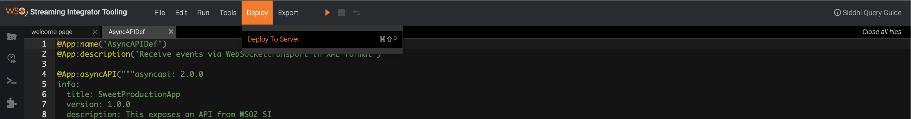
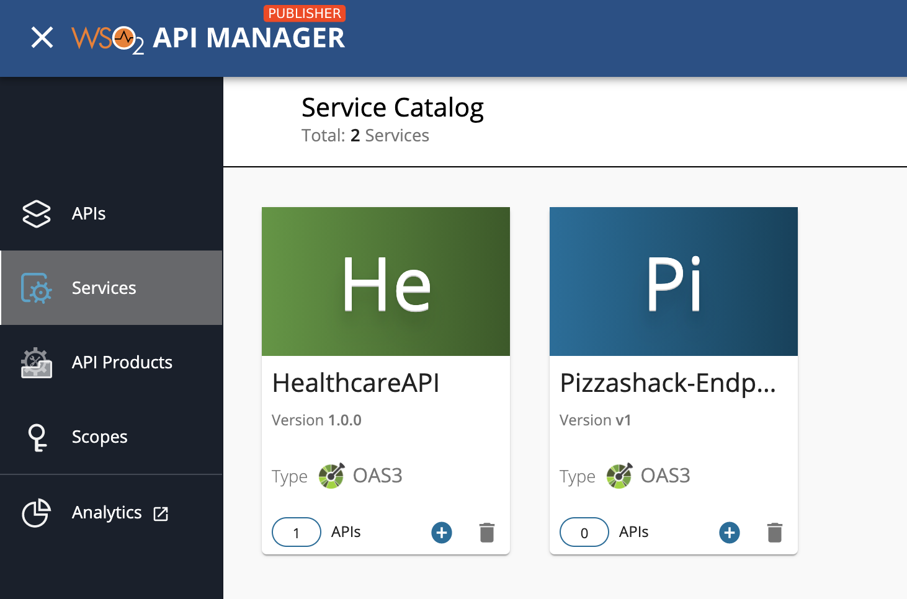

# Exposing a Stream as a Managed API

Managed APIs refer to the APIs that are managed using WSO2 API Manager, namely REST APIs, GraphQL APIs, SOAP APIs, and Streaming APIs. This guide explains how to create a Streaming backend for a [Streaming API](create-streaming-api/streaming-api-overview.mdx), generate an AsyncAPI definition for the corresponding Streaming API, and then publish the AsyncAPI definition in the WSO2 API Manager Service Catalog. 

This involves enabling the AsyncAPI functionality in the Streaming Integrator component. As a result, when you deploy a Siddhi application with an AsyncAPI definition in the Streaming Integrator server, the Streaming Integrator exposes it as an API in WSO2 API Manager's service catalog.

<Steps>

## Enable publishing to the service catalog {/* #step-1---enable-publishing-to-the-service-catalog */}


Follow the instructions below to enable publishing the AsyncAPI definition to the service catalog in WSO2 API Manager:

1. Configure the API Manager port.

     You have to define the port to which the Streaming Integrator publishes the AsyncAPI definition.

     1. Open the `<API-M_HOME>/repository/conf/deployment.toml` file.

     2. Uncomment `offset` in the `[server]` section and set it to `5` as shown below.

         ```
         [server]
         offset=5
         ```
   
2. Configure the basic details needed to publish to the service catalog.

     1. Open the `<SI_HOME>/conf/server/deployment.yaml` file. 
     
     2. Update the `service.catalog.configs:` section as follows:

        ```
        service.catalog.configs:
            enabled: true
            hostname: localhost
            port: 9448
            username: admin
            password: admin
        ```
         In the above configuration -
         
           - You are enabling the AsyncAPI generation functionality by setting the `enabled` parameter to `true`. 
            
           - You are specifying `9448` as the port because you configured a port offset of 5 in the previous step. The default port of the API Manager is `9443`.

   
## Start Streaming Integrator and WSO2 API Manager {/* #step-2---start-streaming-integrator-and-wso2-api-manager */}

[Start the Streaming Integrator server](../../install-and-setup/install/installing-the-product/running-the-si.mdx#starting-the-si-server) and the [API Manager server](../../install-and-setup/install/installing-the-product/running-the-api-m.mdx) based on the instructions in the install and setup section.

## Create a Streaming Backend {/* #step-3---create-a-streaming-backend */}

The Streaming Integrator component in WSO2 API Manager is powered by [Siddhi](https://siddhi.io/). Therefore, you need to create a Siddhi application that has one or more sources, namely of the types `websocket-server`, `webhooks`, or `sse`, as the streaming backend.

[Create a Siddhi application](../../develop/streaming-apps/creating-a-siddhi-application.mdx) with the following Siddhi application configurations.

```
@App:name('AsyncAPIDef')
@App:description('Receive events via WebSockettransport in XML format')

@source(type='websocket-server',host = "localhost",port = "8025",
  @map(type='xml'))
define stream SweetProductionStream (name string,amount double);

@sink(type='log')
define stream LowProductionAlertStream (name string,amount double);

@info(name='query1')
from SweetProductionStream 
select * 
insert  into LowProductionAlertStream;   
```

:::tip

For more information on the configurations and what they mean, refer to [Create a Siddhi application](../../develop/streaming-apps/creating-a-siddhi-application.mdx).

:::

## Generate the AsyncAPI definition {/* #step-4---generate-the-asyncapi-definition */}

Enter the Streaming API related details to generate an AsyncAPI definition based on the Streaming Backend server details, and add the AsyncAPI definition to the Siddhi application. 

1. To view AsyncAPI definitions, you need to click **Async API View**. The Async API View is accessible only for Siddhi applications that have one or more sources/sinks of the `websocket-server`, `webhooks`, or `sse` type.

2. Enter the following Streaming API related details to generate an AsyncAPI definition.
      
   | **Field**                                            | **Value**                             |
   |------------------------------------------------------|---------------------------------------|
   | **Title**                                            | `SweetProductionApp`                  |
   | **Version**                                          | `1.0.0`                               |
   | **Description**                                      | `Consumes events of sweet production` |
   | **Select Source or Sink type to Generate Async API** | Select **websocket-server**           |
   | **Sources**                                          | Select **SweetProductionStream**      |

3. Click **Generate Async API** to generate the AsyncAPI definition.

4. Click **Add Async API** to add the generated AsyncAPI definition to the Siddhi application.

For more information, see [Generating and Viewing AsyncAPI Definitions](../../develop/streaming-apps/working-with-the-async-api-view.mdx).

The following is the AsyncAPI definition that gets generated.

```
@App:asyncAPI("""asyncapi: 2.0.0
info:
  title: SweetProductionApp
  version: 1.0.0
  description: Consumes  events of sweet production
servers:
  production:
    url: 'localhost:8025'
    protocol: ws
    security:
      - keystore.file: []
channels:
  /:
    publish:
      message:
        $ref: '#/components/messages/SweetProductionStreamPayload'
components:
  messages:
    SweetProductionStreamPayload:
      payload:
        type: object
        properties:
          name:
            $ref: '#/components/schemas/name'
          amount:
            $ref: '#/components/schemas/amount'
  schemas:
    name:
      type: string
    amount:
      type: number
  securitySchemes:
    keystore.file:
      type: X509
""")
```

## Publish the AsyncAPI definition {/* #step-5---publish-the-asyncapi-definition */} 

You need to deploy your Streaming backend, which contains the AsycAPI definition, to the Streaming Integrator server in order to export the AsyncAPI definition that you generated to the service catalog in WSO2 API Manager.

Follow the instructions below to publish the AsyncAPI definition to the service catalog:

Let's deploy the `AsyncAPIDef` Siddhi application, which is the Streaming backend, into the Streaming Integrator server.

1. Click **Deploy**, and then click **Deploy to Server** in Streaming Integrator Tooling. 

     [](../../../../assets/img/streaming/working-with-async-api/async-api-websocket-deploy-to-server.png)

     This opens the **Deploy Siddhi Apps to Server** dialog box. 

2. Select the relevant checkbox for your Siddhi application, which contains the AsyncAPI definition, and for the server in which you want to deploy it. 

3. Click **Deploy**. 

     For detailed instructions, see [Deploying Siddhi Applications](../../develop/streaming-apps/deploying-streaming-applications.mdx).

     After the Siddhi application is successfully deployed, the following log messages appear in the Streaming Integrator and API Manager server logs to indicate that the AsyncAPI definition is successfully published in the Service Catalog.

    <Tabs>
    <TabItem value="tab-0" label="Streaming Integrator server logs">

    ```bash
    Siddhi App AsyncAPIDef deployed successfully
    Async API: SweetProdApp-1.0.0 uploaded to the service catalogue
    ```

    </TabItem>
    <TabItem value="tab-1" label="API Manager server logs">

    ```bash
    CommonUtil Creation of folder is successful. Directory Name : SweetProdApp-1.0.0`
    ```

    </TabItem>
    </Tabs>
  
## View the service catalog entry in API Manager {/* #step-6---view-the-service-catalog-entry-in-api-manager */}

Follow the instructions below to view the service catalog entry in WSO2 API Manager:

1. Sign in to the Publisher.

     `https://<hostname>:9448/publisher`
     
     For testing purposes, you can use `https://localhost:9448/publisher` and `admin` as the username and password.

     [](../../../../assets/img/integrate/tutorials/service-catalog/open-service-catalog.png)
     
2. Click the hamburger icon and then click **Services**.

     The services, which includes the `SweetProdApp` service, appears.

3. Click on the respective service (`SweetProdApp`) to view details of the managed service.

</Steps>
   
## What's Next?

<LinkCards>

- [Learn more on the available Streaming APIs](create-streaming-api/streaming-api-overview.mdx). 

- [Learn how you can use a **third-party Streaming Provider** together with the Streaming Integrator in WSO2 API-M to create a Streaming API](../../get-started/streaming-quick-start-guide.mdx).

</LinkCards>
