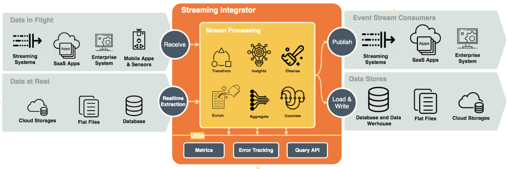

# Streaming Integrator Use Cases Overview

WSO2 Streaming Integrator receives input data, processes it and presents an output as shown in the diagram below.

As shown in the diagram above, WSO2 Streaming Integrator first extracts/receives input data, processes them and then presents the output by publishing/loading/writing it. You can perform supporting activities such as error handling, performing queries via API and analyzing metrics.

### Extracting/receiving data

WSO2 Streaming Integrator can extract static data from sources such as databases, files, and cloud storages, as well as receive data in transit from data publishers and messaging systems.

For more information, see the following guides:

- [Extracting Data from Static Sources in Real Time](extracting-data-from-static-sources-in-real-time.mdx)
- [Receiving Data in Transit](receiving-data-in-transit.mdx)

### Processing data

The different types of processing activities that can be performed by WSO2 Streaming Integrator are as follows:

 - Cleansing data
 
 - Transforming data
 
 - Enriching data
 
 - Aggregating data
 
 - Correlating data
 
For more information about the above processing activities, see [Processing Data](processing-data.mdx)

### Publishing/loading/writing data

Once the received data is processed, the output can be stored in a database, written in a file and/or saved in a cloud storage to be saved in a static manner. Alternatively, it can be published to a destination via a messaging system or a data publisher.

For more information about how the output is published, see the following topics:

- [Loading and Writing Data](loading-and-writing-date.mdx)
- [Publishing Data](publishing-data-to-event-stream-consumers.mdx)

### Supporting tasks

The following guides cover the supporting tasks that can be performed by WSO2 Streaming Integrator when processing Streaming Data.

- [Error Handling](handling-errors.mdx)

- [Metrics (Monitoring)](../../observe/streaming-integrator/setting-up-si-statistics-dashboards.mdx)

- [Query API](../../develop/streaming-apps/store-apis.mdx)
