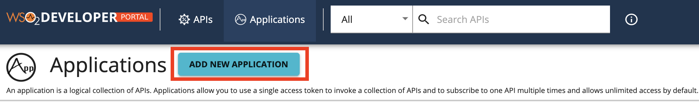
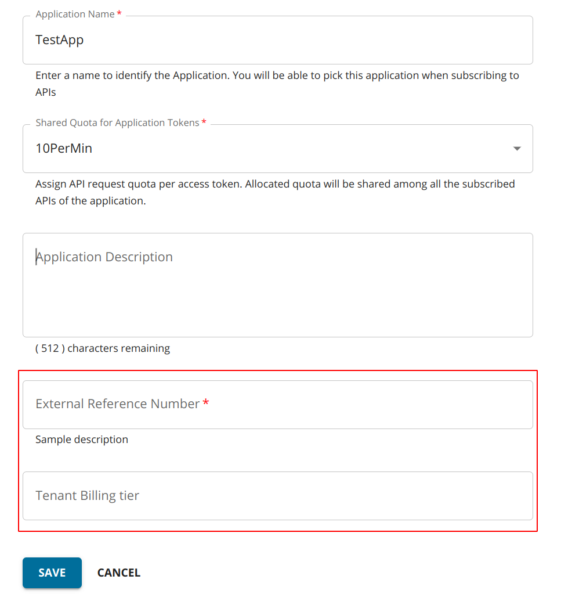

# Add Custom Attributes to Applications

You as a developer can register applications via the WSO2 API Manager Developer Portal. When you create a subscription to an API for an application, it allows you to consume the API. Thereby, this helps developers to expose and monetize their APIs. Applications can be created with a predefined set of properties. In addition, WSO2 API Manager also allows you to add a set of custom attributes while creating an application if required.

Follow the steps below to configure WSO2 API Manager in order to accept custom attributes to applications:

<Steps>

## Configure custom attributes for applications {/* #step-1---configure-custom-attributes-for-applications */}

Use one of the following options to configure custom attributes in WSO2 API Manager.

-   [Server-specific configuration](#server-specific-configuration)
-   [Tenant-specific configuration](#tenant-specific-configuration)

### Server-specific configuration

Follow the instructions below to configure server-specific custom attributes:

1. Open the `<API-M-home>/repository/conf/deployment.toml` file. 

2. Add the `application_attributes` section as shown below.

    ```java
    [[apim.devportal.application_attributes]]
    required=true
    hidden=false
    name="External Reference Id"
    description="Sample description of the attribute"
    ```
    
    :::note

    Default attribute values can be specified in the configurations as below. Default values must be defined for 
    required, hidden attributes.

    ```
    [[apim.devportal.application_attributes]]
    required=true
    hidden=true
    default="DEFAULT"
    name="Organization Id"
    description="Sample description of the attribute"
    ```  

    :::

### Tenant-specific configuration

Follow the instructions below to configure tenant-specific custom attributes:

1. Sign in to the WSO2 API Manager Admin Portal `https://<hostname>:9443/admin`.
2. Click **Settings** --> **Advanced**.
3. Add `ApplicationConfigs` as shown below and save.

     ```java
     "ApplicationConfigs": {
        "Attributes" : [
            {
                "Attribute" : "External Reference Number",
                "Required" : true,
                "Description" : "Sample description"
            },
            {
                "Attribute" : "Tenant Billing tier"
            }
        ]
     }
     ```

## Create an application with the custom attributes {/* #step-2---create-an-application-with-the-custom-attributes */}

After configuring the custom attributes as shown in the previous step, you will be able to add these attributes to the applications you create via the Developer Portal.

1. Sign in to the API Developer Portal. 

2. Click **Add Application**, to add a new application.

    [](../../../../../assets/_versions/4.4.0/img/learn/application-attributes-application-add.png)
    
    You will see the configured custom attribute as shown below.

    [](../../../../../assets/_versions/4.4.0/img/learn/application-attributes.png)

3. Add the application details and click **SAVE**.

</Steps>
