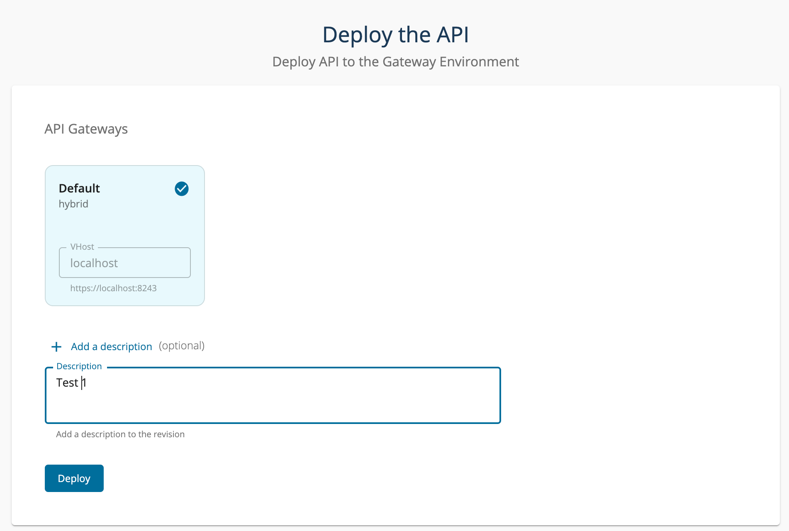
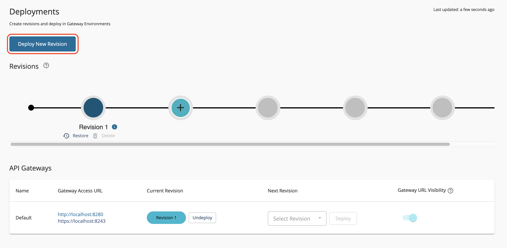
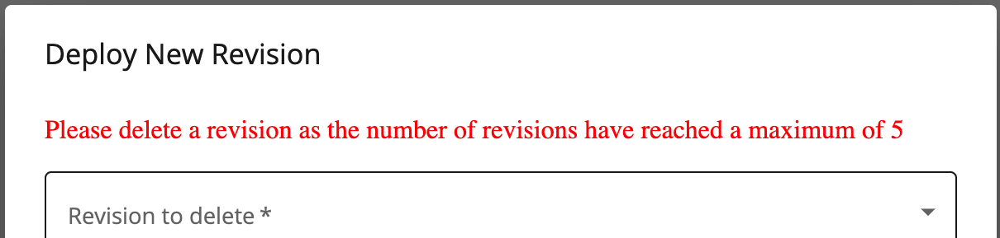

# Deploy an API

Note

The steps involved in deploying an API and deploying an API Product are the same.

**API Deploying** is the process of making the API available for invocation via a Gateway. You can deploy an API to a selected API Gateway environment via the Publisher Portal. To invoke an API, it needs to be published on the Developer Portal as well as deployed on a Gateway environment. You need to create a revision of an API in order to deploy it. For more information, see [Create API Revisions](../../../design/create-api/create-api-revisions.mdx)

**Undeploying an API**  will remove the API from the API Gateway Environment.

Follow the instructions below to deploy a new revision for an API:

1. Sign in to the Publisher.
   
      [https://localhost:9443/publisher](https://localhost:9443/publisher)

2. Navigate to the **Deploy** section and click **Deployments**.
    
      The Deployments page appears as follows when you do not have any existing revisions.

      

      The Deployments page appears as follows when you have at least one revision.

      

    :::note

    The **Information icon** will appear only if you have added a product revision description. You can view the description when you hover over the information icon.

    :::

3. Click **Deploy New Revision**.

    :::note

    **Skip this step** if you are creating your very first revision.

    :::

4.  Optionally, provide a description for the revision.
5.  Select the API Gateways in which you want to deploy the API.
6.  Click **Deploy**.

:::warning

You cannot deploy more than 5 revisions. If you want to deploy a new revision after the maximum allowed number of revisions are reached, you need to delete one of the existing revisions.

 

:::
