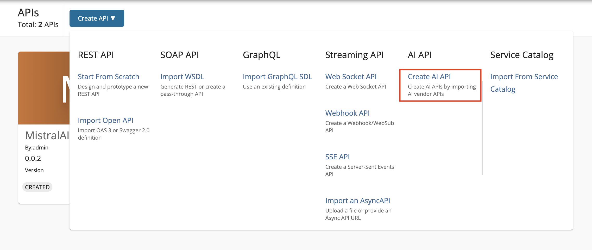
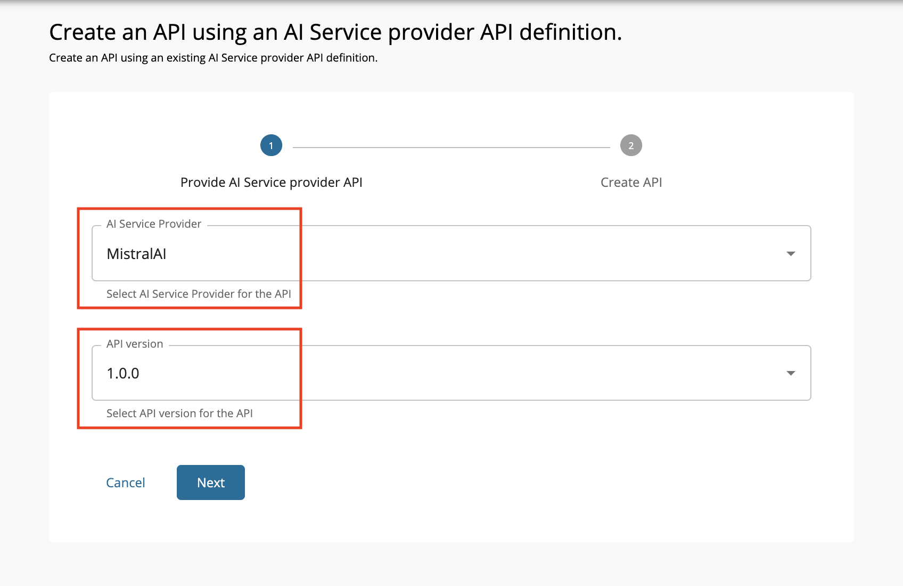
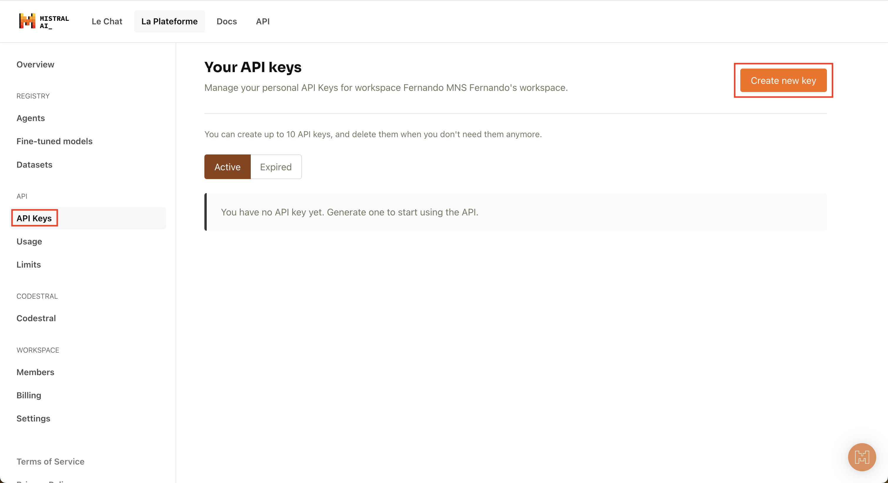
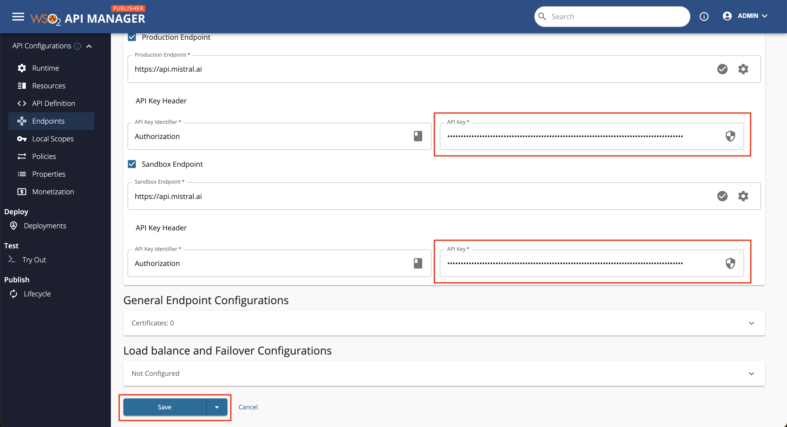

# Create an AI API

AI APIs enable seamless integration of artificial intelligence services into applications through the WSO2 API Manager. By using the AI API feature, users can select specific AI vendors that best suit their needs. WSO2 API Manager provides built-in support for leading AI vendors like **OpenAI**, **Mistral**, and **Azure AI**, while also allowing configuration of custom AI vendors to create AI APIs.

Follow the instructions below to create an AI API using the basic flow:

<Steps>

### Create an AI API {/* #step-1-create-an-ai-api */}

1. Sign in to the API Publisher Portal.

    `https://<hostname>:9443/publisher` 

    Example: `https://localhost:9443/publisher`

    <div className="admonition note">
        <p className="admonition-title">Note</p>
        <p>The <b>Create API</b> button will only appear for a user who has the <code>creator</code> role permission.</p>
        </div>

2. Click **Create API** and then click **AI API**.

    [](../../../../../assets/img/learn/select-ai-api.png)

3. Select the desired **AI Provider** and the relevant **AI Provider API Version** and click Next.

    [](../../../../../assets/img/learn/create-ai-api.png)

    <div className="admonition note">
    <p className="admonition-title">Note</p>
    <p>The available <b>AI service providers and versions</b> will appear on relevant dropdowns. In adition to inbuild AI service vendors, you can also <a href='/api-platform/api-manager/4.4.0/administer/ai-vendors/custom-ai-vendor/'>configure custom AI service vendors</a>.</p>
    </div>

4. Configure AI API details. 
    
    <table><colgroup> <col /> <col /> <col /> </colgroup><tbody><tr><th colSpan="2" >Field</th><th >Sample value</th></tr><tr><td colSpan="2" className="confluenceTd">Name</td><td className="confluenceTd">MistralAIAPI</td></tr><tr><td colSpan="2" className="confluenceTd">Version</td><td colSpan="1" className="confluenceTd">0.0.2</td></tr><tr><td colSpan="2" className="confluenceTd">Context</td><td className="confluenceTd"><div className="content-wrapper"><p><code>mistralaiapi</code></p><div><div className="confluence-information-macro-body"><p>The API context is used by the Gateway to identify the API. Therefore, the API context must be unique. This context is the API's root context when invoking the API through the Gateway.</p></div><div className="confluence-information-macro confluence-information-macro-tip"><span className="aui-icon aui-icon-small aui-iconfont-approve confluence-information-macro-icon"></span><div className="confluence-information-macro-body"><p>You can define the API's version as a parameter of its context by adding the <code>\{version\}</code> into the context. For example, <code>\{version\}/mistralaiapi</code>. The API Manager assigns the actual version of the API to the <code>\{version\}</code> parameter internally. For example, <code>https://localhost:8243/0.0.2/mistralaiapi</code>. Note that the version appears before the context, allowing you to group your APIs based on the versions.</p></div></div></div></div></td></tr><tr><td colSpan="2" className="confluenceTd">Endpoint</td><td colSpan="1" className="confluenceTd"><p><code>https://api.mistral.ai</code></p><p>The endpoint of the AI service vendor is automatically added as the production and sandbox endpoints.</p></td></tr></tbody></table>

5. Click **Create** to create the API.

The overview page of the newly created API appears. 

### Obtain API Key from AI Service Vendor {/* #step-2-obtain-api-key-from-ai-service-vendor */}


<div className="admonition example">
<p className="admonition-title">Example: Mistral AI</p>
<p>Login to **Mistral AI** and go to **<a href='https://console.mistral.ai/'>Mistral AI Console.</a>**</p>
<p>Click **API Keys** and create new key.</p>

[](../../../../../assets/img/learn/mistral-api-key.png)
</div>

### Configure Sandbox and Production Endpoint {/* #step-3-configure-sandbox-and-production-endpoint */}

1. Go to **API Configurations**, and click **Endpoints**.

2. Fill **API Key** for Production and Sandbox Endpoints using the key which was obtained from Step 2.

    :::note

    ```
    APIM supports three AI/LLM vendors by default. The supported authorization approach for each is mentioned below: 
    ```
    - **MistralAI**: `Authorization` header
    - **AzureOpenAI**: `api-key` header
    - **OpenAI**: `Authorization` header

    Note that we prepend "Bearer " to the header value that you provide when it comes to MistralAI and OpenAI since they are expecting an Authorization header.

    :::

    [](../../../../../assets/img/learn/ai-api-auth.png)

3. Click **Save**.

Now, you have successfully created an AI API. Next, [deploy the API](../../../deploy-and-publish/deploy-on-gateway/deploy-api/deploy-an-api.mdx), [test the API](../create-rest-api/test-a-rest-api.mdx), and finally [publish the API](../../../deploy-and-publish/publish-on-dev-portal/publish-an-api.mdx).

</Steps>

## Limitations

Streaming is not supported for AI APIs when using the **WSO2 API Manager Universal Gateway**.

## See Also

Learn more on the concepts that you need to know when creating a REST API:


<LinkCards>

-   [API Security](../../api-security/api-authentication/secure-apis-using-oauth2-tokens.mdx)
-   [Rate Limiting for AI APIs](../../rate-limiting/rate-limiting-for-ai-apis.mdx)
-   [Life Cycle Management](../../lifecycle-management/api-lifecycle.mdx)

-   [API Visibility](../../advanced-topics/control-api-visibility-and-subscription-availability-in-developer-portal.mdx)
-   [API Documentation](../../api-documentation/add-api-documentation.mdx)
-   [Custom Properties](../adding-custom-properties-to-apis.mdx)

</LinkCards>
