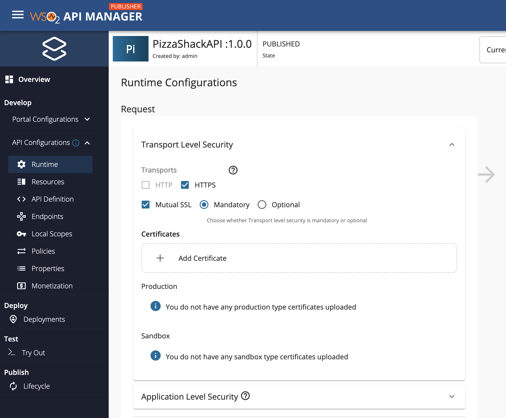
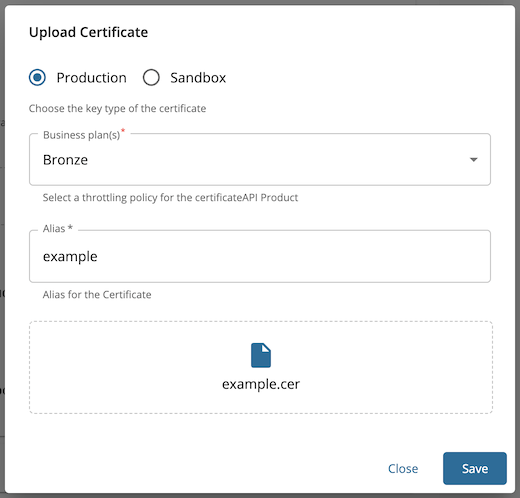

## Create an API secured with Mutual SSL

1.  [Create an API](../../design/create-api/create-rest-api/create-a-rest-api.mdx).
2.  Click **Develop -> API Configurations -> Runtime**.
3.  Select **Mutual SSL**.
    
     

    :::note

      HTTP transport will be disabled for an API if it has Mutual SSL enabled.

    :::

4.  Click **Add Certificate** to upload a new client certificate.
    
    :::note

    This feature currently supports `.crt` and `.cer` formats for certificates.

    If you need to use a certificate in any other format, you can convert it using a standard tool before uploading it.

    :::

5.  Select the key type for which the certificate is uploaded.
    
    :::note

    When Transport Level Security and OAuth2 as Application Level Security are set to mandatory with MTLS enabled and gateway endpoint is invoked providing a valid certificate, it may verify only the existence of the certificate. 
    Authentication may happen with OAuth2.

    :::

6. Provide an alias and public certificate. Select the tier that should be used to throttle out the calls using this particular client certificate and click **Upload**.
    
     
    
6.  **Save and Deploy** the API.
