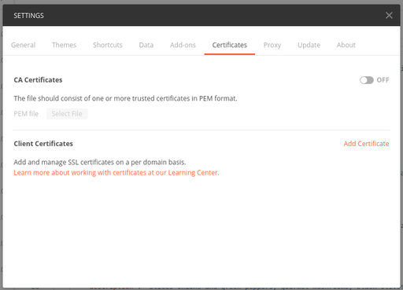
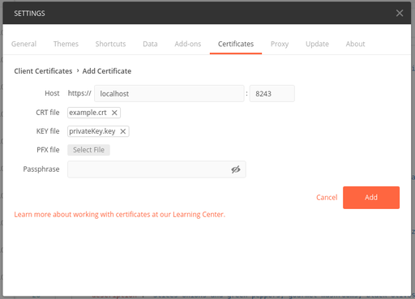

### Invoke an API secured with Mutual SSL using Postman

You can invoke the Production or Sandbox endpoint based on the client certificate you upload.
For example, if you have uploaded example.crt as a `Production` type certificate in the Runtime Configurations for the API and you invoke the API using the same certificate here, the Production endpoint will be invoked.

Import the certificate and private key to Postman.

1. Navigate to the certificates tab in Postman settings.
    
     
    
2. Add the certificate and private key.

     
    
3.  Invoke the API from Postman.
