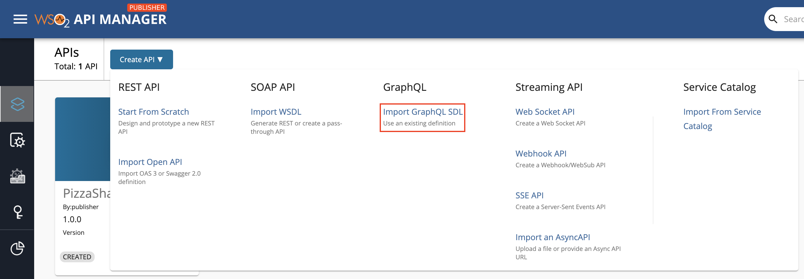
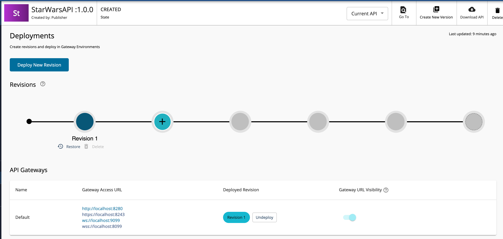
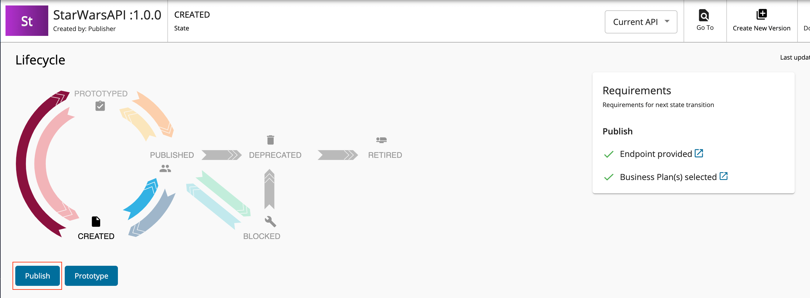
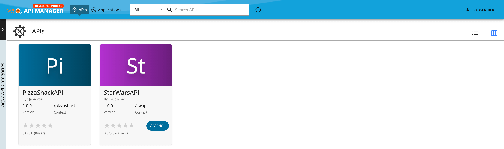
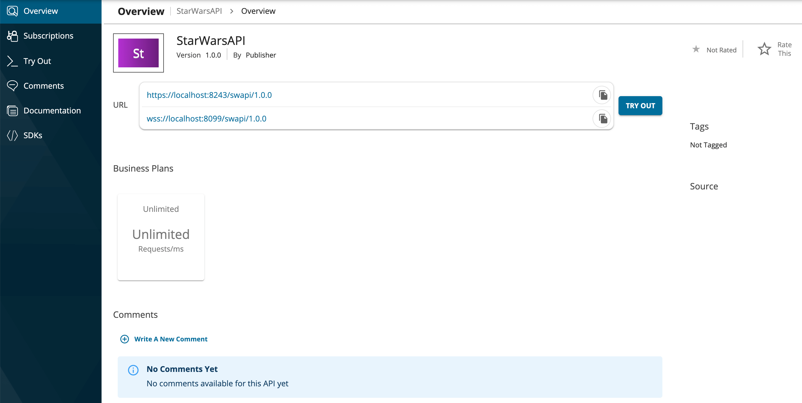
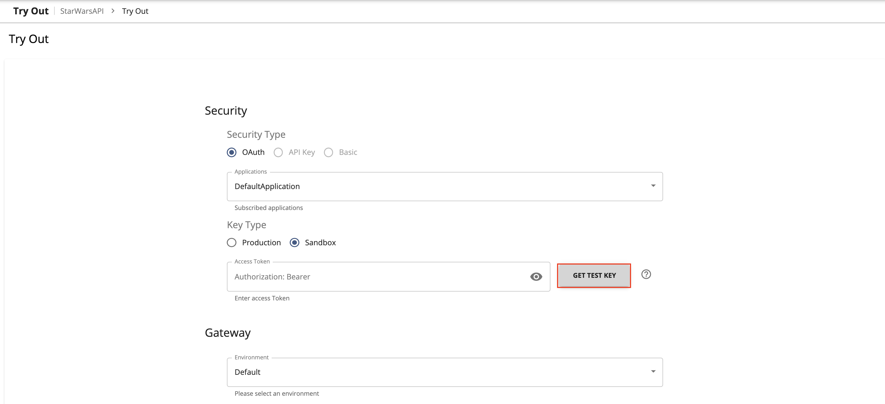
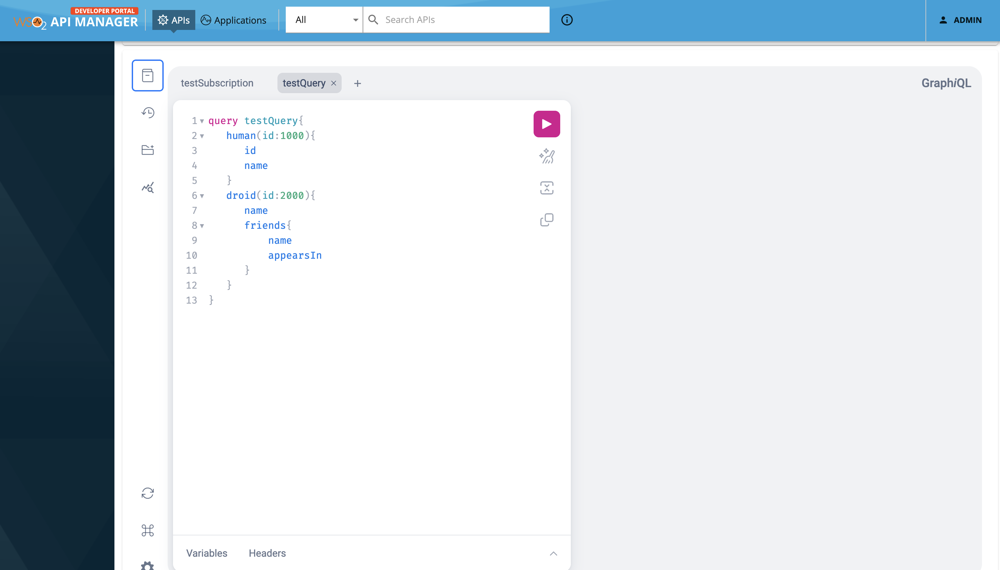
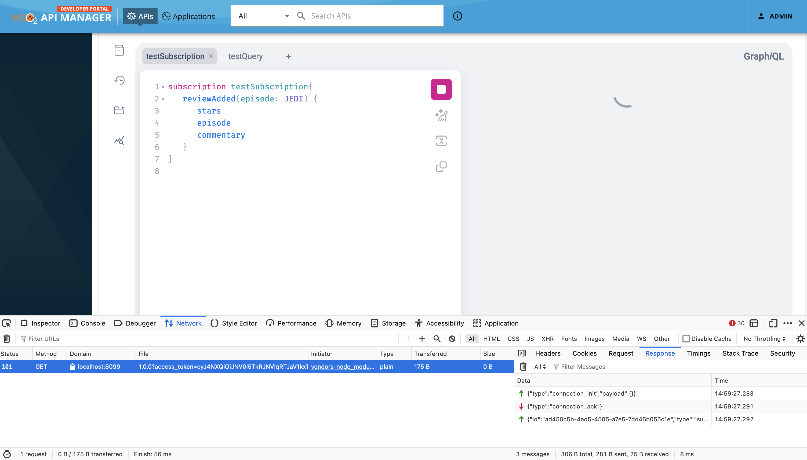

# Create and Publish a GraphQL API

Follow the instructions in this tutorial to design, publish, and invoke a GraphQL API.


<div className={"admonition note"}><p className={"admonition-title"}>{"Note"}</p><p>{"For more information on GraphQL APIs, see "}<a href={"/api-platform/api-manager/4.4.0/design/create-api/create-a-graphql-api"}>{"Create a GraphQL API"}</a>{"."}</p></div>


<Steps>

### Start the GraphQL backend server {/* #step-1---start-the-graphql-backend-server */}

Let's use the Star Wars sample backend server as the backend for the GraphQL API.

1. Clone the [WSO2 API Manager Samples](https://github.com/wso2/samples-apim) repository.

    ```
    git clone https://github.com/wso2/samples-apim

    ```

2. Navigate to `graphql-backend` directory.

    ```
    cd samples-apim/graphql-backend
    ```

3. Run `npm install` to install the necessary node modules.

4. Run `npm start` to start the server.

    Once the above steps are done, the Star Wars server will be running on `http://localhost:8080`.

    [](../../../assets/img/learn/cli-output.png)

    You can use `http://localhost:8080/graphql` as the endpoint when creating the GraphQL API.

### Design a GraphQL API {/* #step-2---design-a-graphql-api */}

1. Sign in to the API Publisher Portal.
   
    `https://<hostname>:9443/publisher` 
   
    Example: `https://localhost:9443/publisher`

    Let's use `admin` as the username and password to sign in.

2. Click **Create API** and then click **Import GraphQL SDL**.

     [](../../../assets/_versions/4.4.0/img/learn/create-graphql-schema-option.png)

3. Import the schema by dragging and dropping the file or by uploading the file, and click **Next**.

       Let's use the [StarWarsAPI schema definition](../../../assets/attachments/learn/schema_graphql.graphql) to create the schema file. 

       <div className={"admonition note"}><p className={"admonition-title"}>{"Note"}</p><ul><li><p>{"You need to define the SDL Schema based on the "}[{"GraphQL schema design best practices"}](https://graphql.org/learn/best-practices){"."}</p></li><li>{"The file extension can be either "}<code>{".graphql"}</code>{", "}<code>{".txt"}</code>{", or "}<code>{".json"}</code>{"."}</li><li>{"The file name can be any name, which is based on your preference."}</li></ul></div>

      [](../../../assets/img/learn/import-graphql-schema-via-file.png)

4. Enter the GraphQL API related details and click **Create**.
    
    Let's create an API named "StarWarsAPI" using the following sample data.

      <table><thead><tr className={"header"}><th><div><div><b>{"Field"}</b></div></div></th><th><div><div><b>{"Description"}</b></div></div></th></tr></thead><tbody><tr><td><p>{"Name"}</p></td><td><p>{"StarWarsAPI"}</p></td></tr><tr><td><p>{"Context"}</p></td><td><p><code>{"/swapi"}</code></p></td></tr><tr><td><p>{"Version"}</p></td><td><p>{"1.0.0"}</p></td></tr><tr><td><p>{"Endpoint"}</p></td><td><a href={"http://localhost:8080/graphql"} target={"_blank"}>{"http://localhost:8080/graphql"}</a><div className={"admonition note"}><p className={"admonition-title"}>{"Note"}</p><p></p><ul><li>{"When you provide the HTTP URL as the backend endpoint, WSO2 API-M will internally derive the corresponding WebSocket URL "}<code>{"ws://localhost:8080/graphql"}</code>{"."}</li><li>{"Thereafter, the API Gateway will use this WebSocket URL as the backend subscription endpoint of the GraphQL API."}</li></ul><p></p></div></td></tr></tbody></table>

       [](../../../assets/img/learn/create-graphql-api-details.png)

5. Optionally, modify the existing GraphQL schema definition.

    1. Navigate to **Develop**, **API Configurations**, and click **Schema Definition**.

    2. Click **Download Definition**.

         The existing GraphQL API schema gets downloaded.

         [](../../../assets/img/learn/download-schema-definition.png)

    3. Update the schema definition as required.

    4. Click **Import Definition** to import the updated schema definition.

6. Update the GraphQL API operations as required.

    Instead of resources, which get populated for REST APIs, operations get populated for GraphQL APIs.

    1. Click **Show More** under the **Operations** section in the **Overview** page to navigate to the operations page.

         [](../../../assets/img/learn/operations.png)  
     
    2. Update the operations as required.
         
        The Publisher can add Rate Limiting policies, scopes and enable/disable security for each of the GraphQL API operations.

        1. **Create scopes**.

            Repeat the following sub-steps to create two scopes named `adminScope` and `FilmSubscriberScope`.

            1. Click **Local Scopes**, and then click **Create Scopes**.

                [](../../../assets/img/learn/add-scope.png)

            2. Enter the required details.

                   <div className={"admonition note"}><p className={"admonition-title"}>{"Note"}</p><p></p><ul><li>{"The role that you enter "}<b>{"should be a valid role that already exists in WSO2 API Manager"}</b>{". Make sure to assign the role to the user."}</li><li>{"For more information, see "}<a href={"../../../administer/managing-users-and-roles/managing-users/"}>{"Adding Users"}</a>{" and "}<a href={"../../../administer/managing-users-and-roles/managing-user-roles/"}>{"Adding User Roles"}</a>{"."}</li></ul><p></p></div>
                  
                   Enter the following details for this example scenario.

                   | **Name** | **Role** |
                   |----------|----------|
                   | `FilmSubscriber` | `FilmSubscriber` |
                   | `adminScope` | `admin` |

                   [](../../../assets/img/learn/create-scope.png)

            3. Press `Enter` to add each role. 

            4. Click **Save**.

                 [](../../../assets/img/learn/starwars-scope-list.png)

         2. **Define the operation level configurations**.

            1. Click **Operations**.
            
            2. Click **Operation Level** to apply Rate Limiting for operations.

                [](../../../assets/img/learn/update-operations.png) 

            3. Select a Rate Limiting Policy, scope, and enable or disable security for each of the operations. 

                   Apply the following scopes to the respective operations.

                   | **Operation** | **Scope** |
                   |----------|----------|
                   | `allDroids` |`FilmSubscriber` |
                   | `allCharacters` |`adminScope` |
            
            4. Click **Save**.

                 If you check the list of scopes, it should appear as follows:

                 [](../../../assets/img/learn/scope-list.png)


Now, you have created and configured the GraphQL API successfully. 

### Deploy the GraphQL API {/* #step-3---deploy-the-graphql-api */}

1. Navigate to **Deploy** and click **Deployments** to navigate to the Deploy the API page. 
2. Click **Deploy** to deploy the API to the API Gateway, which is the default Gateway.

       [](../../../assets/img/learn/deploy-graphql-api.png)

       The Deployment page appears.

       [](../../../assets/img/learn/graphql-api-revision-1.png)

### Publish the GraphQL API {/* #step-4---publish-the-graphql-api */}

1. Navigate to **Publish** and click **Lifecycle**. 
       
       The API lifecycle page appears.
       
2. Click **Publish** to publish the API to the API Developer Portal.

       [](../../../assets/img/learn/publish-graphql-api.png)

### Invoke the GraphQL API {/* #step-5---invoke-the-graphql-api */}

1. Sign in to the **Developer Portal**.
   
       `https://<hostname>:9443/devportal` 
   
       Example: `https://localhost:9443/devportal`

       Let's use `admin` as the username and password to sign in.

       [](../../../assets/_versions/4.4.0/img/learn/starwars-in-dev-portal.png)
    
2. Click on the GraphQL API.
   
      The API overview appears.
   
      [](../../../assets/img/tutorials/create-and-publish-a-graphql-api/api-overview.png)
      

      <div className={"admonition info"}><p className={"admonition-title"}>{"Info"}</p><p></p><ul><li>{"Note that both the HTTP and the WebSocket URLs of the Gateway are displayed for the GraphQL API."}</li><li>{"The HTTP Gateway URL is to invoke the query and mutation operations of the GraphQL API."}</li><li>{"The WebSocket Gateway URL is to invoke the subscription operations of the GraphQL API."}</li></ul><p></p></div>

3. Subscribe to the API.

    1. Click **TRY OUT**.
    
         [](../../../assets/img/tutorials/create-and-publish-a-graphql-api/try-out-graphql-popup.png)
         
         This will create a subscription for the application named `DefaultApplication` and generate a consumer key and consumer secret pair for `DefaultApplication`. Click **TRY OUT** on the pop-up window to navigate to the Try Out Console.

4. Try out the operations.
       1. Click **GET TEST KEY**.

         [](../../../assets/img/learn/get-test-key-starwars.png)
    
<Steps>

#### Optionally, try out a Query operation {/* #step-51---optionally-try-out-a-query-operation */}

<div className={"admonition note"}><p className={"admonition-title"}>{"Note"}</p><ul><li><p>{"If you are going to invoke QUERY Operation, you should start the payload with the keyword 'query'."}</p></li><li><p>{"If you are going to invoke MUTATION Operation, you should start the payload with the keyword 'mutation'."}</p></li></ul></div>
 
 1. Enter the following sample payload as the StarWarsAPI request. Then click on execute button as follows.
 
      ```
      query testQuery{
         human(id:1000){
            id
            name
         }
         droid(id:2000){
            name
            friends{
                name
                appearsIn
            }
         }
      }

      ```

      [](../../../assets/_versions/4.4.0/img/tutorials/create-and-publish-a-graphql-api/graphql-console-execute-query.png)

 2. Click **Execute**.

     [](../../../assets/_versions/4.4.0/img/learn/graphql-response-query.png)

<a name="5.2"></a>

#### Optionally, try out a Subscription operation {/* #step-52---optionally-try-out-a-subscription-operation */}

<div className={"admonition note"}><p className={"admonition-title"}>{"Note"}</p><p>{"If you are going to invoke SUBSCRIPTION operation, you should start the payload with the keyword `subscription`."}</p></div>

1. Enter the following sample payload as the StarWarsAPI `reviewAdded` subscription request to get real-time updates about the addition of new reviews.

    ```
    subscription testSubscription{
       reviewAdded(episode: JEDI) {
          stars
          episode

          commentary
       }
    }
    ```

2. Prepare to inspect the network calls from your browser developer tools.

    For example, if you are using the Google Chrome browser.

    1. Right-click on the browser and click **Inspect**.
    2. Click **Network** to view the network calls via the browser developer tools.

3. Click **Execute**. 
   
    If you inspect the network calls from your browser developer tools, you can see the messages passed between the GraphiQL client and the backend.

    [](../../../assets/_versions/4.4.0/img/tutorials/create-and-publish-a-graphql-api/graphql-sub-init-response.png)
   
    As you can see, a successful WebSocket connection is established between the client and backend via WSO2 API Gateway.

4. While keeping the Developer Portal web browser page opened, separately open a terminal and directly invoke the backend API’s `createReview` mutation operation by executing the following command.

      ```
      curl -X POST "http://localhost:8080/graphql" -H  "accept: application/json" -H  "Content-Type: application/json" -d '{"query":"mutation {createReview(episode: JEDI, review: { stars: 3, commentary: \"Excellent\"}) { stars   episode   commentary }}","variables":null}' -k
      ```

      When the mutation is successful, the GraphQL backend will send the following response:

      ```
      {"data":{"createReview":{"stars":3,"episode":"JEDI","commentary":"Excellent"}}}
      ```

5. Now go back to the Developer Portal browser page.
   
    You can see that you have received the subscription event response that corresponds to the mutation operation you did in <a href="#5.2">Step 5.2 (4)</a>.

    [](../../../assets/_versions/4.4.0/img/tutorials/create-and-publish-a-graphql-api/try-out-sub-event.png)

:::info[Troubleshooting]

    If you **cannot invoke the API's WSS endpoint during handshake** (this causes the **SSLPeerUnverified exception**), it could be because the security certificate issued by the server is not trusted by your browser. 
    
    This will result in the following error being printed in the backend.

    ```
    ERROR - InboundWebsocketSourceHandler Endpoint not found for port : 8099 tenant domain : null
    ```       
    
    To resolve this issue, access the corresponding HTTPS endpoint of the WSS endpoint directly from your browser and accept the security certificate. (e.g., `https://localhost:8099/swapi/1.0.0`) 
    
    If the API Manager has a **certificate signed by a Certificate Authority (CA)**, the WSS endpoints should work out-of-the-box.

:::

You have successfully created and published your first GraphQL API, subscribed to it, obtained an access token for testing, and tested query and subscription operations of your API with the access token.

</Steps>

</Steps>
