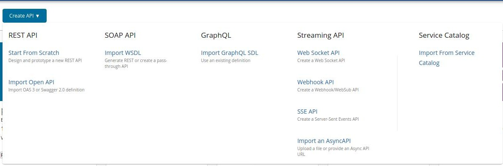
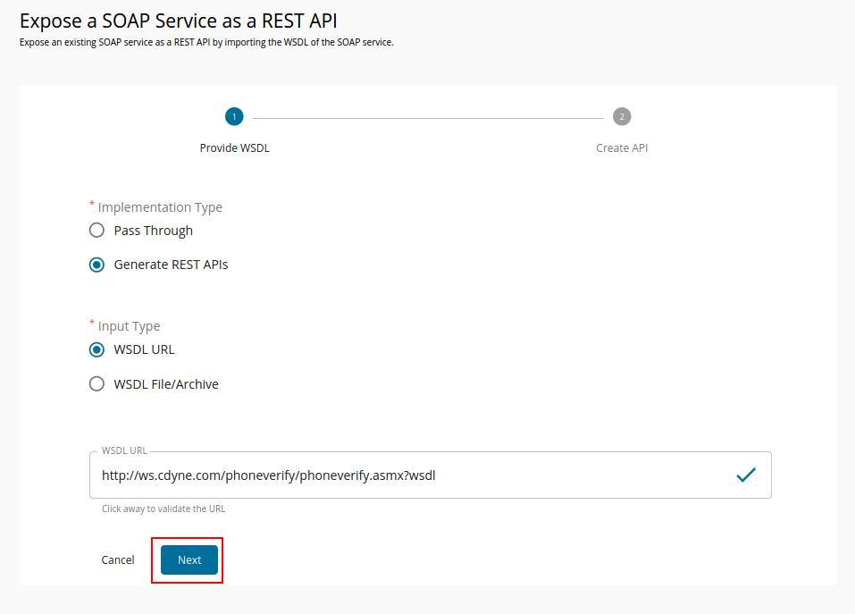
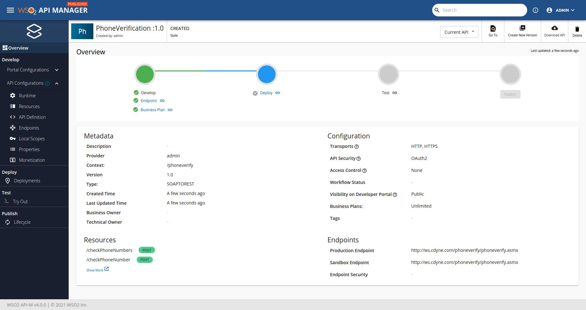
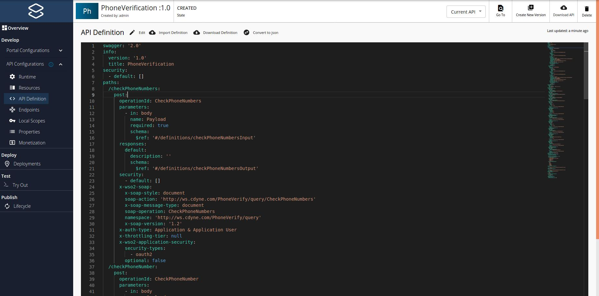
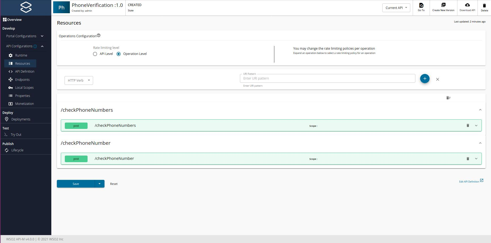
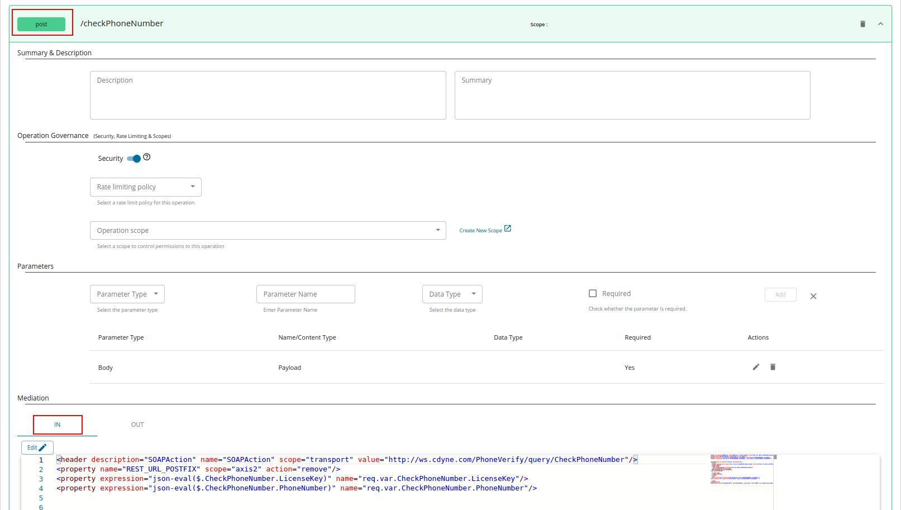

# Generate REST API from SOAP Backend

:::warning[Limitations]


APIM supports only a limited set of capabilities with this feature. If you want to process complex WSDL/XML schema please refer [WSO2 Integration Studio documentation](https://mi.docs.wso2.com/en/latest/develop/creating-artifacts/creating-an-api/).

This feature has the following known limitations.

<details><summary>{"Unsupported / partially supported component types"}</summary>{" - **"}{"<xs:choice\\>"}{"** - **"}{"<xs:annotation\\>"}{"** - **"}{"<xs:attribute\\>"}{"** (Attribute type is always string. Default or fixed values are not supported. Attributes cannot be defined as optional or required) - **"}{"<xs:restriction\\>"}{"** (Only the base type is considered. No other elements added) - **"}{"<xs:complextype\\>"}{"** (Deeply nested complex types do not generate the correct mapping) - **"}{"<xs:complexcontent\\>"}{"** (Has limitations with nested extensions) - **"}{"<xs:simplecontent\\>"}{"** (Has limitations with nested extensions) - **"}{"<xs:all\\>"}{"** (maxOccurs is not taken into consideration) - **"}{"<xs:group\\>"}{"** - **"}{"<xs:attributegroup\\>"}{"** - **"}{"<xs:any\\>"}{"** - **"}{"<xs:anyattribute\\>"}{"** - **"}{"<xs:enumaration\\>"}{"** - **"}{"<xs:alternative\\>"}{"** - **"}{"<xs:assert\\>"}{"** - **"}{"<xs:key\\>"}{"** - **"}{"<xs:keyref\\>"}{"** - **"}{"<xs:list\\>"}{"** (Item types are not defined) - **"}{"<xs:unique\\>"}{"** - **"}{"<xs:appinfo\\>"}{"** - **"}{"<xs:documentation\\>"}{"** - **"}{"<xs:union\\>"}{"** - "}<strong>{"minOccurs"}</strong>{" (This attribute is ignored) - "}<strong>{"maxOccurs"}</strong>{" (Only considers the unbounded case for arrays) - "}<strong>{"substitutionGroup"}</strong>{" (This attribute is ignored) - "}<strong>{"Mixed Content"}</strong>{" (This is ignored) "}</details>

<details><summary>{"Supported primitive or derived datatypes"}</summary>{" - string - time (treated as a string) - boolean - int - nonNegativeInteger - integer - positiveInteger - double - float - long - date - dateTime - decimal - anyType - base64Binary (treated as a string with byte format)"}</details>

:::

This feature allows users to expose their legacy SOAP backends as REST APIs through WSO2 API Manager. 
WSO2 API Manager supports WSDL 1.1 based SOAP backends.

Follow the instructions below to generate REST APIs in WSO2 API Manager for an existing SOAP backend.

   <div className={"admonition note"}><p className={"admonition-title"}>{"Note"}</p><ul>{"Before you begin..."}</ul><ul>{"Make sure that you have a valid WSDL URL from the SOAP backend. It should belong to the WSDL 1.1 version."}</ul></div>

1.  Sign in to the API Publisher Portal.

    `https://<hostname>:9443/publisher` 
   
    Example: `https://localhost:9443/publisher`


2.  Click **CREATE API** and then click **Import WSDL** under **SOAP API**.

    [](../../../../../../assets/img/learn/create-soap-api.jpg)
 
    <div className={"admonition info"}><p className={"admonition-title"}>{"Info"}</p><ul>{"The following are two options to create APIs for SOAP backends "}<li><strong>{"Pass Through"}</strong>{" – Creates a pass-through proxy for SOAP requests coming to the API Gateway."}</li><li><strong>{"Generate REST APIs"}</strong>{" – Generates REST API definitions from the given WSDL URL."}</li></ul></div>

3. Select **Generate REST APIs** and provide the WSDL URL for the SOAP backend. 

      [](../../../../../../assets/img/learn/create-soap-api-as-a-generated-api.jpg)

4. Click **Next** and provide the information in the table below.

    | Field   | Sample value       |
    |---------|--------------------|
    | Name    | PhoneVerification  |
    | Context | /phoneverify       |
    | Version | 1.0.0                |
    | Endpoint| http://ws.cdyne.com/phoneverify/phoneverify.asmx|

    [](../../../../../../assets/img/learn/create-soap-api-form.jpg)

5. Click **CREATE**.
    
     The created API appears in the publisher as follows.
    [](../../../../../../assets/img/learn/generate-rest-api-from-soap-backend-overview.jpg)

6.  Click **API Definition** and click **Edit** to modify the open API Definition of the API.
     [](../../../../../../assets/img/learn/api-definition-of-generated-rest-api-from-soap-backend.jpg)
    
     The generated API resources are added to the API, as shown below.
     [](../../../../../../assets/_versions/4.5.0/img/learn/generated-resources-of-soap-backend.jpg)

7.  Click on a resource to view the In and Out sequences of the API.
    [](../../../../../../assets/img/learn/in-out-sequences-of-generated-rest-api.jpg)

     The following sample shows the generated API In-sequence for a POST method.

     ```xml
        <header description="SOAPAction" name="SOAPAction" scope="transport" value="http://ws.cdyne.com/PhoneVerify/query/CheckPhoneNumber"/>
        <property name="REST_URL_POSTFIX" scope="axis2" action="remove"/>
        <property expression="json-eval($.CheckPhoneNumber.LicenseKey)" name="req.var.CheckPhoneNumber.LicenseKey"/>
        <property expression="json-eval($.CheckPhoneNumber.PhoneNumber)" name="req.var.CheckPhoneNumber.PhoneNumber"/>


        <payloadFactory description="transform" media-type="xml">
        <format>
        <soapenv:Envelope xmlns:soapenv="http://www.w3.org/2003/05/soap-envelope" xmlns:web="http://ws.cdyne.com/PhoneVerify/query">
        <soapenv:Header/>
        <soapenv:Body>
            <web:CheckPhoneNumber xmlns:web="http://ws.cdyne.com/PhoneVerify/query">
        <web:LicenseKey>$1</web:LicenseKey>
        <web:PhoneNumber>$2</web:PhoneNumber>
        </web:CheckPhoneNumber>

        </soapenv:Body>
        </soapenv:Envelope>
        </format>
        <args>
            <arg evaluator="xml" expression="get-property('req.var.CheckPhoneNumber.LicenseKey')"/>
        <arg evaluator="xml" expression="get-property('req.var.CheckPhoneNumber.PhoneNumber')"/>

        </args>
        </payloadFactory>
        <property description="messageProperty" name="messageType" scope="axis2" type="STRING" value="application/soap+xml"/>
     ```

    The incoming JSON message parameters are stored using properties. A payload factory mediator is used to generate the SOAP payload required for the backend.
