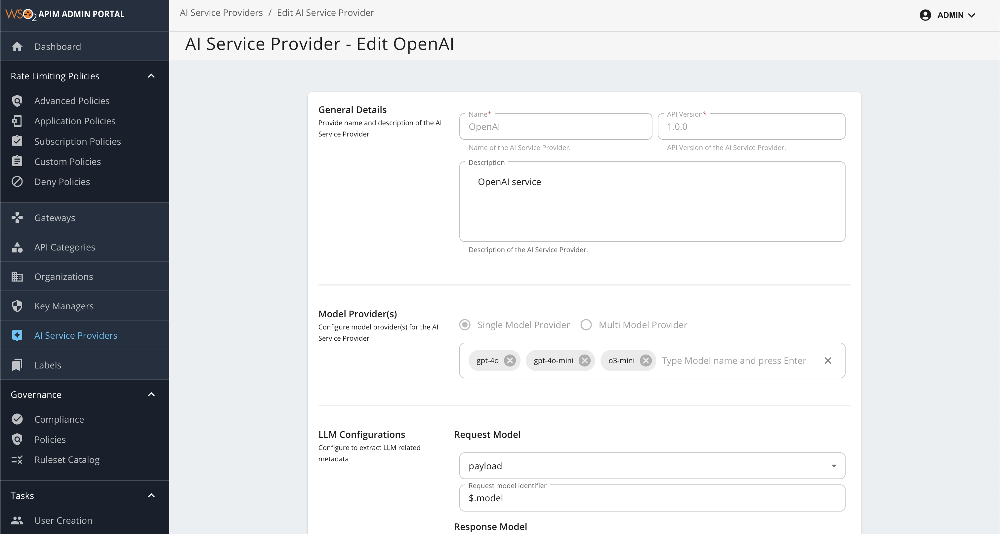

# OpenAI

OpenAI is a **default AI Service Provider** in WSO2 API Manager that allows you to integrate with OpenAI's advanced language models. For more information about OpenAI, see the [OpenAI API Documentation](https://platform.openai.com/docs).

## Configuring OpenAI

<Steps>

### Access Configuration {/* #step-1-access-configuration */}

1. Login to the Admin Portal (`https://<hostname>:9443/admin`)
2. Navigate to **AI Service Providers** → **OpenAI**

### Configure Models {/* #step-2-configure-models */}

#### Read-Only Configurations

The following configurations are **read-only** and cannot be modified:

<table>
    <thead>
        <tr>
            <th>Category</th>
            <th>Fields</th>
        </tr>
    </thead>
    <tbody>
        <tr>
            <td><strong>General Details</strong></td>
            <td>
                • Name 
                • API Version 
                • Description
            </td>
        </tr>
        <tr>
            <td><strong>LLM Configurations</strong></td>
            <td>
                • Request Model 
                • Response Model 
                • Prompt Token Count 
                • Completion Token Count 
                • Total Token Count 
                • Remaining Token Count
            </td>
        </tr>
        <tr>
            <td><strong>LLM Provider Auth Configurations</strong></td>
            <td>
                • Auth Type: Header, Query Parameter or Unsecured 
                • Auth Type Identifier: Header/Query Parameter Identifier
            </td>
        </tr>
        <tr>
            <td><strong>Connector Type for AI Service Provider</strong></td>
            <td>
                • Connector Type
            </td>
        </tr>
    </tbody>
</table>

#### Editable Configurations

The following configurations can be updated:

<table>
    <thead>
        <tr>
            <th>Category</th>
            <th>Description</th>
        </tr>
    </thead>
    <tbody>
        <tr>
            <td><strong>API Definition</strong></td>
            <td>AI service provider exposed API definition file</td>
        </tr>
        <tr>
            <td><strong>Model List</strong></td>
            <td>Add the list of models supported by the AI service provider. This list enables you to configure routing strategies within your AI APIs.</td>
        </tr>
    </tbody>
</table>

- By default, the following models are included: `gpt-4o`, `gpt-4o-mini`, and `o3-mini`.
- To add available models supported by OpenAI, type the model name and press enter. 
- This enables model-based load balancing and failover capabilities. For more details, see [Multi-Model Routing Overview](../multi-model-routing/overview.mdx).

### Save Configuration {/* #step-3-save-configuration */}

Click **Update** to apply your changes.

Once you have saved your changes, the updated OpenAI configuration will be applied and made available for use in your AI APIs, enabling seamless integration with the selected models.

</Steps>
