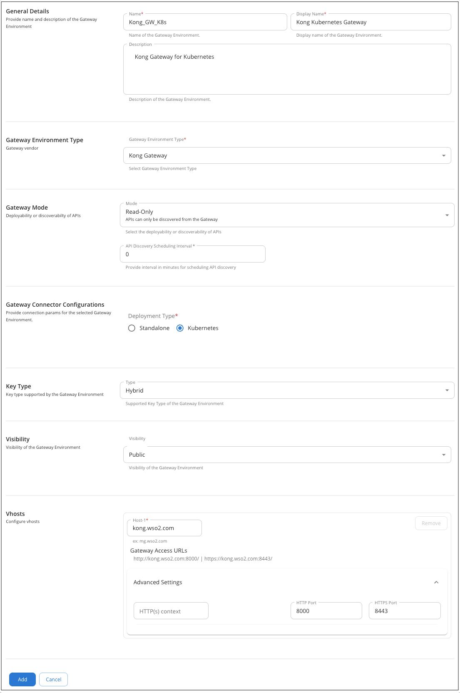
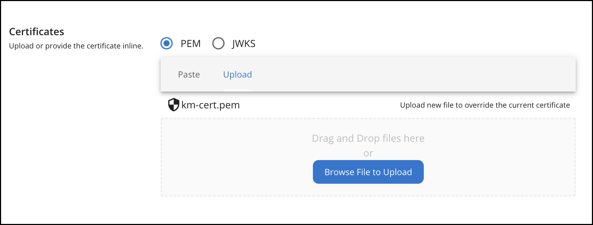
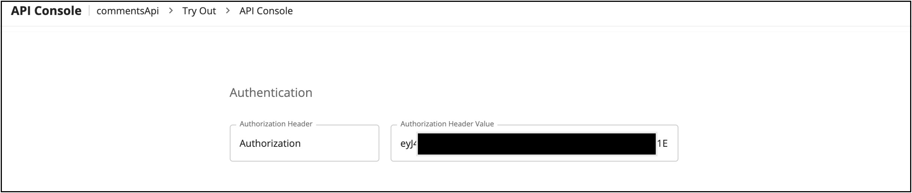

# Discover APIs on Kong Gateway in Kubernetes

From the 4.6.0 release onward, WSO2 API Manager introduces federated API discovery for APIs deployed on Kong Gateway in a Kubernetes cluster. WSO2 API Manager includes a built-in Kong Gateway connector and a separate Gateway Agent, which enables the discovery of APIs deployed on Kong Gateway in the cluster.

API custom resources (CRs) created and managed in Kong Gateway on Kubernetes are automatically discovered and brought under the centralized control plane of WSO2 API Manager. The Gateway Agent detects `HTTPRoutes`, `Services`, and `KongPlugins` applied in the Kubernetes cluster and reconciles them into APIs in WSO2 API Manager.

Follow the steps below to configure Kong Gateway in a Kubernetes cluster as a Federated API Gateway for API discovery.

<Prerequisites>

### Prerequisites

Before you start, ensure you have a Kong Gateway running in a Kubernetes cluster. Complete the following steps:

- Create a namespace in the cluster:
    
    ```
    kubectl create ns kong
    ```

- Install Gateway API CRDs in the cluster:

    ```
    kubectl apply -f https://github.com/kubernetes-sigs/gateway-api/releases/latest/download/standard-install.yaml -n kong
    ```

- Create a Kong `GatewayClass` instance and Kong `Gateway` resource in the cluster. Ensure you have a TLS secret if you plan to use HTTPS.

    !!!note
        For more information see [Create a Kong Gateway](https://developer.konghq.com/operator/dataplanes/get-started/kic/create-gateway/).

- Install Kong Ingress Controller using Helm.

    !!!note
        For more information see [Kong Ingress Controller](https://github.com/Kong/charts/blob/main/charts/ingress/README.md).

- Install Nginx Ingress.

    ```
    helm upgrade --install ingress-nginx ingress-nginx --repo https://kubernetes.github.io/ingress-nginx --namespace ingress-nginx --create-namespace
    ```

</Prerequisites>

<Steps>

## Register Kong Gateway on Kubernetes as a Federated Gateway in WSO2 API Manager {/* #step-1--register-kong-gateway-on-kubernetes-as-a-federated-gateway-in-wso2-api-manager */}

1. Start WSO2 API Manager.

2. Sign in to the Admin Portal.

    <Tabs>
    <TabItem value="tab-0" label="Command">

    ```
    https://localhost:9443/admin
    ```

    </TabItem>
    <TabItem value="tab-1" label="Format">

    ```
    https://<hostname>:9443/admin
    ```

    </TabItem>
    </Tabs>

3. Add a new Gateway Environment.

    1. Enter a **Name** for the Gateway Environment. This **Name** will also be used by the Gateway Agent to identify the environment.
    2. Provide a **Display Name** and a **Description** for the Gateway Environment.
    3. Select **Kong Gateway** as the **Gateway Environment Type**.
    4. Select the **Gateway Mode** as Read-Only.
    5. Provide the **API Discovery Scheduling Interval** as **0**.
    6. Select the **Deployment Type** as **Kubernetes** under **Gateway Connector configurations**.
    7. Enter the **VHost** details according to your Gateway setup. Add the **Host**, **HTTP port** and **HTTPS port** under Advanced Settings.
    9. Click **Add** button to add the Gateway.

         [](../../../../../../assets/img/deploy/add-kong-k8s-gateway.png)

    !!!note
        If you are running Kong Gateway locally and using a custom hostname, make sure to add that hostname to your /etc/hosts file so it resolves correctly. For example:
            
            127.0.0.1 &lt;host>

## Add a PEM Certificate to the Resident Key Manager {/* #step-2--add-a-pem-certificate-to-the-resident-key-manager */}

Kong Gateway on Kubernetes requires PEM-format certificates. Therefore, you need to upload the PEM Certificate to the Resident Key Manager (or any other Key Manager you are using).

1. In your WSO2 API Manager pack, navigate to the `<APIM-Home>/repository/resources/security` directory and run the following commands to generate a PEM certificate from the default keystore:

    ```
    keytool -exportcert -alias wso2carbon -keystore ./wso2carbon.jks -file km-cert.crt
    ```
    ```
    openssl x509 -inform DER -in km-cert.crt -out km-cert.pem
    ```

2. In the Admin Portal, go to the Key Managers section and upload the generated `km-cert.pem` PEM certificate to the Resident Key Manager.

    [](../../../../../../assets/img/deploy/add-pem-to-key-manger-for-kong.png)

## Set up WSO2 Kong Gateway Agent {/* #step-3--set-up-wso2-kong-gateway-agent */}

Use Helm to install the WSO2 Common Agent for Kong. You can use the [Helm chart](https://github.com/wso2-extensions/apim-gw-connectors/tree/main/common-agent/helm) provided in the repository to setup the agent.

When configuring the agent, update the following parameters in the `values.yaml` file:

1. `environmentLabels` - The Name specified for the Kong Gateway Environment in the **step 1.3**
2. `controlPlane.serviceURL` and `controlPlane.eventListeningEndpoints` - Update the URLs and ports based on the port offset and namespace
3. `controlPlane.username` and `controlPlane.password` - Update the username and password based on the control plane credentials
4. `dataPlane.namespace` - The namespace where Kong Gateway is running
5. `dataPlane.gatewayClassName` - The name of the Kong `GatewayClass` Instance
6. `dataPlane.GatewayHTTPSPort` - The HTTPS port configured in the **step 1.3**
7. `dataPlane.GatewayHTTPPort` - The HTTP Port configured in the **step 1.3**
8. `agent.gateway` - Set to `kong`

    !!!note
        You can use this sample [values.yaml](https://github.com/wso2-extensions/apim-gw-connectors/blob/main/kong/sample/helm/values.yaml) as a reference when setting up the agent.

    !!!note
        If you are using the Helm chart in the Git repository, you can use the below command to start the agent:
        
        `helm install kong-agent ./. -n kong -f ../../kong/sample/helm/values.yaml`

## Discover the APIs from Kong Gateway {/* #step-4--discover-the-apis-from-kong-gateway */}

1. Apply the below set of Custom Resources (CRs) in your Kubernetes environment.

    - Service CR – Defines the backend service that will handle API requests.
    - HTTPRoute CRs (API resources) – Map API paths (e.g., /pets, /orders) to the backend service.
    - HTTPRoute CRs (OPTIONS) – Handle CORS preflight requests for browser-based clients.
    - ACL KongPlugin – Restricts access to specific consumers/applications.
    - JWT KongPlugin – Enforces token validation against WSO2 APIM’s Key Manager.
    - CORS KongPlugin - Enables cross-origin requests by configuring allowed origins, methods, and headers.

    !!!note
        You can use this sample [set of CRs](https://github.com/wso2-extensions/apim-gw-connectors/blob/main/kong/sample/api_crs) as a reference.

    !!!note
        The hostname of the HTTPRoute CRs should match with the **Host** you set during the **step 1.3**

    !!!note
        If you define only the Service and HTTPRoute CRs, the discovered API can be invoked without any authentication or authorization. If you add only the JWT KongPlugin, you must use a valid token from the Developer Portal with an active subscription to any API deployed on the Kong Gateway.

2. Sign in to the Publisher Portal and view the discovered API.

    <Tabs>
    <TabItem value="tab-0" label="Command">

    ```
    https://localhost:9443/publisher
    ```

    </TabItem>
    <TabItem value="tab-1" label="Format">

    ```
    https://<hostname>:9443/publisher
    ```

    </TabItem>
    </Tabs>

## Publish the API to Developer Portal {/* #step-5--publish-the-api-to-developer-portal */}

1. Select the Discovered API
2. Access the Lifecycle tab in the left menu and click on the Publish button to publish the API to Developer Portal.

## Subscribe and Invoke the API {/* #step-6--subscribe-and-invoke-the-api */}

1. Sign in to the Developer Portal.

    <Tabs>
    <TabItem value="tab-0" label="Command">

    ```
    https://localhost:9443/devportal
    ```

    </TabItem>
    <TabItem value="tab-1" label="Format">

    ```
    https://<hostname>:9443/devportal
    ```

    </TabItem>
    </Tabs>

2. Create an Application and generate keys for both the environment types Production and Sandbox.
3. Subscribe to the API using the application created.
4. In the application, go to **OAuth2 Tokens** under **Production Keys**. Generate and copy the access token.
5. Navigate to the **API Console** under the **Try Out** of the subscribed API, and paste the copied token inside the **Authorization Header Value field**.

    [](../../../../../../assets/img/deploy/try-out-for-kong-gateway.png)

6. Click on **Try Out**, and then click **Execute** to invoke the API.

!!!note
    To remove the deployment created for an API, delete the corresponding Service CR associated with that API from the Kubernetes cluster.

!!!note
    For more details, see the [Complete Testing Guide](https://github.com/wso2-extensions/apim-gw-connectors/tree/main/kong/gateway-connector#-complete-testing-guide).

</Steps>
