# Configuring external IdP using OIDC for Multi Tenancy

WSO2 API Manager uses the OIDC Single Sign-On feature by default. This document explains how to connect WSO2 Identity Server 7.x (or WSO2 Identity Server as a Keymanager) as a third party Identity provider to API-Manager for multi tenant work flows.

:::info

To use the multi-tenant SSO feature, you need to update your WSO2 API Manager pack to update level 4.6.0.29 or later.

:::

:::note

If do not require multi tenancy, you can follow this document: [Configuring Identity Server as External IdP using OIDC](./configuring-identity-server-as-external-idp-using-oidc.mdx)

:::


<Prerequisites>

## Prerequisites

-   Download the API Manager distribution from [https://wso2.com/api-management/](https://wso2.com/api-management/).
-   Download the Identity Server distribution from [https://wso2.com/identity-and-access-management/](https://wso2.com/identity-and-access-management/).

    :::tip

    For **testing purposes** if you want to run both the WSO2 API Manager and WSO2 Identity Server on the same server, go to the `<IS_HOME>/repository/conf/deployment.toml` file and offset the port by 1 as by adding following configuration:

    ```toml
    [server]
    offset=1
    ```

    :::

-   Start the servers using the following commands:

    <Tabs>
    <TabItem value="tab-0" label="On Windows">

    ```
    wso2server.bat --run
    ```

    </TabItem>
    <TabItem value="tab-1" label="On Linux/Mac OS">

    ```
    sh wso2server.sh
    ```

    </TabItem>
    </Tabs>

</Prerequisites>

## Configure the Identity Server

<Steps>

### Create new Organization {/* #step-1-create-new-organization */}

1.  Sign in to the Management Console of WSO2 IS by browsing the following URL:  

    ```
    https://{is-ip}:9444/console
    ```

2. Click on **Root Organization** and click **Manage Root Organization**

    [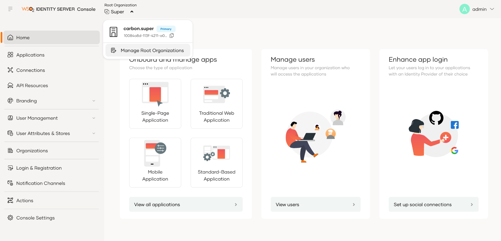](../../../../../assets/img/setup-and-install/is-create-new-org.png)


3. Then click New Root Organization button and fill this form to create new organization

    [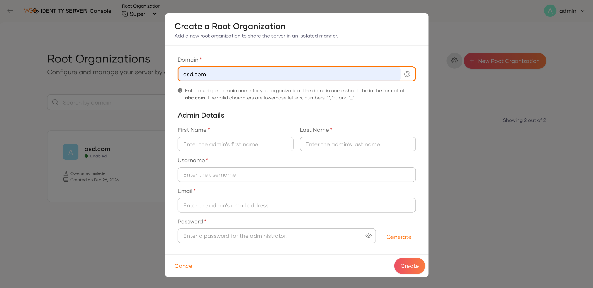](../../../../../assets/img/setup-and-install/is-register-new-org.png)

4. Log into the new organization. (https://localhost:9444/t/TENANT_DOMAIN/console)

    :::note

    In this example, go to `https://localhost:9444/t/asd.com/console`, where `asd.com` is a sample tenant domain name. Replace it with your actual tenant domain.

    :::


### Configure the Service Provider {/* #step-2-configure-the-service-provider */}

1. Create a Service Provider:

    a.  Go to **Applications** → **New Application** and select **Traditional Web Application**.

    b.  In the popup, provide the following details and click **Create**:

    <table>
        <tbody>
            <tr>
                <td>Protocol</td>
                <td>OpenID Connect</td>
            </tr>
            <tr>
                <td>Authorized Redirect URL</td>
                <td>https://localhost:9443/t/asd.com/commonauth</td>
            </tr>
        </tbody>
     </table>

    [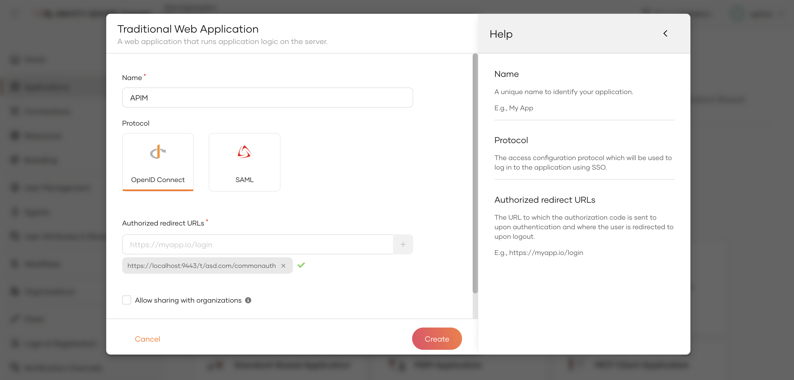](../../../../../assets/img/setup-and-install/create-traditional-web-app-tenant.png)

    c.  In the configuration page, select **User Attributes** and enable the **Groups** attribute.

    [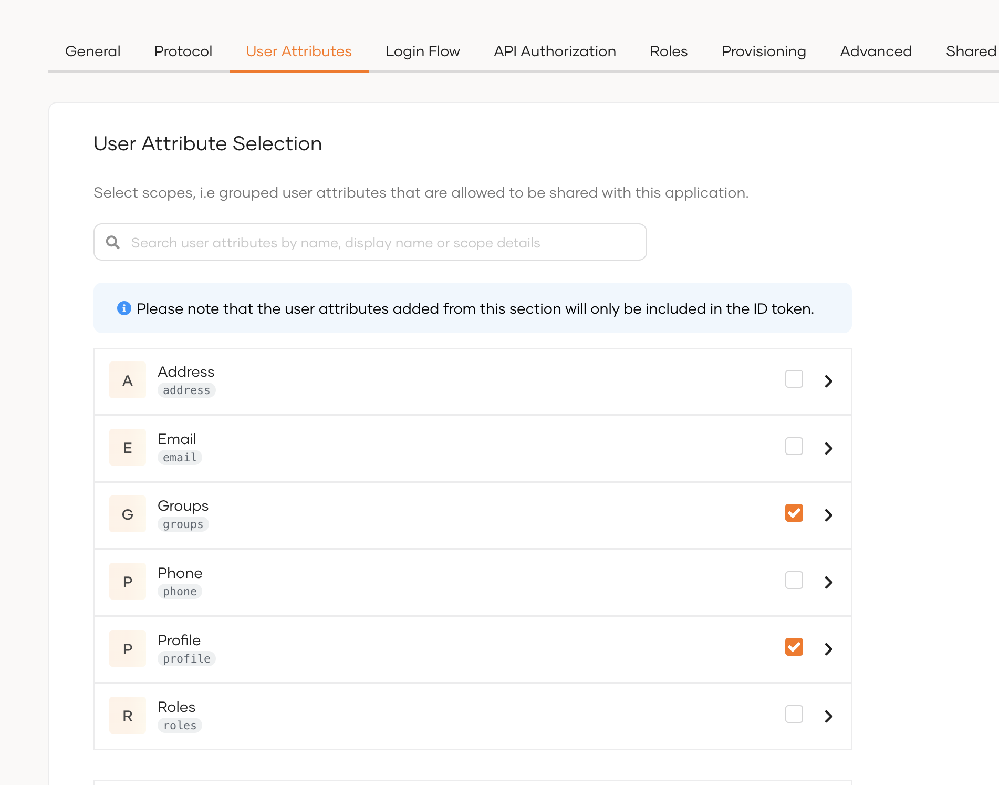](../../../../../assets/img/setup-and-install/select-groups-attribute.png)

    d.  In the same tab, under the **Subject** section, select **Assign alternate subject identifier** and from the dropdown list select **Username**.

    [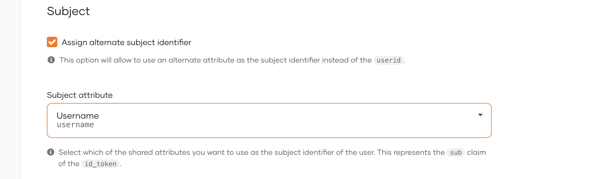](../../../../../assets/img/setup-and-install/assign-alternate-subject-identifier.png)

    e.  Under the **Protocol** tab, copy the **Client ID** and **Client Secret**.

    :::info

    For each tenant, you must create a new application. For the super tenant, the **Authorized Redirect URL** is `https://localhost:9443/commonauth`.

    :::

### Create users and roles {/* #step-3-create-users-and-roles */}

1. Create the required [users](https://is.docs.wso2.com/en/latest/guides/users/onboard-users/) and [groups](https://is.docs.wso2.com/en/latest/guides/users/manage-groups/) in Identity Server. Assume, following users are created in Identity Servers with the given groups.

    <table>
        <thead>
            <tr>
                <th>User</th>
                <th>Groups</th>
            </tr>
        </thead>
        <tbody>
            <tr>
                <td>Sam</td>
                <td>publisher</td>
            </tr>
            <tr>
                <td>Karen</td>
                <td>devportal</td>
            </tr>
        </tbody>
    </table>

</Steps>


## Configure the API Manager

:::note

You need to enable tenant synchronization to create IS tenants on the APIM side. Refer to the linked guide for details on [tenant synchronization setup](../../../administer/multitenancy/tenant-sharing-with-wso2is7.mdx).

:::


<Steps>

### Import the Identity Server Certificate to WSO2 API Manager {/* #step-1-import-the-identity-server-certificate-to-wso2-api-manager */}

Import the Keymanager certificate to the WSO2 API Manager `client-truststore.jks` using the following steps.

1.  Export the WSO2 IS certificate.

    <Tabs>
    <TabItem value="tab-0" label="On Mac/Linux">

    ```bash
    echo -n | openssl s_client -connect localhost:9444 -servername wso2is7 | openssl x509 > is7.cert
    ```

    </TabItem>
    <TabItem value="tab-1" label="On Windows">

    ```bash
    openssl s_client -connect localhost:9444 -servername wso2is7 < NUL | openssl x509 > is7.cert
    ```

    </TabItem>
    </Tabs>

2.  Import this certificate to the `client-truststore.jks` located in `<AM_HOME>/repository/resources/security/`.

    ```bash
    keytool -import -alias wso2is7cert -file is7.cert -keystore client-truststore.jks -storepass wso2carbon
    ```

### Additional `deployment.toml` changes {/* #step-2-additional-deploymenttoml-changes */}

```toml
[tenant_context]
enable_tenant_qualified_urls = true
enable_tenanted_sessions = true
skip_tenant_validation_for_oauth_endpoints = true
session_manager= "org.apache.catalina.session.StandardManager"

[event.default_listener.jit_provisioning_handler]
enable = false

[[event_listener]]
id = "org_jit_provisioning_handler"
type="org.wso2.carbon.identity.core.handler.AbstractIdentityHandler"
name = "org.wso2.carbon.identity.outbound.organization.auth.OrganizationJITProvisioningHandler"
# Same value as "event.default_listener.jit_provisioning_handler.priority": "20",
order = 20
```

```
<table>
    <thead>
        <tr>
            <th>Config</th>
            <th>Description</th>
        </tr>
    </thead>
    <tbody>
        <tr>
            <td>tenant_context.enable_tenant_qualified_urls</td>
            <td>Enable tenant qualified URLs.</td>
        </tr>
        <tr>
            <td>tenant_context.enable_tenanted_sessions</td>
            <td>Enable tenanted sessions</td>
        </tr>
        <tr>
            <td>tenant_context.skip_tenant_validation_for_oauth_endpoints</td>
            <td>Enable this if you are using resident key manager</td>
        </tr>
        <tr>
            <td>tenant_context.session_manager</td>
            <td>You can skip this if you are using external key manager</td>
        </tr>
        <tr>
            <td>event.default_listener.jit_provisioning_handler.enable</td>
            <td>To disable default JIT provisioning handler</td>
        </tr>
        <tr>
            <td>event_listener</td>
            <td>This adds custom JIT provisioning handler</td>
        </tr>
    </tbody>
</table>
```


### Configure Federated Authenticators {/* #step-3-configure-federated-authenticators */}

1. Configure Super Tenant IdP

    -   Purpose: Capture tenant details and proxy tenant-specific users to the appropriate service providers within their respective tenants, while also handling users from the carbon.super tenant.
    -   First log in to the carbon portal (https://\{apim-ip\}:9443/carbon) using the admin account.
    -   Then, from the left navigation menu, go to the Identity Providers section and click the Add button.
    -   Add the following claim mapping under the **Claim Configuration** section.
        <table>
        <thead>
            <tr>
                <th>Identity Provider Claim URI</th>
                <th>Local Claim URI</th>
            </tr>
        </thead>
        <tbody>
            <tr>
                <td>groups</td>
                <td>http://wso2.org/claims/role</td>
            </tr>
        </tbody>
        </table>
    
        Also select **groups** as the **Role Claim URI**.

    [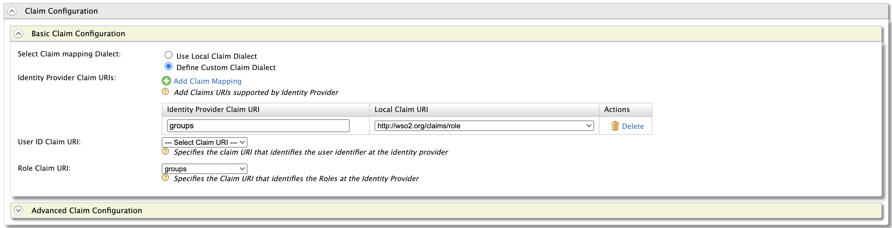](../../../../../assets/_versions/4.6.0/img/setup-and-install/claim-mapping-for-sso.png)


    -   Add the following role mapping under the **Role Configuration** section:
    
        <table>
        <thead>
            <tr>
                <th>Identity Server Roles</th>
                <th>Roles Mapped in API Manager</th>
            </tr>
        </thead>
        <tbody>
            <tr>
                <td>devportal</td>
                <td>Internal/Subscriber</td>
            </tr>
            <tr>
                <td>publisher</td>
                <td>Internal/publisher</td>
            </tr>
        </tbody>
        </table>

        [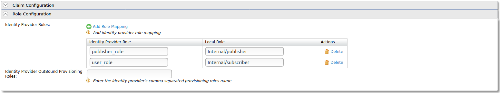](../../../../../assets/_versions/4.6.0/img/setup-and-install/role-mapping-for-sso.png)

        :::tip

        Instead of using the default internal roles, you can also create new roles in API Manager and map it to the provisioned users. 

        :::

    - Select **Multi Tenant Authenticator Configuration** under the **Federated Authenticators** section:

        <table>
        <thead>
            <tr>
                <th>Configuration</th>
                <th>Value</th>
                <th>Description</th>
            </tr>
        </thead>
        <tbody>
            <tr>
                <td>Enable</td>
                <td>true</td>
                <td>Set true to enable the authenticator</td>
            </tr>
            <tr>
                <td>Tenant Selection Page URL</td>
                <td>`https://{apim-ip}:9443/select-tenant/`</td>
                <td>You can customize this page as required, default page will be available on the above location</td>
            </tr>
            <tr>
                <td>Common Service Provider Name</td>
                <td>`commonsp`</td>
                <td>In each tenant (including super tenant), you have to create a service provider from this name</td>
            </tr>
            <tr>
                <td>Scopes</td>
                <td>openid groups</td>
                <td></td>
            </tr>
        </tbody>
        </table>

        Other fields are self explanatory. Refer the image below if you need more clarity.

        [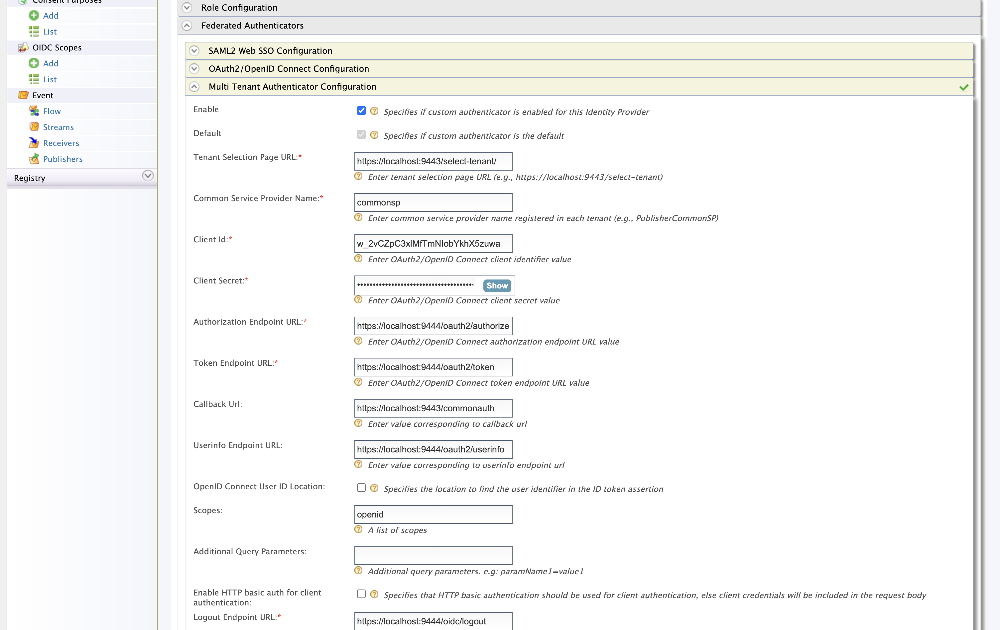](../../../../../assets/img/setup-and-install/multi-tenant-authenticator-configs.png)
    

    -   Enable Just-in-Time Provisioning to provision the users in API Manager:

        [](../../../../../assets/img/setup-and-install/jit-provisioning-for-sso.png)

    - Finally click **Register** to save the changes


### Configure Common Service Provider {/* #step-4-configure-common-service-provider */}

-   From the left navigation menu, go to the Service Providers section and click the Add button.
-   The SP name should match the one you define in the super tenant IdP, under 'Common Service Provider Name'.

    [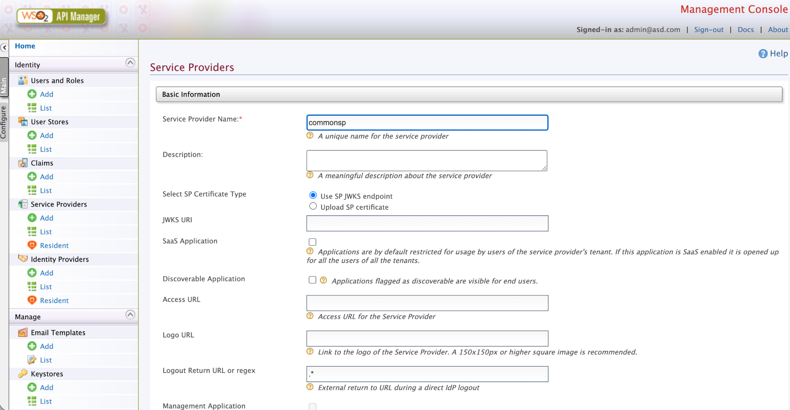](../../../../../assets/img/setup-and-install/multi-tenant-common-sp.png)

-   Next, you need to configure the claim settings to pass user details to the super tenant custom authenticator.
    -   Expand the Claim Configuration and expand the Basic Claim Configuration section.
    -   In the 'Requested Claims' section, click 'Add Claim URI' and add the following claims.
        -   `http://wso2.org/claims/username`
        -   `http://wso2.org/claims/roles`
    -   Then, select `http://wso2.org/claims/username` as the Subject Claim URI.

    [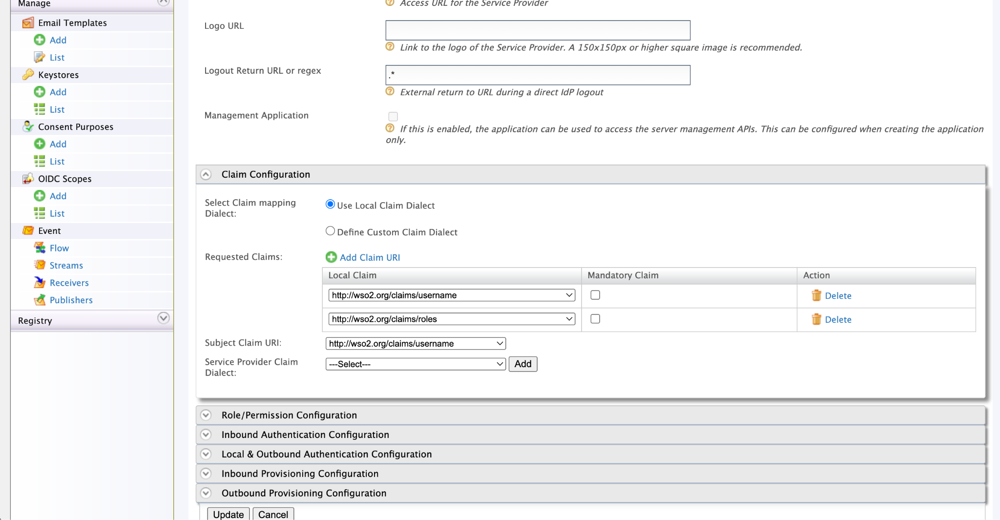](../../../../../assets/img/setup-and-install/multi-tenant-sp-claim-configs.png)


-   Next, expand the Inbound Authentication Configurations, and expand Oauth/OpenID connect configuration and click configure. Then set the Callback Url to `https://localhost:9443/commonauth` and click update.

    [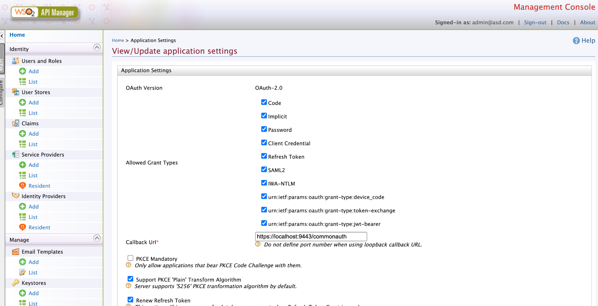](../../../../../assets/img/setup-and-install/multi-tenant-sp-oidc-config.png)

-   Next, expand the Local & Outbound Authentication Configurations, Select the previously created IdP as the Federated Authenticator, and check the following configurations:

    [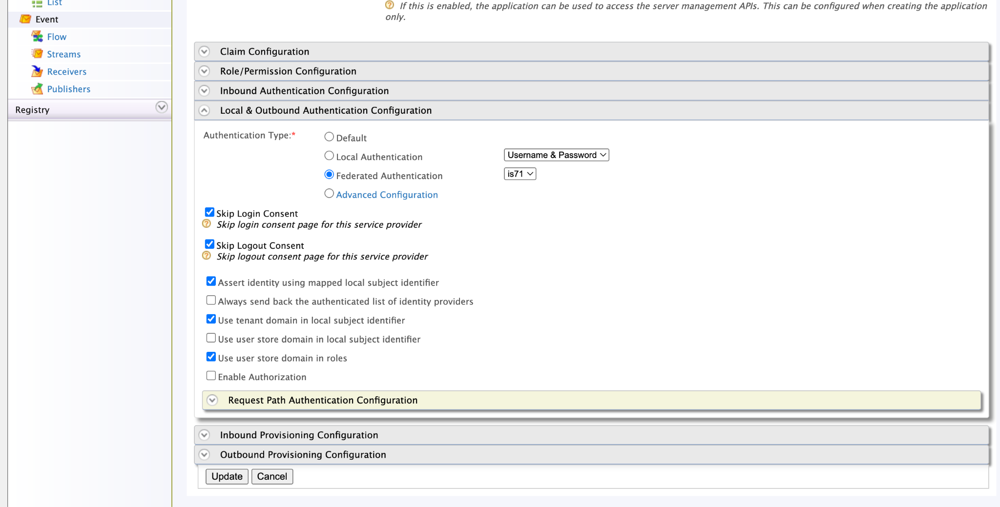](../../../../../assets/img/setup-and-install/multi-tenant-sp-outbound-configs.png)


### Configure Tenanted IdP {/* #step-5-configure-tenanted-idp */}

-   Log into carbon portal as a tenanted admin
-   Follow the same steps in [step - 3](#step-3-configure-federated-authenticators), But this time instead of **Multi Tenant Authenticator Configuration** select **OAuth2/OpenID Connect Configuration**

    :::info

    Here you need to connect to the IS tenanted Application you created in the [first section](#step-2-configure-the-service-provider)

    :::


### Configure Tenanted Common Service Provider {/* #step-6-configure-tenanted-common-service-provider */}

-   Log into carbon portal as a tenanted admin
-   Follow the same steps in [step - 4](#step-4-configure-common-service-provider)


### Configure the IdP for the Portals {/* #step-7-configure-the-idp-for-the-portals */}

-   Now, In carbon portal, again log as super admin.
-   Click on the List under the Service Providers section.
-   We can see the apim_devportal, apim_publisher and apim_admin_portal service providers as below.
-   Click on the Edit button of one of the service providers and then expand the Local & Outbound Authentication Configuration section.
-   Select Federated Authentication option under the Authentication Type section and select the created IdP (WSO2_IS7)
-   Put a tick to Assert identity using mapped local subject identifier option. Please note that this is a mandatory one to perform the role mapping properly.

    [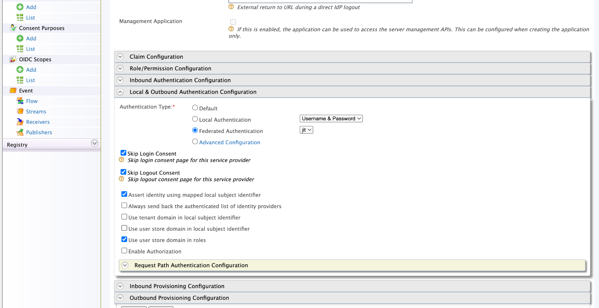](../../../../../assets/img/setup-and-install/multi-tenant-portal-sps.png)

</Steps>


## Verifying

- Now you are good to go, go the publisher portal `https://{apim-ip}:9443/publisher` you will see a tenant selection page

    [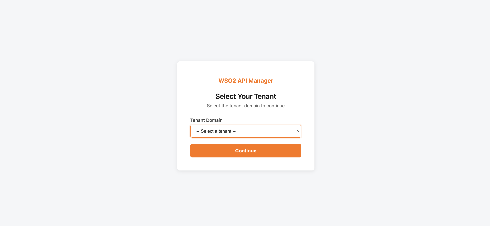](../../../../../assets/img/setup-and-install/tenant-selection-page.png)


!!! Note For secondary user stores
    If your Identity Provider has multiple secondary user stores (such as LDAP) and you want to include the user domain in the subject identifier (`LDAP_DOMAIN/username`), you must also connect the same user stores to the API Manager in read-only mode. This is required when the secondary user stores contain users with the same name and you cannot provision those users to the API Manager primary user store.

:::note

This approach is not limited to WSO2 IS 7.x, you can connect any third party identity provider using this method

:::
